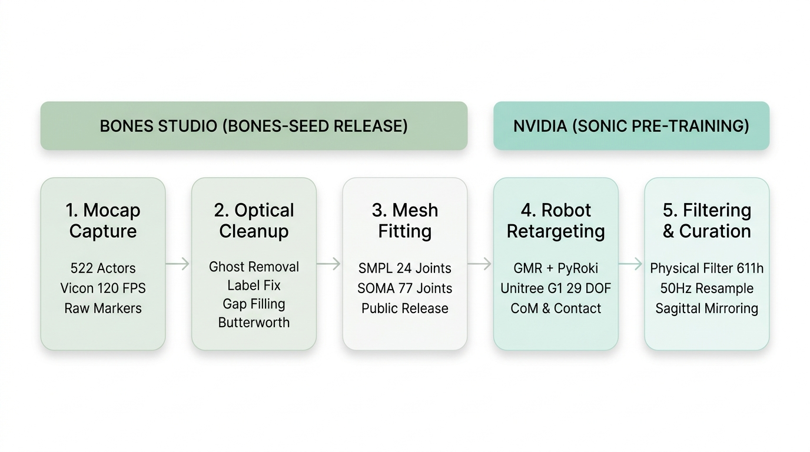

# Báo Cáo Chi Tiết: Quy Trình Thu Thập & Xử Lý Dữ Liệu BONES-SEED

---

## 1. Sơ Đồ Quy Trình Tối Giản (Minimalist Pipeline Flow)



### Chi Tiết Dạng Text:

```text
══════════════════════════════════════════════════════════════════════════════════════════════════════════════
BƯỚC 1: THU THẬP DỮ LIỆU THÔ PHÒNG THU (DATA COLLECTION - BONES STUDIO)
══════════════════════════════════════════════════════════════════════════════════════════════════════════════
  [522 Diễn viên] ──► [Hệ thống Camera Vicon 120 FPS] ──► [Đám mây Marker hồng ngoại thô]
  • 253 Nữ, 269 Nam    • Sub-millimeter precision          • Hơn 700 giờ chuyển động
  • Tuổi: 17 – 71      • Capture volume không góc chết     • Chứa điểm ma, mất dấu, lệch nhãn
                                      │
                                      ▼
══════════════════════════════════════════════════════════════════════════════════════════════════════════════
BƯỚC 2: LÀM SẠCH QUANG HỌC 4 CẤP ĐỘ (OPTICAL CLEANUP - BONES STUDIO)
══════════════════════════════════════════════════════════════════════════════════════════════════════════════
  ┌────────────────────────────────────────────────────────────────────────────────────────────────────────┐
  │ (1) Khử điểm ảo (Ghost Markers): Lọc bỏ tọa độ phản xạ từ sàn và đạo cụ kim loại                       │
  │                                    │                                                                   │
  │ (2) Sửa nhãn chéo (Label Swap): Continuous Tracking + Ràng buộc xương bất biến ||p_i - p_j|| ≈ L_ij    │
  │                                    │                                                                   │
  │ (3) Lấp khuyết (Gap-Filling): Rigid-Body Interpolation + Kinematic Priors khi marker bị che khuất       │
  │                                    │                                                                   │
  │ (4) Lọc làm mượt (Smoothing): Bộ lọc Butterworth bậc 4 không lệch pha (fc = 6-10 Hz) khử jitter       │
  └────────────────────────────────────┬───────────────────────────────────────────────────────────────────┘
                                       │
                                       ▼
══════════════════════════════════════════════════════════════════════════════════════════════════════════════
BƯỚC 3: KHỚP MÔ HÌNH NGƯỜI & ĐÓNG GÓI BẢN PUBLIC (FITTING & RELEASE - BONES STUDIO)
══════════════════════════════════════════════════════════════════════════════════════════════════════════════
  ┌────────────────────────────────────────────────────────────────────────────────────────────────────────┐
  │ • Khớp toàn thân chuẩn SMPL (24 khớp) cho chuyển động tổng quát                                        │
  │ • Khớp chi tiết toàn diện SOMA (77 khớp) biểu diễn 10 ngón tay độc lập (30 DOF)                       │
  │ • Gán nhãn ngữ nghĩa: Gán 6 câu văn tự nhiên mô tả & Timestamp phân đoạn hành động                     │
  └────────────────────────────────────┬───────────────────────────────────────────────────────────────────┘
                                       │
                                       ▼
              [PHÁT HÀNH CÔNG KHAI BONES-SEED TRÊN HUGGING FACE]
              • 142,220 sequences (~288 giờ chuyển động sạch)
              • Đầy đủ định dạng: Marker 3D, SMPL (24D), SOMA (77D)
                                       │
═══════════════════════════════════════╪══════════════════════════════════════════════════════════════════════
BƯỚC 4: GENERAL MOTION RETARGETING SANG ROBOT G1 (RETARGETING - NVIDIA SONIC)
══════════════════════════════════════════════════════════════════════════════════════════════════════════════
                                       │
                                       ▼
  ┌────────────────────────────────────────────────────────────────────────────────────────────────────────┐
  │ Thuật toán GMR kết hợp thư viện tối ưu hóa PyRoki giải Động học nghịch (IK Optimization):              │
  │                                                                                                        │
  │  • Khớp vị trí & hướng: Tránh co kéo sai lệch tỉ lệ cơ thể người / robot (H_robot = 1.30m)            │
  │  • Bảo toàn khối tâm (CoM): Giữ cân bằng động tự nhiên c(q) ≈ s * c_human, chống đổ ngã                │
  │  • Khóa tiếp xúc sàn (Foot Contact): Khóa vận tốc bàn chân khi chạm đất, triệt tiêu trượt chân giả tạo │
  │  • Giới hạn cơ khí: Ép góc quay và vận tốc góc trong ngưỡng an toàn 29 mô-tơ G1: q_min ≤ q ≤ q_max     │
  │  • Chống tự va chạm (Self-Collision Avoidance): Kiểm tra lưới va chạm Collision Meshes trong MuJoCo    │
  └────────────────────────────────────┬───────────────────────────────────────────────────────────────────┘
                                       │
                                       ▼
══════════════════════════════════════════════════════════════════════════════════════════════════════════════
BƯỚC 5: LỌC PHI VẬT LÝ, TĂNG CƯỜNG & CHUẨN HÓA HUẤN LUYỆN (CURATION - NVIDIA SONIC)
══════════════════════════════════════════════════════════════════════════════════════════════════════════════
  ┌────────────────────────────────────────────────────────────────────────────────────────────────────────┐
  │ (1) Lọc phi vật lý: Loại bỏ các tư thế dựa ngoại vật (leo thang, ngồi tựa ghế) ──► 700h còn 611h       │
  │                                    │                                                                   │
  │ (2) Tái lấy mẫu tần số: Downsample 120 FPS ──► 50 Hz (Δt = 0.02 s) đồng bộ chu kỳ điều khiển Policy   │
  │                                    │                                                                   │
  │ (3) Lật gương đối xứng (Sagittal Mirroring): Nhân đôi dữ liệu, khử triệt để định kiến thuận chi        │
  │                                    │                                                                   │
  │ (4) Phân tầng Taxonomy (33 nhóm chính, 8,447 danh mục con) & Phân chia tập Train / Unseen Test         │
  └────────────────────────────────────┬───────────────────────────────────────────────────────────────────┘
                                       │
                                       ▼
        [KHO DỮ LIỆU ĐỒ SỘ HƠN 100 TRIỆU KHUNG HÌNH @ 50 Hz CHO POLICY SONIC]
```

---

## 2. Giải Thích Chi Tiết Từng Giai Đoạn Quy Trình

### Giai Đoạn 1: Thu thập dữ liệu thô tại phòng thu (Bones Studio)
* **Quy mô**: $522$ diễn viên chuyên nghiệp ($253$ nữ, $269$ nam; độ tuổi $17 \div 71$; chiều cao $145 \div 199\text{ cm}$; cân nặng $38 \div 145\text{ kg}$).
* **Trang thiết bị**: Hệ thống camera quang học hồng ngoại Vicon ghi nhận tọa độ $3\text{D}$ phản quang của các marker gắn tại các mốc giải phẫu và từng khớp ngón tay ở tần số $120\text{ FPS}$.
* **Dữ liệu thô**: Hơn $700$ giờ chuyển động, mang sai số đo lường quang học thực tế (điểm ma, mất dấu do che khuất, nhầm lẫn danh tính marker).

### Giai Đoạn 2: Làm sạch quang học 4 cấp độ (Bones Studio)
1. **Khử điểm ảo**: Loại bỏ các hạt marker ảo do phản xạ sàn nhà hoặc đạo cụ.
2. **Sửa lỗi hoán đổi nhãn**: Thuật toán bám quỹ đạo liên tục kết hợp ràng buộc độ dài đoạn xương $\|p_i(t) - p_j(t)\| \approx L_{ij}$ để tự động sửa các lỗi nhầm lẫn giữa tay trái và tay phải khi va chạm gần.
3. **Lấp khuyết điểm**: Khôi phục các khung hình marker bị che khuất ($5 \div 30\text{ frames}$) bằng mô hình nội suy vật thể cứng (Rigid-body) từ cụm marker lân cận cùng đoạn xương và tiên nghiệm động học.
4. **Lọc mượt Butterworth**: Bộ lọc số bậc 4 không lệch pha với tần số cắt $f_c \approx 6 \div 10\text{ Hz}$ loại bỏ rung giật tần số cao cấp độ dưới milimét.

### Giai Đoạn 3: Khớp mô hình nhân trắc học & Release BONES-SEED (Bones Studio)
* Dữ liệu marker sạch được khớp vào mô hình **SMPL ($24$ khớp)** và mô hình chi tiết bàn tay **SOMA ($77$ khớp)**.
* Gán $6$ câu mô tả ngôn ngữ tự nhiên đa dạng cho mỗi clip cùng mốc thời gian (*timestamp*).
* Đóng gói và phát hành công khai bộ dữ liệu **BONES-SEED** ($142{,}220$ chuỗi, $\sim 288$ giờ) trên Hugging Face.

### Giai Đoạn 4: Motion Retargeting sang Robot Unitree G1 (NVIDIA SONIC)
* Chuyển đổi chuyển động người sang $29$ bậc tự do cơ khí của robot G1 thông qua **GMR (General Motion Retargeting)** và **PyRoki**:
  * **Tối ưu hóa IK**: Điều chỉnh khớp vừa vặn với chiều cao $1.30\text{ m}$ của G1.
  * **Bảo toàn khối tâm (CoM)**: Giữ $\mathbf{c}(q) \approx s \cdot \mathbf{c}_{\text{human}}$ để robot duy trì thăng bằng động.
  * **Bảo toàn tiếp xúc chân**: Khóa vận tốc tiếp tuyến bàn chân khi tiếp đất để triệt tiêu trượt chân giả tạo (*foot sliding*).
  * **Ràng buộc an toàn cơ khí**: Giới hạn góc và vận tốc mô-tơ ($q_{\min} \le q \le q_{\max}$), kiểm tra chống tự va chạm mắt xích cơ khí trong mô phỏng MuJoCo.

### Giai Đoạn 5: Lọc phi vật lý, tăng cường & chuẩn hóa huấn luyện (NVIDIA SONIC)
1. **Lọc phi vật lý**: Loại bỏ các động tác dựa dẫm điểm tì ngoại cảnh (leo thang, ngồi dựa ghế, đu xà) để rút từ $700$ giờ thô xuống còn **$611$ giờ chuyển động khả thi trên sàn phẳng**.
2. **Tái lấy mẫu thời gian**: Hạ từ $120\text{ FPS}$ xuống **$50\text{ Hz}$** ($\Delta t = 0.02\text{ s}$) khớp chính xác với chu kỳ điều khiển Policy.
3. **Lật đối xứng gương**: Tạo bản sao đối xứng dọc giữa (Sagittal Mirroring) nhân đôi dữ liệu và cân bằng chuyển động trái/phải.
4. **Phân loại Taxonomy**: Cấu trúc thành $33$ nhóm chính, $8{,}447$ nhãn con; phân bổ tập Train ($317{,}189$ clips, $611$ giờ) và tập Unseen Test ($15$ giờ kiểm thử zero-shot).
* **Kết quả**: Tạo ra kho dữ liệu hơn **$100$ triệu khung hình** cho mạng học tăng cường SONIC.
