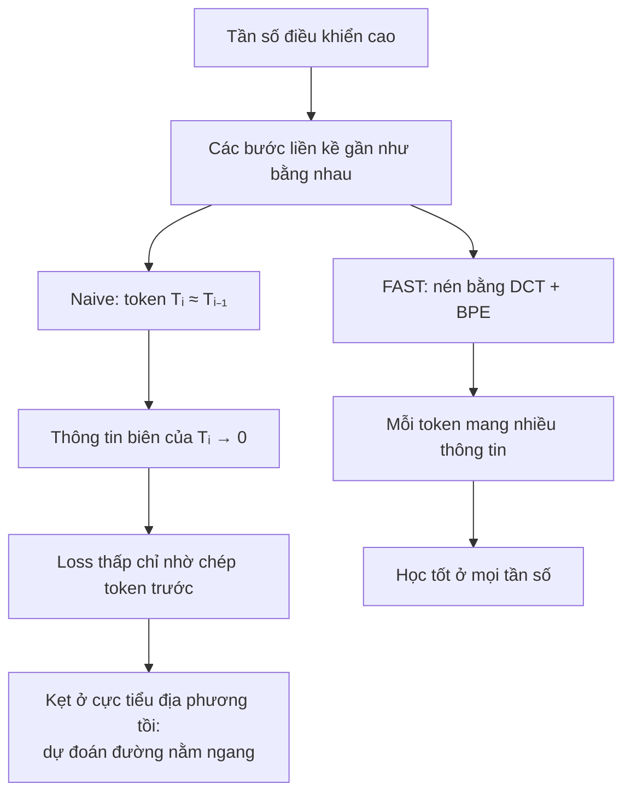
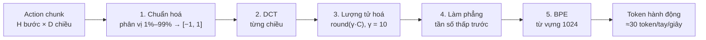
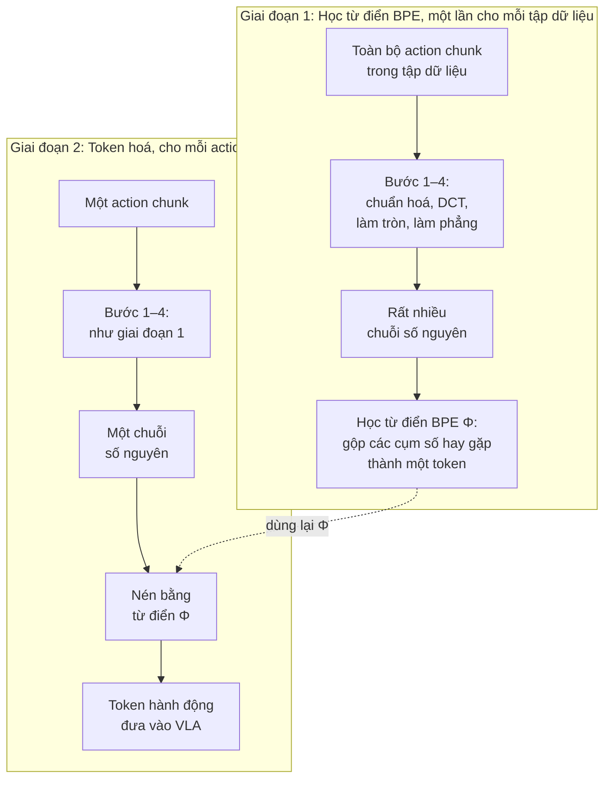
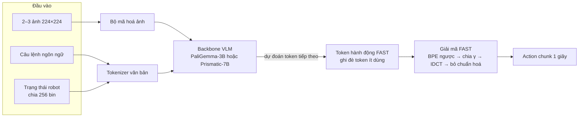
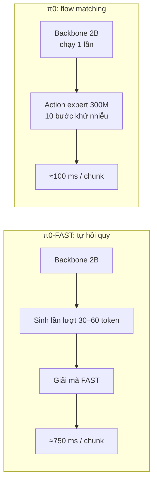
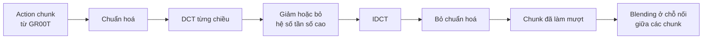

# FAST: Mã hoá hành động hiệu quả cho mô hình Vision-Language-Action

> **Bài gốc:** *FAST: Efficient Action Tokenization for Vision-Language-Action Models*
> Karl Pertsch\*, Kyle Stachowicz\*, Brian Ichter, Danny Driess, Suraj Nair, Quan Vuong, Oier Mees, Chelsea Finn, Sergey Levine
> Physical Intelligence, UC Berkeley, Stanford. arXiv:2501.09747v1, ngày 16/01/2025. Trang dự án: https://pi.website/research/fast
>
> Tài liệu này tóm tắt và viết lại nội dung bài báo bằng tiếng Việt. Các con số có ghi "≈" là giá trị đọc từ biểu đồ, không phải số liệu bảng gốc.

---

## 1. Tóm tắt

Các VLA tự hồi quy (autoregressive), tức Transformer dự đoán token tiếp theo, rất mạnh trong việc học hành vi robot phức tạp và tổng quát. Tuy nhiên, chúng cần một cách **token hoá** (tokenization) tín hiệu hành động liên tục thành các ký hiệu rời rạc. Cách phổ biến hiện nay là **chia bin độc lập theo từng chiều, tại từng bước thời gian** (dùng trong RT-2, OpenVLA). Cách này hoạt động rất kém với các kỹ năng khéo léo (dexterous) và dữ liệu có tần số điều khiển cao.

Bài báo đề xuất **FAST** (*Frequency-space Action Sequence Tokenization*), một cách token hoá dựa trên **nén tín hiệu** bằng **biến đổi cosin rời rạc (DCT)** rồi **mã hoá cặp byte (BPE)**. Kết quả chính:

- FAST cho phép huấn luyện VLA tự hồi quy trên các tác vụ khéo léo, tần số cao (tới 50 Hz) mà cách chia bin cũ thất bại hoàn toàn.
- **FAST+** là bộ token hoá **phổ quát** (universal), huấn luyện trên khoảng 1 triệu chuỗi hành động thật. Nó dùng được ngay như một hộp đen cho nhiều loại robot, không gian hành động và tần số khác nhau.
- Kết hợp với VLA π0, mô hình **π0-FAST** mở rộng được tới 10 nghìn giờ dữ liệu robot và đạt hiệu năng tương đương π0 bản diffusion. Thời gian huấn luyện giảm tới **5 lần**.

---

## 2. Động cơ: vì sao cách token hoá cũ thất bại?

### 2.1. Bài toán

Mục tiêu là học chính sách π(a₁:H | o): từ quan sát `o` (ảnh và câu lệnh ngôn ngữ), dự đoán một **action chunk**, tức chuỗi H hành động tương lai. Việc dự đoán cả chunk giúp hành động nhất quán theo thời gian và giảm sai số tích luỹ.

Token hoá hành động là ánh xạ 𝒯ₐ : a₁:H → [T₁, …, Tₙ], biến chuỗi hành động liên tục (số chiều |𝒜|) thành n token rời rạc trong một bộ từ vựng 𝒱. Giống câu văn, số token n **có thể thay đổi** giữa các chuỗi.

### 2.2. Cách cũ: chia bin theo từng bước thời gian ("naive")

Với mỗi chiều hành động, khoảng giá trị trong tập huấn luyện được chia đều thành N bin (thường N = 256). Việc này áp dụng cho **mọi bước thời gian và mọi chiều**, nên một chunk D chiều, H bước sinh ra H × D token.

Với dữ liệu tần số cao, số token trên mỗi chunk lên tới hàng trăm. Huấn luyện khó hơn và suy luận chậm hơn.

### 2.3. Thí nghiệm minh hoạ (toy example)

Tác giả tạo một tập dữ liệu tổng hợp: cho 4 điểm ngẫu nhiên, mô hình phải dự đoán đường **spline bậc ba** nội suy qua 4 điểm đó. Họ lấy mẫu đường cong với tần số từ 25 đến 800 bước mỗi chuỗi, trong khi **độ phức tạp thực của dữ liệu không đổi**. Cách làm này mô phỏng việc huấn luyện trên dữ liệu robot ở các tần số điều khiển khác nhau.

Kết quả (Hình 3 trong bài):

- Với cách chia bin naive, sai số MSE thấp khi tần số thấp. Tần số càng cao thì sai số tăng vọt, và cuối cùng mô hình **chỉ sao chép token đầu tiên**, cho ra một đường thẳng nằm ngang.
- Với cách token hoá DCT, sai số luôn thấp (khoảng 10⁻³) ở mọi tần số.

### 2.4. Giải thích

Mô hình tự hồi quy học bằng cách dự đoán token Tᵢ khi đã biết T₁:ᵢ₋₁. Tín hiệu học tỉ lệ với **lượng thông tin biên** (marginal information) của Tᵢ so với các token trước đó.

Khi tín hiệu mượt và tần số cao, hai bước liền kề gần như giống nhau, nên lượng thông tin biên **tiến về 0**. Chỉ cần "lặp lại token trước" là loss đã rất thấp, và mô hình mắc kẹt ở cực tiểu địa phương tồi. Đây cũng là lý do OpenVLA làm tốt trên BridgeV2 và RT-1 (tần số thấp) nhưng gặp khó với DROID (tần số cao hơn).



**Ý tưởng cốt lõi:** tín hiệu hành động cần được **nén** trước khi huấn luyện, để giảm tương quan giữa các token liên tiếp.

---

## 3. Phương pháp FAST

### 3.1. Nén chuỗi thời gian bằng DCT

DCT biểu diễn một tín hiệu liên tục thành tổng các thành phần cosin ở nhiều tần số:

- **Tần số thấp** mô tả hình dạng tổng thể của tín hiệu.
- **Tần số cao** mô tả các bước nhảy đột ngột.

DCT là nền tảng của nén ảnh JPEG. Tín hiệu mượt (như điểm ảnh hay quỹ đạo robot) có thể được biểu diễn bằng rất ít hệ số, nên ta có thể bỏ các hệ số có trọng số nhỏ.

So với các phương pháp nén **học được** (như vector quantization), DCT là phép biến đổi **giải tích**: đơn giản, nhanh và không cần huấn luyện mạng.

Tác giả nhấn mạnh: **bất kỳ** phương pháp nén đủ tốt nào áp lên nhãn hành động cũng giúp huấn luyện VLA hiệu quả hơn. DCT chỉ là một lựa chọn thực dụng.

### 3.2. Pipeline token hoá FAST

Pipeline gồm 5 bước (xem Hình 4 trong bài):



1. **Chuẩn hoá:** ánh xạ phân vị 1% và 99% của mỗi chiều hành động về khoảng [−1, 1]. Dùng phân vị thay cho min/max để bền với các giá trị ngoại lai trong tập dữ liệu lớn, đồng thời giúp dữ liệu đa robot (cross-embodiment) có thang đo tương đồng.
2. **DCT:** áp dụng DCT **riêng cho từng chiều** hành động trên cả chunk.
3. **Lượng tử hoá:** nhân hệ số với thang γ rồi làm tròn: C̄ = round(γ · C). Nhiều hệ số nhỏ trở thành 0, và ma trận hệ số trở nên **thưa**. γ điều khiển sự đánh đổi giữa mức nén và độ mất mát.
4. **Làm phẳng:** biến ma trận |𝒜| × H thành vector 1 chiều, **xếp xen kẽ các chiều hành động, tần số thấp đứng trước**: [C̄¹₁, C̄²₁, …, C̄ⁿ₁, C̄¹₂, …].
5. **BPE:** huấn luyện bộ mã hoá cặp byte để nén không mất mát chuỗi số nguyên thành các token dày đặc. BPE "ép" các chuỗi số 0 và gộp các tổ hợp hệ số hay xuất hiện giữa các chiều. Ngoài ra, BPE cho ra bộ từ vựng kích thước cố định, dễ ghép vào từ vựng của VLM.

**Thuật toán 1 (FAST Tokenizer)** chạy qua hai giai đoạn:

- **Giai đoạn 1** chỉ chạy **một lần** cho mỗi tập dữ liệu, để học từ điển BPE Φ.
- **Giai đoạn 2** chạy cho **mỗi action chunk** khi huấn luyện VLA và khi suy luận, dùng lại Φ đã học.



**Ví dụ minh hoạ** (số do mình tự tính, không lấy từ bài báo): một chunk có 2 chiều hành động, 4 bước thời gian, γ = 10.

| Bước | Làm gì | Chiều 1 (tay đang di chuyển) | Chiều 2 (tay đứng yên) |
|---|---|---|---|
| 1. Chuẩn hoá | Đưa giá trị về khoảng [−1, 1] | 0.10, 0.20, 0.30, 0.40 | 0.50, 0.50, 0.50, 0.50 |
| 2. DCT | Đổi 4 giá trị theo thời gian thành 4 hệ số tần số, từ thấp đến cao | 0.50, −0.22, 0.00, −0.02 | 1.00, 0.00, 0.00, 0.00 |
| 3. Làm tròn | Nhân với γ = 10 rồi làm tròn; hệ số nhỏ biến thành 0 | 5, −2, 0, 0 | 10, 0, 0, 0 |

**Bước 4, làm phẳng:** lấy lần lượt hệ số tần số thấp nhất của mọi chiều, rồi tới tần số tiếp theo, và cứ thế. Kết quả là chuỗi 8 số:

> 5, 10, −2, 0, 0, 0, 0, 0

**Bước 5, BPE:** giả sử từ điển Φ đã học được rằng cụm "0, 0, 0, 0, 0" rất hay xuất hiện và gộp nó thành một token. Khi đó chuỗi trên chỉ còn **4 token**:

> 5 | 10 | −2 | (0, 0, 0, 0, 0)

**Giải mã** chạy ngược lại: tách token BPE, xếp lại thành ma trận, chia cho γ, chạy DCT ngược, rồi bỏ chuẩn hoá. Với ví dụ trên, chiều 1 khôi phục thành 0.12, 0.20, 0.30, 0.38, gần với giá trị gốc. Sai lệch nhỏ này đến từ bước làm tròn, và γ càng lớn thì sai lệch càng nhỏ, đổi lại nhiều token hơn.

**Về thứ tự làm phẳng:** có hai lựa chọn.

- Column-first: nối các thành phần tần số thấp nhất của mọi chiều trước.
- Row-first: nối tất cả tần số của một chiều rồi mới sang chiều khác.

Tác giả chọn **column-first**, vì dự đoán các thành phần tần số thấp (hình dạng tổng thể) trước giúp rollout ổn định hơn.

**Tính khả nghịch:** mọi bước đều đảo ngược được, nên giải mã hành động nhanh.

**Siêu tham số:** chỉ có hai siêu tham số, là thang làm tròn γ và kích thước từ vựng BPE. Cả hai **không nhạy**; mọi thí nghiệm dùng chung **γ = 10, từ vựng BPE = 1024**. Ngược lại, các phương pháp VQ học đầu-cuối thường khó huấn luyện và cần tinh chỉnh siêu tham số theo từng tập dữ liệu.

Có thể thay BPE bằng thuật toán nén không mất mát khác (Huffman, Lempel-Ziv, tức thuật toán của gzip). Tác giả để dành hướng này cho các nghiên cứu sau.

### 3.3. FAST+: bộ token hoá hành động phổ quát

Thành phần **duy nhất cần học** là từ vựng BPE, vốn phải huấn luyện lại cho mỗi tập dữ liệu. Việc này chỉ mất vài phút nhưng vẫn gây phiền.

Để bỏ bước này, tác giả huấn luyện **FAST+** trên một tập đa robot lớn:

- Khoảng **1 triệu action chunk dài 1 giây**.
- Nhiều loại robot: một tay, hai tay, robot di động.
- Nhiều không gian hành động: joint space, end-effector trong hệ toạ độ thế giới, end-effector trong hệ toạ độ camera.
- Nhiều tần số: 5 đến 50 Hz.
- Mọi hành động được pad lên **32 chiều**.
- Hỗn hợp dữ liệu chủ yếu là các tập của π0 (ARX, AgileX, Fibocom, Franka FR3, Trossen, UR5…), cộng thêm ALOHA, DROID, BridgeV2 và OpenX (chi tiết ở Phụ lục A).

FAST+ được phát hành dưới dạng `AutoProcessor` của HuggingFace:

```python
from transformers import AutoProcessor

tokenizer = AutoProcessor.from_pretrained(
    "physical-intelligence/fast", trust_remote_code=True
)
tokens = tokenizer(action_chunk)

# Huấn luyện một FAST tokenizer mới trên dữ liệu riêng
new_tokenizer = tokenizer.fit(action_dataset)
```

Khuyến nghị: chuẩn hoá hành động về [−1, 1] theo phân vị như trên, và token hoá từng chunk dài 1 giây.

---

## 4. Thí nghiệm

### 4.1. Thiết lập

**Backbone:**

- **π0**: VLA dựa trên PaliGemma-3B. Đây là backbone chính.
- **OpenVLA**: dựa trên Prismatic 7B.

Khi huấn luyện, mỗi chunk 1 giây được token hoá, và các token hành động **ghi đè lên những token ít dùng nhất** trong từ vựng của VLM, giống RT-2 và OpenVLA. Mô hình được fine-tune toàn bộ, không đóng băng trọng số.



**Chi tiết huấn luyện (Phụ lục C):**

- 2 đến 3 ảnh đầu vào (một camera góc thứ ba, một camera cổ tay cho mỗi tay), độ phân giải 224×224. Mỗi ảnh đi qua bộ mã hoá ảnh pretrained rồi nối token lại.
- Câu lệnh ngôn ngữ và **trạng thái proprioceptive** được token hoá như văn bản. Trạng thái dùng cách chia 256 bin đơn giản; như vậy là đủ vì trạng thái là *đầu vào*, còn đầu ra mới cần token hoá tốt.
- Warmup tuyến tính 1k bước, sau đó learning rate hằng số **5e-5**. Dùng AdamW (β₁ = 0.9, β₂ = 0.95), không weight decay, clip gradient ở 1, EMA trọng số 0.999.
- Suy luận: giải mã tự hồi quy greedy. Riêng các tác vụ hai tay (gấp áo, lấy bánh mì, gấp đồ giặt) dùng nhiệt độ β = 0.7, để robot chịu rời vị trí ban đầu (dữ liệu có nhiều chunk đứng yên ở đầu episode).

**Phương pháp so sánh:**

- **Naive**: chia bin theo từng bước thời gian (RT-2, RT-2-X, OpenVLA).
- **FSQ**: học một mạng lượng tử hoá (Finite Scalar Quantization, một biến thể đơn giản hơn VQ-VAE) để nén chunk hành động. Đây là phương án nén **học được**, phức tạp hơn DCT.
- **FAST**: huấn luyện BPE riêng cho từng tập dữ liệu.
- **FAST+**: bộ token hoá phổ quát.

**Bảy môi trường đánh giá (6 robot thật, 1 mô phỏng):**

| Tác vụ | Robot | Tần số | Mô tả |
|---|---|---|---|
| **Libero** | Mô phỏng | – | Trung bình trên Libero-Spatial, Object, Goal và Libero-10 |
| **Table Bussing** | UR5 một tay | 20 Hz | Dọn 12 đồ vật trên bàn vào thùng rác hoặc hộp nhựa |
| **T-Shirt Folding** | ARX hai tay | 50 Hz | Gấp nhiều loại áo trải phẳng trên bàn |
| **Grocery Bagging** | UR5 một tay | 20 Hz | Cho 7 món đồ vào túi giấy, không làm đổ hay rách túi |
| **Toast out of Toaster** | Trossen ViperX hai tay | 50 Hz | Lấy 2 lát bánh mì khỏi máy nướng, đặt lên đĩa |
| **Laundry Folding** | ARX hai tay | 50 Hz | Lấy quần áo từ giỏ, trải phẳng, gấp và xếp chồng. Đây là tác vụ khéo léo nhất |
| **DROID zero-shot** | Franka | 15 Hz | Thao tác trên bàn trong môi trường **hoàn toàn chưa thấy** (bàn, nền, vật, góc camera, chiều cao bàn mới) |

Grocery Bagging, Toaster và Laundry Folding chỉ dùng để đánh giá mô hình generalist mạnh nhất (mục 4.6).

### 4.2. So sánh các bộ token hoá

**Bảng I: số token trung bình trên mỗi chunk 1 giây**

| Tập dữ liệu | Số chiều hành động | Tần số | Token (naive) | Token (FAST) | Tỉ lệ nén |
|---|---|---|---|---|---|
| BridgeV2 | 7 | 5 Hz | 35 | 20 | 1.75× |
| DROID | 7 | 15 Hz | 105 | 29 | 3.6× |
| Bussing | 7 | 20 Hz | 140 | 28 | 5.0× |
| Shirt Fold | 14 | 50 Hz | 700 | 53 | **13.2×** |

Nhận xét:

- FAST nén mạnh trên mọi tập, và nén càng nhiều khi tần số càng cao.
- FAST luôn cho khoảng **30 token/chunk cho mỗi cánh tay** (khoảng 60 cho robot hai tay), **gần như không phụ thuộc tần số**. Điều này cho thấy FAST bám theo *độ phức tạp thực* của tín hiệu, chứ không theo số mẫu.
- Phép nén không hoàn toàn không mất mát; γ điều khiển sự đánh đổi. Các số trong Bảng I được so ở cùng mức sai số tái tạo (xem Phụ lục B / Hình 12).

**Hiệu năng chính sách (Hình 6, trung bình và khoảng tin cậy 95%, số đọc từ biểu đồ):**

| Tác vụ | Naive | FSQ | FAST | FAST+ |
|---|---|---|---|---|
| Libero (% thành công) | ≈55 | ≈78 | ≈83 | ≈82 |
| DROID 15 Hz (% tiến độ) | ≈20 | ≈55 | ≈57 | ≈50 |
| Table Bussing 20 Hz (% tiến độ) | ≈0 | ≈26 | ≈85 | ≈81 |
| T-Shirt Folding 50 Hz (% thành công) | ≈0 | ≈26 | ≈67 | ≈71 |
| **Trung bình** | ≈19 | ≈46 | **≈71** | **≈69** |

- **Naive** hoàn toàn không học được ở hai tác vụ tần số cao nhất (Bussing 20 Hz, T-Shirt 50 Hz).
- Các phương pháp **có nén** (FSQ, FAST) huấn luyện hiệu quả hơn hẳn.
- **FAST ngang hoặc tốt hơn FSQ**, đặc biệt ở tác vụ khéo léo tần số cao, dù đơn giản hơn nhiều và không cần huấn luyện mạng riêng.

**DROID zero-shot:** FAST lần đầu tiên cho phép huấn luyện thành công một chính sách generalist mạnh trên DROID mà **đánh giá được zero-shot** trong môi trường mới, chỉ bằng câu lệnh ngôn ngữ, không co-training hay fine-tune. Bài báo DROID gốc và OpenVLA đều không có kết quả zero-shot. Tác giả thử cùng một checkpoint ở **3 trường đại học** (Berkeley, Stanford, U. Washington). Robot làm tốt các tác vụ đơn giản như gắp đặt, mở/đóng tủ, bật vòi nước. Ngay cả khi thất bại, hành vi vẫn hợp lý, ví dụ tiến tới tay nắm cửa lò vi sóng.

### 4.3. Bộ token hoá phổ quát FAST+

Tác giả thử FAST+ trên 13 tập dữ liệu **không có** trong tập huấn luyện tokenizer (Bảng III). Tỉ lệ nén naive/FAST (Hình 8, đọc từ biểu đồ):

| Nhóm | Tập dữ liệu (nền tảng, số chiều, tần số) | Tỉ lệ nén ≈ |
|---|---|---|
| Một tay | SERL (Franka, 7D, 10 Hz), SOAR (WidowX, 7D, 5 Hz) | ≈2.5× |
| | DROID-Eval EEF / Joint (Franka, 7–8D, 15 Hz) | ≈3.3× / ≈4.5× |
| | π Table Bussing (UR5, 8D, 20 Hz) | ≈8.5× |
| Tay khéo | Berkeley DexHand (Allegro, 16D, 20 Hz) | ≈2.5× |
| | HATO (UR5 + Psyonic, 24D, 10 Hz) | ≈3.5× |
| | Berkeley DexArm (xArm + Allegro, 23D, 20 Hz) | ≈4.5× |
| | NYU DexHand (Allegro, 30D, 16 Hz) | ≈11× |
| UMI | UMI on Legs, UMI (7D, 20 Hz) | ≈7× / ≈9× |
| Humanoid | HumanPlus (Unitree H1, 40D, 50 Hz) | ≈3.5× |
| | UCSD Open-TeleVision (Unitree H1 + cổ, 28D, 60 Hz) | ≈14× |
| Điều hướng | Waymo (xe tự lái, 2D delta, 10 Hz) | ≈2.5× |

- FAST+ giảm số token **ít nhất 2 lần trên mọi tập**, và nhiều hơn đáng kể trên một số tập.
- Khi huấn luyện chính sách (Hình 6), FAST+ **ngang với tokenizer riêng từng tập**, nên có thể dùng làm lựa chọn mặc định.

### 4.4. Nghiên cứu cắt bỏ (ablation)

**(1) FAST có độc lập với backbone không?** Tác giả huấn luyện OpenVLA trên T-Shirt Folding (50 Hz), sửa code để nhận nhiều ảnh và dự đoán chunk 1 giây:

- OpenVLA gốc (naive): ≈2% thành công.
- OpenVLA + FAST+: ≈56% thành công.

Kết luận: FAST **độc lập với backbone** và áp dụng được cho nhiều Transformer tự hồi quy pretrained khác.

**(2) BPE quan trọng thế nào?**

| Tác vụ | FAST | FAST không BPE |
|---|---|---|
| Table Bussing (% tiến độ) | ≈88 | ≈57 |
| T-Shirt Fold (% thành công) | ≈67 | ≈20 |

Không có BPE thì kết quả kém hơn, nhưng vẫn hơn naive. DCT tự nó đã dồn thông tin vào ít hệ số. Tuy vậy, thiếu BPE sẽ có rất nhiều token 0 lặp lại. Chúng làm loãng tín hiệu học và làm suy luận chậm hẳn, vì mô hình phải sinh tự hồi quy hàng trăm token.

### 4.5. So sánh FAST với diffusion

So sánh π0 bản diffusion (flow matching) với **π0-FAST** (π0 + FAST, giải mã tự hồi quy), huấn luyện đơn tác vụ (Hình 9, đọc từ biểu đồ):

| Tác vụ | π0-FAST | π0 (diffusion) | π0 (3× compute) |
|---|---|---|---|
| Libero | ≈85 | ≈91 | – |
| Table Bussing | ≈86 | ≈56 | ≈79 |
| T-Shirt Folding | ≈70 | ≈55 | – |
| DROID | ≈60 | ≈22 | – |
| **Trung bình** | **≈73** | ≈57 | |

- **Tập nhỏ** (Libero, T-Shirt Folding; dưới 50 giờ): hai mô hình ngang nhau.
- **Tập lớn** (Table Bussing): FAST **hội tụ nhanh hơn nhiều**, đạt hiệu năng cao với số bước huấn luyện ít hơn 3 lần.
- **DROID**: π0-FAST **bám câu lệnh ngôn ngữ tốt hơn**; π0 diffusion thường bỏ qua câu lệnh nên điểm thấp.

**Hạn chế: tốc độ suy luận.**

| | π0 diffusion | π0-FAST |
|---|---|---|
| Thời gian cho một chunk 1 giây (RTX 4090) | ≈100 ms | ≈750 ms |
| Số bước giải mã | 10 bước diffusion | 30–60 token tự hồi quy |
| Mạng sinh hành động | "action expert" 300M | toàn bộ backbone 2B |



Với các tác vụ thao tác tĩnh trong bài, độ chậm này không làm giảm hiệu năng, nhưng khiến việc đánh giá lâu hơn nhiều. Có thể tăng tốc bằng các kỹ thuật từ LLM như speculative decoding, lượng tử hoá, hay kernel suy luận tuỳ biến.

### 4.6. Mở rộng lên dữ liệu robot lớn

π0-FAST được huấn luyện trên hỗn hợp dữ liệu đa robot của π0, tập dữ liệu thao tác khéo léo lớn nhất hiện có:

- **903 triệu timestep** dữ liệu nội bộ (tổng khoảng 10k giờ).
- **9.1%** là dữ liệu mở: BridgeV2, DROID, OXE.

**So sánh generalist, đánh giá zero-shot hoặc fine-tune theo quy trình của π0 (Hình 11, % tiến độ, ≈):**

| Tác vụ | π0-FAST | π0 |
|---|---|---|
| T-Shirt Folding | ≈66 | ≈77 |
| Table Bussing | ≈86 | ≈71 |
| Grocery Bagging | ≈85 | ≈73 |
| Toast out of Toaster | ≈40 | ≈66 |
| Laundry Folding | ≈77 | ≈79 |
| **Trung bình** | ≈70 | ≈72 |

- π0-FAST **ngang π0 diffusion**, kể cả ở Laundry Folding, tác vụ khó nhất.
- π0-FAST cần **ít hơn 5 lần GPU-giờ** để huấn luyện. Hình 1 cho thấy π0-FAST đạt khoảng 80 điểm sau khoảng 180k bước, còn π0 cần khoảng 700k bước để đạt khoảng 77.

**So sánh cùng lượng compute (Hình 15, ≈):**

| Tác vụ | π0-FAST | π0 (cùng compute) |
|---|---|---|
| T-Shirt Folding | ≈72 | ≈50 |
| Table Bussing | ≈88 | ≈42 |
| Grocery Bagging | ≈86 | ≈31 |
| Toast out of Toaster | ≈42 | ≈68 |
| **Trung bình** | **≈73** | ≈49 |

Khi cùng ngân sách huấn luyện, π0-FAST vượt rõ π0 nhờ hội tụ nhanh hơn. Với các lần huấn luyện VLA tốn hàng nghìn GPU-giờ, giảm 5 lần compute là rất đáng kể.

---

## 5. Thảo luận và hướng phát triển

**Tokenizer hành động:**

- FAST mới được kiểm chứng *chính sách* trên tay máy tĩnh. Thí nghiệm offline cho thấy FAST+ nén tốt cả robot di động, tay khéo và humanoid, nhưng hiệu năng chính sách trên các nền tảng này chưa được thử.
- Có thể thử các phương pháp nén khác, hoặc kết hợp mã hoá dựa trên nén với giải mã **không tự hồi quy** (ví dụ diffusion).

**Kiến trúc VLA:** chưa có kết luận VLA tự hồi quy hay VLA diffusion tốt hơn. Cần nghiên cứu thêm về tốc độ huấn luyện, khả năng bám ngôn ngữ và độ biểu đạt của từng hướng.

**Tốc độ suy luận:** π0-FAST chậm hơn π0 diffusion. Cần tăng tốc suy luận VLA tự hồi quy cho các tác vụ có tính động cao; có sẵn nhiều kỹ thuật từ LLM để áp dụng.

---

## 6. Phụ lục: một số chi tiết đáng chú ý

### 6.1. Đánh đổi nén và tái tạo (Phụ lục B, Hình 12)

Tác giả so sai số tái tạo theo số token trên 6 tập (CALVIN, LIBERO, Bridge, DROID, ARX-Laundry, UR5-Bussing), với cùng kích thước từ vựng:

- **FAST:** quét γ.
- **Naive:** quét tần số subsampling.
- **FSQ:** quét số latent token.

Ở mức độ chính xác thấp, FAST kém hiệu quả hơn các tokenizer dựa trên VQ. Nhưng FAST **mở rộng tốt hơn nhiều khi cần độ chính xác tái tạo cao**, nên phù hợp với điều khiển tinh.

### 6.2. Cấu hình DROID (Phụ lục D)

- Đầu vào: một camera góc thứ ba (chọn ngẫu nhiên 1 trong 2 camera ngoài mỗi episode) và camera cổ tay. Chọn ngẫu nhiên 1 trong 3 chú thích ngôn ngữ. **Không dùng hiệu chuẩn camera**, nên chạy được ở góc nhìn mới mà không cần hiệu chuẩn.
- Không gian hành động: **vận tốc khớp và vị trí tuyệt đối của gripper**. Chunk 15 bước; khi suy luận chạy open-loop 8 hoặc 15 bước.
- Lọc dữ liệu nhẹ: chỉ dùng episode "success" (75k episode, 21M mẫu), bỏ các timestep có hành động toàn 0 (thường là lúc người điều khiển reset tay cầm VR).
- Huấn luyện 3 epoch (240k bước, batch 256), khoảng **4 ngày trên 8×H100** cho VLA 3B tham số.
- Đánh giá định lượng: 16 tác vụ, 44 lượt thử mỗi chính sách, chấm theo thang tiến độ (ví dụ 1 điểm cho gắp đúng vật, 1 điểm cho đặt đúng chỗ).

### 6.3. Libero

Gộp cả 4 bộ thành một tập 270k mẫu, huấn luyện một chính sách chung trong 40k bước (khoảng 40 epoch), dùng bản re-render dữ liệu của OpenVLA. Thành công được chấm nhị phân cho mỗi episode.

---

## 7. Điểm rút ra

1. **Vấn đề nằm ở token hoá, không nằm ở dữ liệu:** dữ liệu tần số cao làm các token liên tiếp gần như trùng nhau. Loss dự đoán token tiếp theo khi đó hầu như không mang tín hiệu học, và mô hình chỉ học cách sao chép.
2. **Nén trước khi học:** DCT (như JPEG) cộng BPE (như tokenizer văn bản) là một công thức đơn giản, gần như không có siêu tham số, và khả nghịch.
3. **Số token theo độ phức tạp, không theo tần số:** khoảng 30 token cho mỗi cánh tay mỗi giây ở mọi tần số.
4. **Hiệu năng:** VLA tự hồi quy với FAST ngang VLA diffusion (π0) nhưng huấn luyện nhanh hơn tới 5 lần, và bám ngôn ngữ tốt hơn. Đổi lại, suy luận chậm hơn khoảng 7 lần (750 ms so với 100 ms mỗi chunk).
5. **Dùng ngay được:** FAST+ có trên HuggingFace (`physical-intelligence/fast`) và áp dụng cho robot mới chỉ trong vài dòng code.

---

## 8. Liên hệ với dự án GR00T N1.7 + SONIC (nhận xét riêng, không có trong bài báo)

- **GR00T N1.x dùng action head flow-matching**, cùng họ với π0 diffusion. Vì vậy, các kết luận về suy luận nhanh (một chunk qua vài bước khử nhiễu với action head nhỏ) áp dụng trực tiếp. FAST chủ yếu có lợi khi cần **huấn luyện nhanh** hoặc **bám ngôn ngữ tốt**, và phải trả giá bằng độ trễ suy luận. Với vòng điều khiển humanoid, độ trễ này là vấn đề đáng cân nhắc.
- **Làm mượt quỹ đạo (nhánh `feat/smooth-vla-trajectory`):** cách nhìn của FAST gợi ý một kỹ thuật dùng được ngay mà không cần huấn luyện lại, là **lọc thông thấp action chunk trong miền DCT**. Cụ thể: chuẩn hoá, DCT theo từng chiều, bỏ hoặc giảm các hệ số tần số cao, rồi DCT ngược. Cách này giữ hình dạng tổng thể của quỹ đạo và loại bỏ rung ở tần số cao. Tuy nhiên, nó không xử lý được **chỗ nối giữa hai chunk liên tiếp**; phần đó vẫn cần blending hoặc temporal ensembling.


- **Humanoid:** FAST+ nén HumanPlus (Unitree H1, 40D, 50 Hz) khoảng 3.5× và Open-TeleVision (H1 có cổ, 28D, 60 Hz) khoảng 14×. Đây là bằng chứng offline cho thấy phương pháp dùng được với không gian hành động nhiều chiều như G1, nhưng bài báo **chưa kiểm chứng hiệu năng chính sách** trên humanoid.
