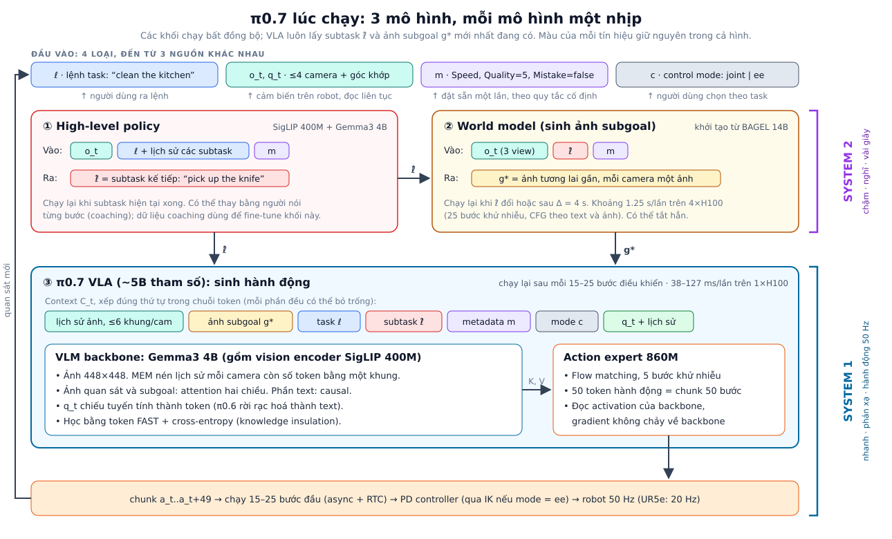
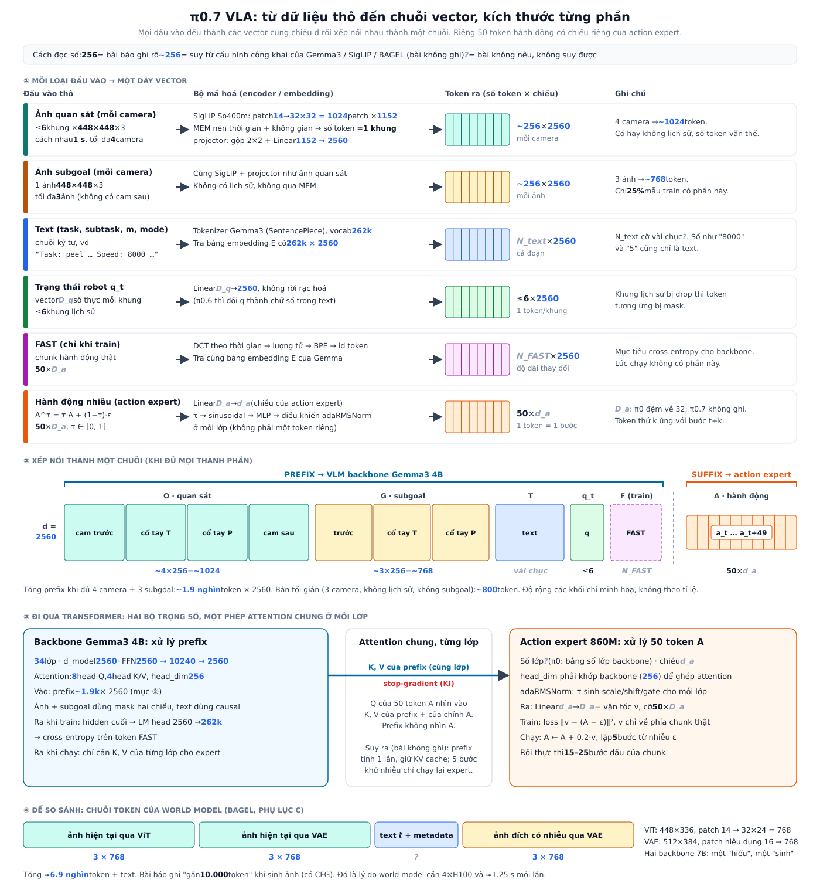
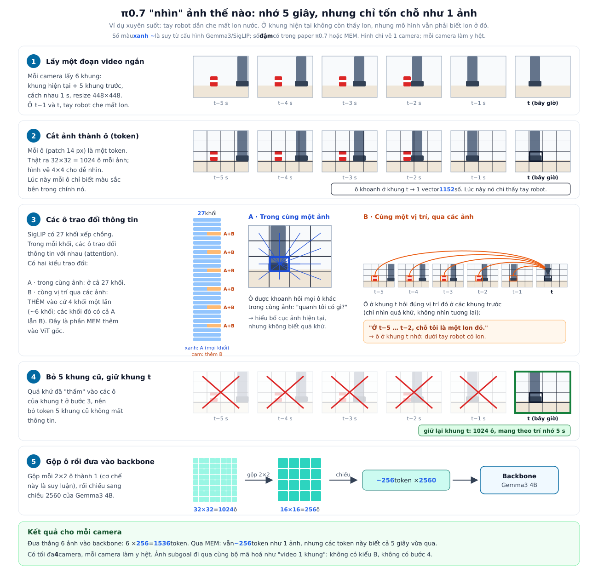
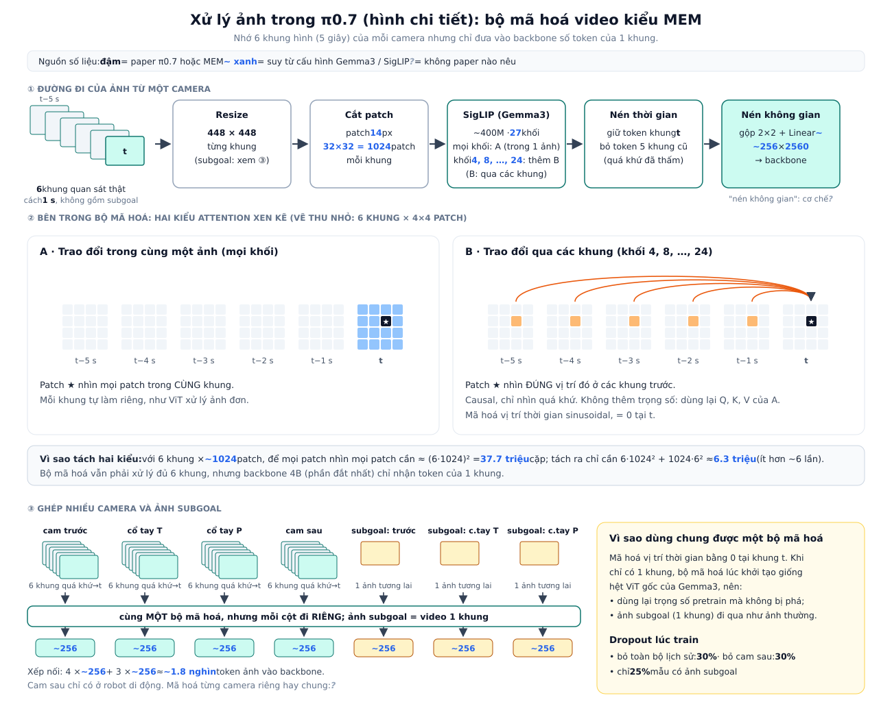
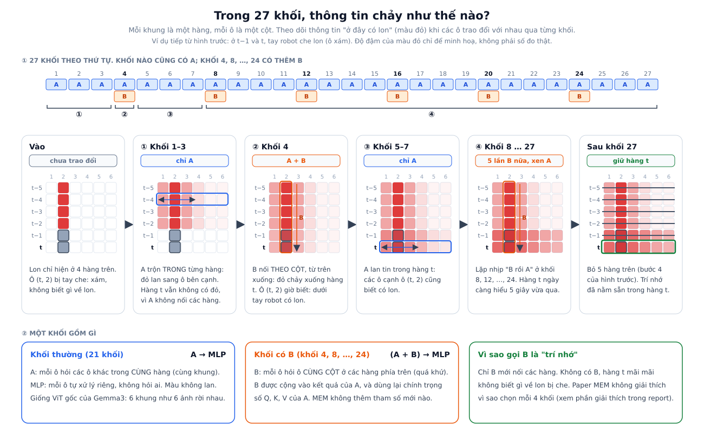
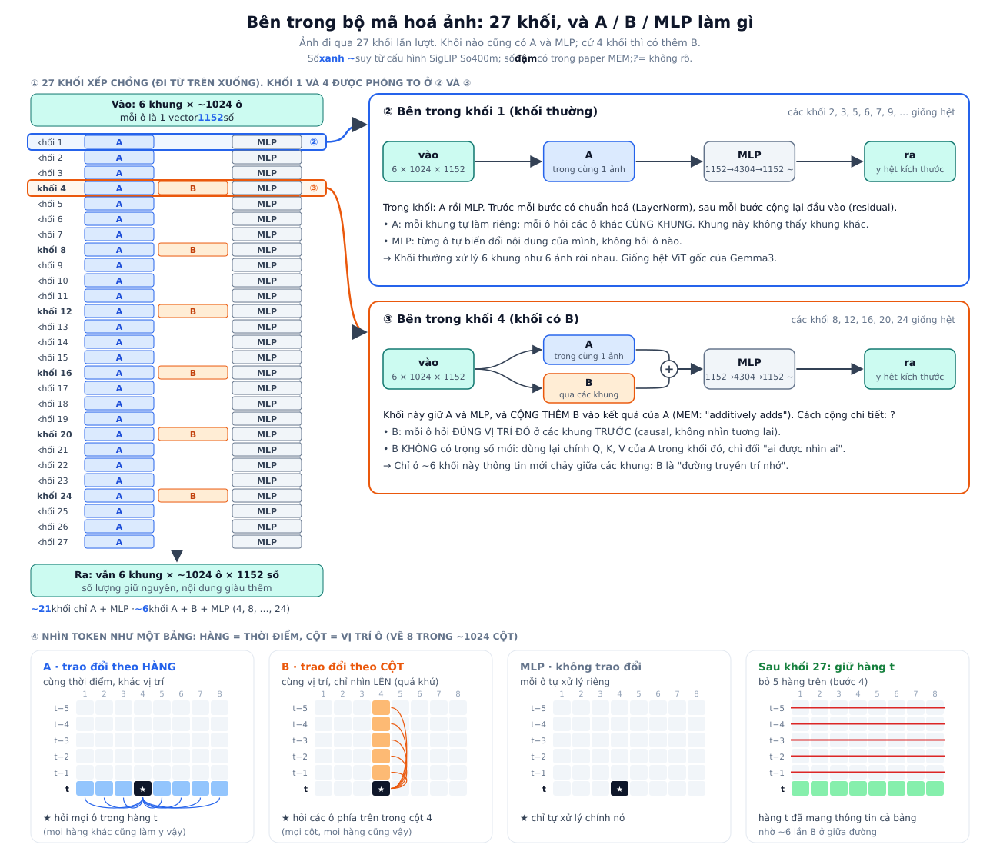
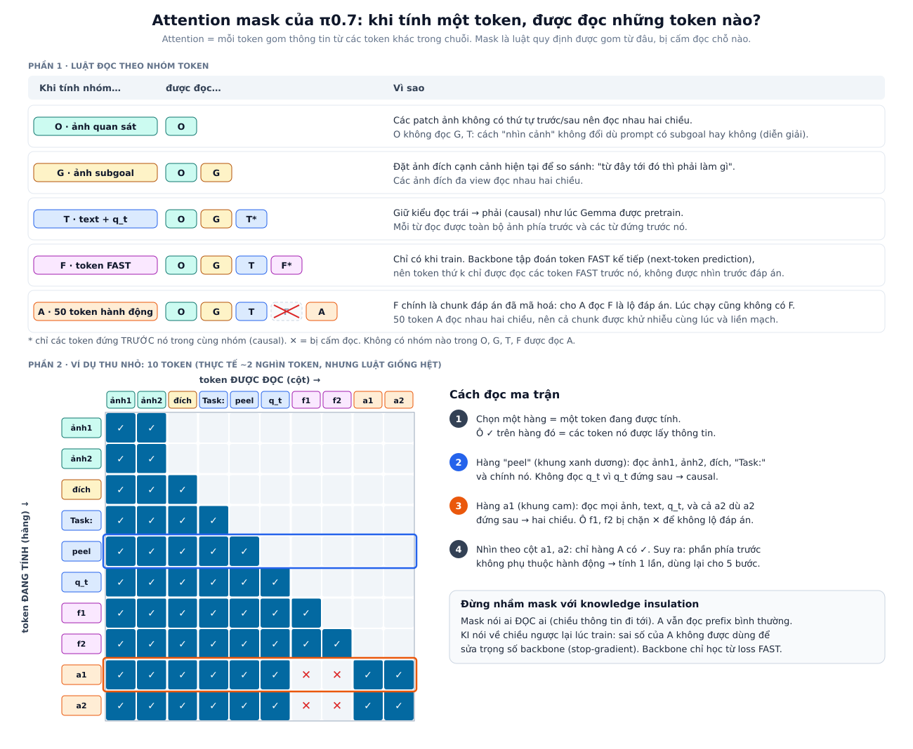

# π0.7: Mô hình nền tảng robot đa năng, điều khiển được bằng prompt, có năng lực "nổi lên"

> **Bài gốc:** *π0.7: a Steerable Generalist Robotic Foundation Model with Emergent Capabilities*
> Physical Intelligence (Bo Ai, Ali Amin, …, Sergey Levine, …, Ury Zhilinsky). Bản PDF tạo ngày 17/04/2026, không ghi số arXiv.
> Trang dự án: https://pi.website/pi07. File gốc: [`pi07.pdf`](pi07.pdf) (25 trang).
>
> Tài liệu này tóm tắt và viết lại nội dung bài báo bằng tiếng Việt. Các con số có ghi "≈" là giá trị đọc từ biểu đồ, bài báo không có bảng số. Các sơ đồ ở mục 3 được vẽ lại từ Hình 2, Hình 19, phần mô tả trong bài và paper MEM (arXiv 2603.03596), không phải hình gốc.

---

## 1. Tóm tắt

π0.7 là VLA mới nhất của Physical Intelligence, xây trên π0.6 và bộ nhớ video MEM. Bài báo không đề xuất kiến trúc mới. Đóng góp chính là một **cách huấn luyện**: mỗi mẫu dữ liệu đi kèm một **context (prompt) giàu thông tin**, mô tả không chỉ *làm gì* mà cả *làm như thế nào*. Context gồm:

- **Subtask**: câu lệnh ngắn cho bước kế tiếp (vd "open the fridge door"), bên cạnh lệnh task tổng (vd "clean the kitchen").
- **Ảnh subgoal**: ảnh cảnh tương lai gần cho từng camera, do một world model nhỏ sinh ra.
- **Metadata của episode**: tốc độ, điểm chất lượng 1–5, và đoạn đó có mắc lỗi hay không.
- **Control mode**: điều khiển theo góc khớp hay theo end-effector.

Nhờ context này, mô hình học được từ dữ liệu rất lẫn tạp mà không bị "trung bình hoá" thành hành vi tầm thường: demo tốt lẫn demo kém, episode thất bại, rollout tự động của các policy cũ (kể cả policy đã RL), video người góc nhìn thứ nhất và dữ liệu web. Lúc chạy, chỉ cần prompt "Quality = 5, Mistake = false, tốc độ nhanh" là mô hình làm theo kiểu tốt nhất nó từng thấy.

Kết quả chính, tất cả đều **không fine-tune riêng cho task**:

1. **Khéo léo ngay khi dùng**: pha espresso, gấp quần áo, gấp hộp, đổ rác, gọt rau… ngang các model chuyên biệt π\*0.6 đã RL. Với gấp đồ khó và gấp hộp, throughput còn cao hơn khoảng 1.45 lần.
2. **Bám lệnh ngôn ngữ tốt hơn hẳn** π0.5 và π0.6, kể cả lệnh lạ và lệnh đi ngược thiên lệch của dữ liệu.
3. **Chuyển kỹ năng sang robot khác mà không cần dữ liệu (zero-shot cross-embodiment)**: gấp áo trên UR5e hai tay dù không có dữ liệu gấp đồ nào trên robot này, đạt ngang người teleop giỏi thử lần đầu.
4. **Tổng quát hoá bằng cách ghép kỹ năng (compositional)**: làm task ngắn mới chỉ bằng prompt; task dài mới (vd dùng nồi chiên không dầu) bằng cách người "coaching" từng bước bằng lời, rồi dùng chính dữ liệu coaching đó để train high-level policy chạy tự động.

---

## 2. Động cơ

LLM ghép được kiến thức theo cách mới (compositional generalization). VLA thì chưa: chúng khó làm task mới, và thường còn không làm tốt được mọi lệnh đã train nếu không fine-tune riêng.

Muốn tổng quát hơn thì cần dữ liệu đa dạng hơn. Nhưng dữ liệu đa dạng thì lẫn nhiều **chiến lược** và **chất lượng** khác nhau. Train thẳng lên đó, mô hình sẽ trung bình các mode lại và cho kết quả kém.

Ý tưởng của π0.7 tương tự **prompt expansion** trong mô hình sinh ảnh/video: chú thích dữ liệu thật chi tiết để mô hình phân biệt được các mode. Khác biệt là trong robot, thông tin quyết định thành bại có khi không nói được bằng lời, chẳng hạn chất lượng episode hay hình dạng áo gấp gọn. Vì vậy prompt được mở rộng sang ảnh và metadata, không chỉ text.

---

## 3. Kiến trúc

### 3.1. Toàn hệ thống: 3 mô hình, 3 nhịp chạy



| Khối | Khởi tạo từ | Vào | Ra | Khi nào chạy lại |
|---|---|---|---|---|
| ① High-level policy | Kiến trúc như VLA: SigLIP 400M + Gemma3 4B | ảnh hiện tại, task ℓ + lịch sử subtask, metadata | subtask ℓ̂ (text) | khi subtask xong. Có thể thay bằng người |
| ② World model | BAGEL 14B (mixture-of-transformers hiểu + sửa + sinh ảnh) | 3 ảnh hiện tại, ℓ̂, metadata | ảnh subgoal g\* cho từng camera | khi ℓ̂ đổi hoặc sau Δ = 4 s, bất đồng bộ |
| ③ π0.7 VLA | π0.6 + MEM, backbone Gemma3 4B | context đầy đủ (mục 3.3) | chunk 50 hành động | sau mỗi H̃ ∈ {15, 25} bước, bất đồng bộ + RTC |

Hai khối ① và ② là **tuỳ chọn**. VLA vẫn chạy được chỉ với lệnh task, vì lúc train từng thành phần của prompt bị drop ngẫu nhiên. World model **không nằm trong** mô hình π0.7. Bài báo chỉ gọi khối ③ là "π0.7 model".

### 3.2. Đâu là System 2, đâu là System 1

Bài báo **không dùng** cụm "System 1 / System 2". Cách ghép dưới đây là của người viết tài liệu này, dựa trên vai trò và nhịp chạy của từng khối. Nó khớp với cách phân tầng tầng cao/tầng thấp mà PI đã dùng ở π0.5 và Hi Robot.

| | **System 2**: chậm, "nghĩ" | **System 1**: nhanh, "phản xạ" |
|---|---|---|
| Thành phần | ① high-level policy + ② world model | ③ π0.7 VLA (backbone Gemma3 4B + action expert 860M) |
| Trả lời câu hỏi | Bước tiếp theo là gì? Khi xong bước đó thì cảnh trông ra sao? | Ngay bây giờ các khớp phải chuyển động thế nào? |
| Đầu ra | subtask ℓ̂ (text) và ảnh subgoal g\* | chunk 50 hành động liên tục |
| Nhịp chạy | ℓ̂: khi subtask xong. g\*: khi ℓ̂ đổi hoặc tối đa 4 s, mỗi lần ≈1.25 s | suy luận lại sau mỗi 15–25 bước (0.3–0.5 s ở 50 Hz), mỗi lần 38–127 ms. Hành động ra 50 Hz (UR5e 20 Hz) |
| Phần cứng | 1×H100 cho ①, 4×H100 cho ② | 1×H100 |
| Thay bằng người được? | Có: người nói từng bước (coaching) thay cho ① | Không |
| Bắt buộc? | Không, bỏ cả hai vẫn chạy | Có |

**Hai tầng giao tiếp bằng prompt, không bằng vector ẩn.** System 2 chỉ đưa text ℓ̂ và ảnh g\* vào context của System 1. Việc chọn "giao diện" này có ba hệ quả:
- Người có thể thay thế System 2 bằng lời nói.
- System 2 được train riêng, vd fine-tune ① bằng dữ liệu coaching (mục 8.4), mà không đụng tới System 1.
- Thiếu một phần tín hiệu từ System 2 thì System 1 vẫn chạy, vì lúc train từng phần đã bị drop.

**Chú ý: có hai cách gọi khác nhau.** GR00T N1.x (và Figure Helix) đặt tên System 2/1 **bên trong một model**. System 2 là VLM backbone, System 1 là action head. System 1 đọc embedding của System 2.

| Cách hiểu | System 2 | System 1 |
|---|---|---|
| Phân tầng hệ thống (dùng trong tài liệu này) | ① high-level policy + ② world model | ③ VLA |
| Kiểu GR00T N1, trong một model | backbone Gemma3 4B | action expert 860M |

Theo cách thứ hai, cặp backbone/action expert của π0.7 tương ứng với cặp VLM/DiT của GR00T. Khác biệt là trong π0.7, hai phần này chạy **trong cùng một lượt forward, cùng nhịp**. Tầng chạy chậm hơn thật sự trong π0.7 là ① và ②. Vì vậy, khi nói về π0.7, nên dùng cách hiểu thứ nhất.

### 3.3. Bên trong VLA: token được ghép thế nào, kích thước bao nhiêu



**Về độ tin cậy của các con số.** Bài báo chỉ ghi vài số: ảnh 448×448, ≤4 camera × ≤6 khung, ≤3 ảnh subgoal, 50 token hành động, 860M, 5 bước khử nhiễu. Các số màu xanh có dấu "~" được **suy ra** từ cấu hình công khai của Gemma3 4B và SigLIP So400m: d_model 2560, 34 lớp, patch 14, 256 token mỗi ảnh. Phép suy dựa trên giả định π0.7 giữ nguyên projector ảnh của Gemma3, vốn gộp mọi ảnh về 256 token. Nếu PI đổi projector thì số token mỗi ảnh sẽ khác. Các số dấu "?" (D_a, d_a, số lớp của expert, độ dài text) bài không nêu.

Tóm tắt cách ghép:

1. **Mọi thứ trong prefix đều thành vector 2560 chiều**, là chiều ẩn của Gemma3 4B:
   - Ảnh đi qua SigLIP rồi projector.
   - Text và token FAST tra bảng embedding của Gemma.
   - q_t đi qua một lớp Linear.
2. **Xếp nối theo thứ tự cố định**: quan sát → subgoal → text → q_t → (FAST khi train). Phần nào bị drop thì không có mặt, chuỗi ngắn lại.
3. **50 token hành động nằm riêng ở cuối** và có chiều d_a của action expert. Chúng không đi qua trọng số của backbone. Ở mỗi lớp, chúng chỉ "nhìn sang" K, V của prefix qua attention chung.
4. **Timestep khử nhiễu τ không phải một token.** Nó được đưa vào qua adaRMSNorm, tức điều chỉnh scale/shift trong từng lớp của expert.

Thông số chính:

- **Tổng cộng ≈ 5B tham số**: backbone Gemma3 4B (gồm vision encoder SigLIP 400M) và action expert 860M.
- **Ảnh**: tối đa 4 camera (trước, 2 cổ tay, sau nếu là robot di động). Mỗi camera có tối đa 6 khung lịch sử, cách nhau 1 s. Bộ mã hoá video **MEM** nén lịch sử của mỗi camera còn số token bằng một khung, nén cả theo thời gian lẫn không gian (chi tiết ở mục 3.4). Tối đa 3 ảnh subgoal (bỏ cam sau). Mọi ảnh resize về 448×448.
- **Trạng thái robot q_t**: chiếu tuyến tính thành token, mỗi khung lịch sử là một token. π0.6 thì rời rạc hoá q_t thành text.
- **Action expert**: transformer nhỏ, train bằng flow matching, dùng adaptive RMSNorm để đưa timestep khử nhiễu vào. Có 50 token hành động (chunk 50 bước) nhìn nhau hai chiều và nhìn toàn bộ activation của backbone.
- **Knowledge insulation (KI)**: backbone được giám sát bằng token FAST và cross-entropy. Gradient từ action expert **không** chảy ngược về backbone, nhờ đó backbone giữ được kiến thức của VLM.
- **Training-time RTC**: lúc train mô phỏng độ trễ suy luận 0–12 bước (tới 240 ms ở 50 Hz), để lúc chạy nối chunk mượt dù có trễ.

### 3.4. Xử lý ảnh đầu vào: bộ mã hoá video kiểu MEM



*Đọc hình từ trên xuống, qua 5 bước. Ví dụ xuyên suốt: tay robot dần che mất lon nước, nên ở khung hiện tại không còn thấy lon. Bước 3B cho thấy ô ở khung t hỏi đúng vị trí đó ở các khung trước, nhờ vậy "nhớ" dưới tay robot có lon. Bước 4 bỏ token của 5 khung cũ mà không mất trí nhớ đó.*



*Hình chi tiết: cùng nội dung ở dạng sơ đồ kỹ thuật, kèm kích thước, chi phí attention và cách ghép nhiều camera với ảnh subgoal.*

Bài π0.7 chỉ dành vài câu cho phần ảnh. Nó ghi bộ mã hoá ảnh "theo thiết kế MEM video history encoder [37]", một paper khác của PI (Torne et al., arXiv 2603.03596, 2026). Mục này ghép thông tin từ cả hai paper, và ghi rõ nguồn từng ý: **[π0.7]**, **[MEM]**, hoặc **[suy luận]** nếu là của tài liệu này.

**Mục tiêu.** Robot cần nhớ vài giây vừa qua, chẳng hạn để biết đồ vừa bị che ở đâu hay bước trước đã làm chưa. Nhưng đưa 6 khung hình vào backbone 4B thì số token ảnh tăng 6 lần. MEM giải bài toán này: nhớ 6 khung mà backbone chỉ phải trả giá cho 1 khung.

#### Các bước với một camera

1. **Chọn khung.** Khung hiện tại t cùng 5 khung quá khứ, cách nhau **1 s**, tức nhớ được 5 giây. [π0.7, MEM] Cả 6 khung đều là **ảnh quan sát thật** từ camera. Ảnh subgoal không nằm trong 6 khung này mà đi riêng (xem phần "Nhiều camera và ảnh subgoal" bên dưới). MEM cho biết lúc chạy có thể kéo dài lịch sử tới 18 khung (54 s), dù lúc train chỉ dùng 6 khung. [MEM]
2. **Resize** về **448×448**. [π0.7] Bài không nói kéo giãn hay đệm viền khi tỉ lệ khung của camera khác hình vuông.
3. **Cắt patch** 14 px, được khoảng 32×32 = 1024 patch mỗi khung. [suy luận từ cấu hình SigLIP]
4. **Qua SigLIP của Gemma3 (~400M)**, đã sửa thành bộ mã hoá video. SigLIP gồm **27 khối transformer** xếp chồng, mỗi khối có attention rồi FFN. [suy luận từ cấu hình SigLIP So400m] Có hai kiểu attention xen kẽ:
   - *Attention không gian*, có ở **cả 27 khối**: mỗi patch nhìn mọi patch **trong cùng khung**, như ViT xử lý ảnh đơn. Mỗi khung tự làm riêng.
   - *Attention thời gian*, **thêm vào** cứ mỗi khối thứ 4 (khoảng 6 khối): mỗi patch nhìn **đúng vị trí đó** ở các khung trước, với mask causal nên chỉ nhìn quá khứ. [MEM; con số ~6 khối là tự tính]

   **Một "khối" của SigLIP là gì.** SigLIP là bộ mã hoá ảnh của Google, dạng Vision Transformer (ViT). Gemma3 dùng bản So400m, khoảng 400M tham số. [suy luận từ cấu hình công khai] Bản này gồm **27 khối giống hệt nhau về cấu trúc** xếp chồng lên nhau, khác nhau ở trọng số. Mỗi khối gồm hai bước:
   1. **Attention**: các patch trao đổi thông tin với nhau.
   2. **MLP**: biến đổi riêng từng patch.

   Mỗi bước có chuẩn hoá (LayerNorm) và đường tắt residual. Qua mỗi khối, số token và số chiều giữ nguyên (khoảng 1024 token × 1152 số mỗi khung). Chỉ "nội dung" của từng token được làm giàu thêm: các khối đầu nắm cạnh và màu, các khối sau nắm vật thể và quan hệ giữa chúng. Con số 27 (cùng chiều 1152) đến từ cấu hình "shape-optimized" (So = shape-optimized) mà Google tìm ra khi tối ưu độ sâu và độ rộng của ViT cho cỡ khoảng 400M. Nó không có ý nghĩa riêng với robot.

   **Khối có B thì vẫn có A.** MEM chỉ *thêm* attention thời gian vào cứ mỗi khối thứ 4. Các khối đó vẫn giữ attention không gian như cũ, nên chúng làm cả A lẫn B, rồi mới tới MLP. [MEM: "incorporate both spatial … but also temporal context"] B được **cộng thêm** vào kết quả của A, chứ không chạy thành một bước nối tiếp sau A (MEM viết "additively adds attention over the time dimension"). Cách cộng chính xác thì paper không nói.

   **B không có trọng số mới.** Nguyên văn MEM: *"our video encoder … does not introduce new learnable parameters compared to standard, single-image ViTs. Video encoding capabilities are added by modifying the attention pattern of the ViT and adding a fixed sinusoidal temporal position encoding."* Như vậy, B dùng lại chính Q, K, V của attention trong khối đó. Chỉ có "ai được nhìn ai" thay đổi: cùng vị trí qua các khung, thay vì các ô trong cùng khung. Thêm vào đó là mã hoá vị trí thời gian cố định, không học.

   **Vì sao cứ 4 khối mới có B.** Paper MEM **không giải thích** và **không có thí nghiệm so sánh** với các cách khác (B ở mọi khối, mỗi 2 khối, chỉ ở cuối…). Các lý do dưới đây là **suy luận** của tài liệu này:
   - *Không phải vì chi phí tính toán.* B rất rẻ: mỗi ô chỉ nhìn 6 ô (cùng vị trí ở 6 khung), khoảng 1024 × 6² phép so, so với 6 × 1024² của A. Có B ở cả 27 khối thì chi phí cũng gần như không đổi.
   - *Giữ được "kiến thức nhìn ảnh" đã pretrain.* B dùng lại trọng số Q, K, V vốn được học cho việc so các ô trong cùng ảnh, và mỗi lần B được cộng vào là biểu diễn lệch khỏi thứ ViT gốc từng thấy. Đặt B thưa (khoảng 6/27 khối) để phần lớn các khối vẫn chạy đúng như ViT gốc, nhờ đó dùng lại được trọng số của Gemma3 mà không phá kiến thức sẵn có.
   - *Thưa vẫn đủ để lan tin.* Sau mỗi khối có B, ba khối thường tiếp theo dùng A để lan thông tin quá khứ từ một ô sang các ô xung quanh trong khung. Nhịp "trộn thời gian → trộn không gian ×3" lặp khoảng 6 lần nên đủ để thông tin quá khứ thấm khắp khung t.
   - Con số 4 cụ thể nhiều khả năng là một siêu tham số được chọn theo kinh nghiệm.

   

   *Hình: xem token của một camera như một bảng, mỗi hàng là một khung (t−5 … t), mỗi cột là một vị trí ô. Hình theo dõi thông tin "ở đây có lon" (màu đỏ) qua các khối:*
   - *Khối 1–3 chỉ có A, nên đỏ chỉ lan trong từng hàng. Hàng t vẫn trống.*
   - *Khối 4 có B, nên đỏ chảy theo cột xuống hàng t. Ô bị tay che giờ "biết" có lon.*
   - *Các khối sau: A lan tin trong hàng t, B lặp lại ở các khối 8, 12, …, 24.*
   - *Cuối cùng chỉ giữ hàng t.*

   

   *Hình chi tiết:*
   - *① 27 khối xếp chồng.*
   - *② và ③ phóng to **khối 1** (khối thường: A → MLP) và **khối 4** (khối có B: (A + B) → MLP). Hai khối này được tô nổi trong chồng khối, cùng màu với khung phóng to.*
   - *④ Bốn thao tác A, B, MLP, giữ hàng t, vẽ trên bảng token.*
5. **Nén thời gian.** Ra khỏi bộ mã hoá, token của 5 khung quá khứ bị **bỏ**, chỉ giữ token của khung t. Thông tin quá khứ đã "thấm" vào các token này qua attention thời gian. [MEM]
6. **Nén không gian và chiếu sang backbone**, còn khoảng ~256 token × 2560 mỗi camera. π0.7 có nói "nén cả theo không gian" nhưng không giải thích. Có lẽ đây là bước gộp patch 2×2 của projector Gemma3. [suy luận]

**Vì sao một khung chứa được thông tin của 5 khung trước.** Điều quan trọng: sau bộ mã hoá, "khung t" **không còn là một bức ảnh**. Nó là 1024 vector, mỗi vector khoảng 1152 số, một vector cho mỗi ô. Điểm ảnh gốc không đổi; cái thay đổi là **nội dung các vector**, được viết lại qua từng khối.

Ở khối có B, vector của một ô ở khung t được cập nhật gần đúng như sau:

```
vector_mới(t) = vector_cũ(t) + trộn[ w₅·V(t−5), …, w₁·V(t−1), w₀·V(t) ]
```

Trong đó:
- `V(t−k)` là nội dung rút ra từ vector của **cùng ô đó** ở khung t−k.
- `w` là mức chú ý, do mô hình tự tính.
- Dấu **cộng** (residual) nghĩa là thông tin quá khứ được **ghi thêm** vào vector hiện tại, không ghi đè.

Ví dụ lon bị che: sau bước cắt ô, vector ô (t, 2) chỉ mô tả "tay robot màu xám". Qua khối 4, B cộng thêm phần "có lon đỏ" đọc được từ t−5 … t−2. Các khối sau (A, MLP) kết hợp hai điều đó thành "có lon bị che dưới tay". *(Minh hoạ; trong mô hình thật các con số không có nghĩa rõ ràng như vậy.)*

Đây là **nén, không phải giữ tất cả**. Khoảng 1152 số mỗi ô đủ chỗ để vừa mô tả chính ô đó vừa mang tóm tắt quá khứ, nhưng chỉ những gì **có ích** được giữ. Mô hình học cách chọn qua quá trình train: nếu quên điều quan trọng thì đoán hành động sai và loss tăng. [suy luận, dựa trên cơ chế attention + residual chuẩn của transformer]

**Vì sao tách attention làm hai kiểu.** Với K khung, mỗi khung n patch:
- Để mọi patch nhìn mọi patch thì tốn O(n²K²).
- Tách thành không gian và thời gian thì chỉ tốn O(Kn² + nK²). [MEM]

Với K = 6 và n ≈ 1024, con số tương ứng là ≈37.7 triệu cặp so với ≈6.3 triệu cặp, ít hơn khoảng 6 lần. Bộ mã hoá vẫn phải xử lý đủ 6 khung, nhưng backbone 4B, phần đắt nhất, chỉ nhận token của 1 khung.

**Mã hoá vị trí thời gian** dùng sinusoidal cố định và có **giá trị 0 tại khung t**. Vì vậy khi chỉ có 1 khung, bộ mã hoá lúc khởi tạo giống hệt ViT gốc của Gemma3. [MEM] Có hai hệ quả:
- Khởi tạo từ trọng số pretrain mà không làm hỏng chúng.
- Ảnh subgoal, vốn chỉ có 1 khung, đi qua **cùng bộ mã hoá** như ảnh thường. [π0.7 ghi dùng chung bộ mã hoá; phần giải thích vì sao là suy luận]

#### Nhiều camera và ảnh subgoal

- Tối đa **4 camera**: cam trước, 2 cam cổ tay, cam sau nếu là robot di động. Mỗi camera có tối đa 6 khung. [π0.7]
- Tối đa **3 ảnh subgoal**, không có cam sau, mỗi ảnh 1 khung. [π0.7]
- Token của các camera xếp nối nhau, rồi tới ảnh subgoal. Tổng cộng ≈ 7 × 256 ≈ 1.8 nghìn token ảnh. [suy luận]
- Mỗi camera được mã hoá riêng hay chung, bài không nói.
- Trong chuỗi token, ảnh quan sát đọc nhau hai chiều, ảnh subgoal đọc được ảnh quan sát (mục 3.5). [π0.7]

#### Dropout lúc train [π0.7]

| Thành phần | Xác suất | Khi bị bỏ thì sao |
|---|---|---|
| Toàn bộ lịch sử ảnh | 30% | chỉ còn khung t; số token không đổi |
| Cam sau | 30% | bớt ~256 token |
| Ảnh subgoal | chỉ có trong 25% mẫu | bớt tới ~768 token |

Nhờ dropout, lúc chạy có thể bật hoặc tắt lịch sử và subgoal tuỳ nhu cầu. Chi phí cũng khác nhau:
- Bản tối giản (3 camera, 5 bước khử nhiễu): 38 ms trên H100.
- Bật MEM và thêm ảnh subgoal: tối đa 127 ms. [π0.7]

#### Bài không nói

- Chuẩn hoá màu và augmentation (crop, đổi màu…).
- Độ phân giải và tần số khung hình gốc của camera.
- Cách resize khi camera không vuông.
- Các camera có chung trọng số bộ mã hoá không.
- Video người góc nhìn thứ nhất và ảnh web đi vào VLA thế nào. Bài chỉ nói rõ các nguồn này dùng để train world model.

**So với world model:** world model mã hoá mỗi ảnh hai lần, ViT 448×336 cho ngữ nghĩa và VAE 512×384 cho chi tiết (mục 4.2, và phần ④ của hình ở mục 3.3). **So với dự án:** REAL_G1 của GR00T chỉ dùng 1 camera `ego_view` với 2 khung (`delta_indices [-20, 0]`).

### 3.5. Attention mask: token nào được đọc token nào



**Attention mask là gì.** Trong transformer, mỗi token được tính lại bằng cách gom thông tin từ các token khác. Mask là luật quy định một token **được gom từ đâu** và **bị cấm đọc chỗ nào**. Ma trận ở phần 2 của hình đọc theo hàng: mỗi hàng là một token đang được tính, ô ✓ là những token nó được đọc.

**Luật của π0.7, nói gọn:**

| Nhóm đang tính | Được đọc | Lý do |
|---|---|---|
| O: ảnh quan sát | O (hai chiều) | Patch ảnh không có thứ tự trước/sau |
| G: ảnh subgoal | O, G (hai chiều) | So ảnh đích với cảnh hiện tại |
| T: text + q_t | O, G, và các token T đứng trước | Giữ kiểu causal như lúc Gemma pretrain |
| F: FAST (chỉ khi train) | O, G, T, và các token F đứng trước | Tập đoán token kế tiếp, không được nhìn trước đáp án |
| A: 50 token hành động | O, G, T, A (hai chiều); **không đọc F** | F là chunk đáp án đã mã hoá; lúc chạy cũng không có F |

**Ba hệ quả nên nhớ:**

- **Không nhóm nào phía trước đọc A**, nên prefix không phụ thuộc hành động nhiễu. Suy ra lúc chạy có thể tính prefix một lần rồi giữ K, V của nó (**KV cache**), và 5 bước khử nhiễu chỉ chạy lại action expert. Bài báo không nhắc tới KV cache; đây là hệ quả của mask, và π0 cũng làm như vậy.
- **A không đọc F** là để chống lộ đáp án. Nếu A đọc được F, lúc train nó chỉ việc chép lại F.
- **Mask khác knowledge insulation.** Mask nói ai đọc ai: A vẫn đọc prefix bình thường. KI nói về gradient lúc train: sai số của A không được dùng để sửa trọng số backbone.

Việc O không đọc G và T là bài báo quy định. Còn lý do "để cách nhìn cảnh không đổi dù prompt thế nào" là diễn giải của tài liệu này, bài không giải thích. Khi chạy có CFG, nhánh có metadata và nhánh không metadata được xếp chung một chuỗi ("attention tree"), và hai nhánh không đọc nhau.

### 3.6. Vòng suy luận (Algorithm 1)

```
Vào: ảnh o_0, lệnh task ℓ, metadata m, control mode c
ℓ̂  ← high-level policy (hoặc người coaching)
g* ← world model(o_0, ℓ̂, m)
C  ← {ℓ, ℓ̂, g*, m, c}
a_{t:t+H} ← π0.7(a | o_{t-T:t}, C)           # có thể dùng CFG
lặp t = 0, 1, 2, …
    nếu ℓ̂ đổi hoặc đã quá Δ = 4 s:
        g* ← world model(o_t, ℓ̂, m)          # chạy nền, không chặn
        cập nhật C
    nếu đã chạy xong H̃ bước từ lần suy luận trước:
        a_{t:t+H} ← π0.7(a | o_{t-T:t}, C, a_đang_chạy)   # bất đồng bộ + RTC
    thực thi a_t
```

Mỗi lần suy luận dùng 5 bước khử nhiễu để sinh chunk 50 bước, rồi thực thi 15 hoặc 25 bước đầu.

**Tốc độ (Phụ lục D):**

| Thành phần | Phần cứng | Thời gian |
|---|---|---|
| VLA bản tối giản (3 camera, 5 bước khử nhiễu, training-time RTC) | 1×H100 | 38 ms |
| VLA thêm MEM và ảnh subgoal | 1×H100 | tối đa 127 ms |
| World model: 25 bước khử nhiễu, CFG text + ảnh, chuỗi ≈10k token | 4×H100 (tensor parallel, lượng tử 8-bit, SageAttention sửa đổi) | 1.25 s |

---

## 4. Đa dạng hoá prompt

### 4.1. Subtask instruction ℓ̂

Như π0.5, prompt có thêm câu mô tả **bước ngữ nghĩa kế tiếp**. Dữ liệu được chia đoạn và chú thích text chi tiết. Lúc chạy, ℓ̂ đến từ high-level policy hoặc từ người.

Vì mô hình bám lệnh tốt, người có thể **coaching bằng lời** từng bước cho một task mới. Sau đó dùng chính dữ liệu coaching để fine-tune high-level policy, và task đó chạy được tự động.

### 4.2. Ảnh subgoal g\*

Text như "open the fridge door" không nói tay nắm cầm thế nào. Ảnh subgoal cho thấy **cảnh sẽ trông ra sao** khi xong bước đó. Có nhiều view: cam trước thể hiện kết quả với vật và môi trường, cam cổ tay thể hiện tư thế tay và gripper.

World model g_ψ được train bằng flow matching:

max_ψ E[ L_CFM( g\*_t , g_ψ(o_t, ℓ̂_t, m) ) ]

Nhãn g\* là **khung cuối của đoạn subtask**. Chỉ dùng các đoạn có nhãn subtask chất lượng cao, vì bài báo thấy chất lượng cắt đoạn theo thời gian ảnh hưởng mạnh đến ảnh sinh ra.

World model được khởi tạo từ BAGEL, theo cách làm của SuSIE. Nó được train trên dữ liệu robot, video người góc nhìn thứ nhất, cùng các dataset sửa ảnh và video mã nguồn mở. Nhờ vậy nó mang kiến thức web vào π0.7 qua hình ảnh. Mỗi ảnh vào được mã hoá hai đường: ViT 448×336 cho ngữ nghĩa và VAE 512×384 cho chi tiết. Hai backbone 7B xử lý: một cho hiểu, một cho sinh.

### 4.3. Episode metadata m

Đây là phần quan trọng nhất để dùng được dữ liệu kém:

| Trường | Ý nghĩa | Cách gán |
|---|---|---|
| Speed | độ dài episode (số bước), gom bin 500 bước, vd 1750–2250 → "2000" | tự động |
| Quality | điểm chất lượng 1–5 | người chú thích thô |
| Mistake | đoạn này robot có sai không (trượt gắp, làm nhầm subtask) | người chú thích thô |

Lúc chạy luôn đặt **Speed = phân vị 15% độ dài episode của task** (tức nhanh), **Quality = 5**, **Mistake = false**.

#### Metadata để làm gì

**Vấn đề: dữ liệu tốt và kém trộn lẫn thì mô hình học ra "trung bình".** Ví dụ với việc gấp áo, cùng cảnh "áo trải trên bàn" có thể có ba kiểu episode:

1. Người teleop giỏi: gấp nhanh, gọn, không sai.
2. Người mới: chậm, lóng ngóng, nếp gấp lệch.
3. Rollout của policy cũ: gắp trượt hai lần rồi mới gấp được.

Nếu prompt chỉ có "fold the shirt", mô hình thấy cùng một đầu vào nhưng ba cách làm khác nhau. Nó học ra thứ trung bình của cả ba: hơi chậm, thỉnh thoảng lóng ngóng. Còn nếu vứt bỏ dữ liệu kém thì mất nhiều dữ liệu, và mất cả những thứ chỉ dữ liệu kém mới có (xem cuối mục).

**Giải pháp: ghi nhãn "episode này được làm như thế nào".** Có nhãn, mô hình không còn học "với cảnh này thì làm gì". Nó học "với cảnh này, *nếu làm theo kiểu X* thì làm gì", nên các kiểu làm không trộn vào nhau nữa.

| Trường | Tách cái gì khỏi cái gì |
|---|---|
| Speed | Người làm nhanh và người làm chậm. Bài báo nhận xét làm nhanh thường cũng là làm tốt, ít sai hơn. Nhãn này tự động, rẻ nhất. |
| Quality | Bản làm gọn và bản làm ẩu, **kể cả khi cả hai đều thành công**. |
| Mistake | **Chỗ** sai *bên trong* một episode. Nhãn gắn theo từng đoạn, không phải cả episode. |

Mistake gắn theo đoạn là chi tiết quan trọng. Trong episode 3 ở trên, đoạn gắp trượt được gắn `Mistake: true`, còn đoạn gắp lại ngay sau đó được gắn `Mistake: false`. Nhờ vậy mô hình có thể học cách **sửa sai** khi đã rơi vào tình huống xấu, mà không học chính cái sai. Ý "học sửa sai" là diễn giải của tài liệu này, bài báo không nói thẳng.

**Lúc chạy thì không ai đo metadata.** Người ta điền sẵn giá trị tốt nhất để *yêu cầu* mô hình làm theo kiểu tốt nhất nó từng thấy. Cách này giống viết "high quality, 4k" vào prompt của mô hình sinh ảnh. CFG trên metadata (mục 6) còn khuếch đại thêm khoảng cách giữa "làm tốt nhất" và "làm bình thường".

**Bằng chứng: metadata quyết định dữ liệu kém có ích hay có hại.**
- Hình 7 (mục 8.1): bỏ metadata khỏi prompt, throughput gấp hộp còn ≈0.24 lần bản đầy đủ.
- Hình 18 (mục 8.5), khi tăng lượng dữ liệu từ top 30% lên 100%:
  - Có metadata: throughput tăng từ ≈13 lên ≈23 lần/giờ.
  - Không metadata: throughput nhích lên ≈12 rồi tụt về ≈9.5.

**Vì sao không bỏ luôn dữ liệu kém:**
1. *Độ phủ trạng thái.* Demo tốt không bao giờ đi vào tình huống "áo bị gắp lệch, nằm nhăn một góc". Dữ liệu kém thì có, và cho thấy cách thoát ra.
2. *Số lượng.* Rollout từ các lần đánh giá policy rất nhiều và gần như miễn phí.
3. *Chưng cất.* Rollout của các policy đã RL có chất lượng lên xuống. Gắn nhãn xong, π0.7 lấy được cách làm tốt nhất của chúng.

#### Áp dụng thử cho dự án G1 phân loại lon (nhận xét riêng, không có trong bài báo)

Việc này làm được mà không đổi kiến trúc GR00T, vì metadata chỉ là thêm chữ vào câu lệnh. Đây là cách làm rẻ nhất để thử ý tưởng của π0.7. Dưới đây là hiện trạng code và những chỗ cần sửa.

**Hiện trạng:**
- **Câu lệnh**: `collect_demos.py` chỉ có 2 câu cố định, lưu trong biến `TASKS`, ví dụ "Pick up the Coca-Cola can and place it in the red tray". Hai câu này được ghi vào `meta/tasks.jsonl`. Mỗi khung có cột `task_index` (cột `annotation.human.task_description` cũng trỏ vào đó). Client gửi câu lệnh lên server dưới dạng chuỗi trong `language.annotation.human.task_description`.
- **Chất lượng**: `sim/episode_metrics.py` đo các chỉ số vật lý chứ **không cho điểm 1–5**. Các chỉ số gồm:
  - khoảng hở từ tay tới lon còn lại theo từng pha (trước khi kẹp, đang kẹp, sau khi nhả);
  - số bước chạm lon còn lại, và lon còn lại bị xê dịch bao nhiêu;
  - thân chạm bàn; thân ngả, xoay, trượt; bàn chân xoay;
  - thời điểm kẹp và độ lệch điểm gắp.

  Các chỉ số này được ghi vào `meta/collection.jsonl` (trường `quality`). `tools/demo_quality.py` đo lại chúng bằng cách phát lại dataset.
- **Lọc**: `--quality-filter` (mặc định bật) **dừng thu ngay** khi vi phạm ngưỡng. Ngưỡng là: chạm hoặc sát lon còn lại dưới 1 cm; và nếu chạy với `--lower-body balance` thì thêm thân chạm bàn, thân ngả quá 5°, bàn chân xoay quá 5°. Lần thử bị loại chỉ để lại lý do và chỉ số trong `meta/rejected.jsonl`. **Quỹ đạo của nó không được lưu.**

**Cần làm:**
1. **Giữ lại lần thử kém.** Thêm chế độ ghi tiếp khi vi phạm, không dừng sớm, và lưu parquet cùng video như episode thường. Rollout closed-loop ghi bằng `--record-vla` cũng là một nguồn, nhưng cần chuyển sang định dạng LeRobot.
2. **Quy đổi chỉ số thành nhãn.** Sim có lợi thế lớn: nhãn tự động, chính xác, không cần người chấm.
   - `Mistake` gắn **theo khung**, vì `task_index` vốn là cột theo khung, nên gắn nhãn theo đoạn được đúng như π0.7. Các khung đang vi phạm (đang chạm lon còn lại, thân đang chạm bàn…) gắn `true`, phần còn lại gắn `false`.
   - `Quality` 1–5 gắn theo episode, dựa trên biên an toàn: khoảng hở nhỏ nhất tới lon còn lại, góc ngả thân lớn nhất, độ lệch điểm gắp. Ngưỡng từng mức nên chọn theo phân phối thật (bảng trung vị theo nhóm mà `demo_quality.py` in ra), không đặt tay.
   - `Speed` có thể bỏ lúc đầu. Demo do planner sinh ra có tốc độ khá đều, nên nhãn này ít thông tin.
3. **Sinh câu lệnh.** `tasks.jsonl` sẽ chứa các tổ hợp, ví dụ "Pick up the Coca-Cola can and place it in the red tray. Quality: 4. Mistake: false." Với 2 lon × 5 mức × 2 giá trị Mistake thì có 20 câu. Nên giữ khoảng 15% dữ liệu dùng câu gốc không có metadata, giống dropout của π0.7, để model vẫn chạy được khi không có metadata.
4. **Lúc chạy**, client gửi "… Quality: 5. Mistake: false."

**Rủi ro và cách kiểm chứng:**
- Fine-tune mặc định **đóng băng backbone VLM**, chỉ tune projector và action head. Chữ "Quality: 3" và "Quality: 5" vẫn cho embedding khác nhau, nên về lý thuyết action head vẫn học dùng được. Tuy vậy điều này chưa kiểm chứng. Nếu không có tác dụng, thử tune thêm phần LLM.
- GR00T lúc chạy không có CFG, nên chỉ có điều kiện hoá thuần, không có bước khuếch đại như π0.7.
- π0.7 hưởng lợi ở quy mô dữ liệu rất lớn. Với vài trăm demo sim, hiệu ứng có thể nhỏ.
- Thí nghiệm nên làm: cùng số bước train, so ba dataset:
  - (a) chỉ demo sạch;
  - (b) demo sạch + demo kém, không nhãn;
  - (c) demo sạch + demo kém, có nhãn.

  Theo Hình 18, kỳ vọng (c) ≥ (a) > (b). Nếu (b) và (c) ngang nhau thì model không dùng metadata.

### 4.4. Control mode c

Có token `joint` hoặc `ee` trong prompt. Dữ liệu có cả hai loại, lúc chạy chọn tuỳ task. Theo Phụ lục E, khi chuyển robot, điều khiển bằng ee không hơn joint rõ ràng. Vì vậy các thí nghiệm chính dùng joint.

### 4.5. Prompt đầy đủ và dropout lúc train

```
<Ảnh đa view><Ảnh subgoal đa view>
Task: peel vegetables. Subtask: pick up the peeler. Speed: 8000. Quality: 5. Mistake: false. Control Mode: joint.<Proprioception>
```

| Thành phần | Cách drop khi train |
|---|---|
| Ảnh subgoal | chỉ có trong **25%** mẫu của mỗi batch. Có subgoal thì model học nhanh hơn hẳn, vì bài toán gần thành inverse dynamics, nên phải hạn chế để model không phụ thuộc |
| Subtask ℓ̂ (khi có subgoal) | drop 30%, vì ảnh subgoal đã thay được text |
| Metadata | drop cả khối 15%; mỗi trường thêm 5% |
| Lịch sử ảnh | drop cả khối 30% |
| Cam sau | drop 30% |
| Control mode | không drop |

**Chọn ảnh subgoal khi train:** 25% lấy khung cuối đoạn (khớp với nhãn của world model), 75% lấy ngẫu nhiên từ 0–4 s phía trước. Ngoài ảnh thật còn thêm nhiều ảnh **do world model sinh** để giảm lệch train/test.

---

## 5. Dữ liệu huấn luyện

- Demo của nhiều robot (tĩnh, di động; một tay, hai tay) trong môi trường lab, giống nhà và nhà thật.
- **Dữ liệu tự động, gồm cả kém chất lượng**: episode thất bại, episode thành công nhưng sai nhiều, và rollout từ các lần đánh giá policy cũ. Có cả dữ liệu π\*0.6 sinh ra trong lúc train RL, nên thực chất π0.7 **chưng cất (distill)** hành vi của các specialist đã RL. Dữ liệu từ các lần đánh giá tổng quát hoá trong bài bị loại khỏi tập train.
- Can thiệp của người trong lúc policy chạy.
- Dataset robot mã nguồn mở.
- Video người góc nhìn thứ nhất.
- Dữ liệu web: định vị vật, dự đoán thuộc tính, VQA, text thuần, chú thích video (cả video robot nội bộ).

Metadata là thứ biến dữ liệu kém từ "nhiễu" thành "thông tin": mô hình học được hành vi tệ trông thế nào để tránh khi được yêu cầu Quality = 5.

---

## 6. Prompt lúc chạy và classifier-free guidance

Vì mỗi thành phần context đều từng bị drop, có thể dùng **CFG** trên bất kỳ phần nào. Trong bài, CFG được dùng trên **metadata** để đẩy hành động về phía nhanh và chất lượng cao:

∇ log π(a | o, C) + β · ( ∇ log π(a | o, C) − ∇ log π(a | o, C_uncond) )

với β ∈ {1.3, 1.7, 2.2}. Lúc chạy, nhánh có điều kiện và nhánh không điều kiện được xếp chung một chuỗi token ("attention tree"), hai nhánh không nhìn nhau.

---

## 7. Robot dùng trong thí nghiệm

| Robot | Cấu hình | Tần số | Vai trò |
|---|---|---|---|
| Robot di động hai tay | 2 tay 6 DoF + gripper, cơ cấu nâng 1–2 DoF, đế holonomic 3 DoF, có cam sau | 50 Hz | task nhà bếp, phòng ngủ |
| Robot tĩnh hai tay "BiPi" | 2 tay 6 DoF nhẹ | 50 Hz | phần lớn dữ liệu gấp đồ |
| UR5e hai tay + gripper Robotiq | tay dài hơn, nặng, quán tính lớn, đặt hai bên bàn | 20 Hz | **robot đích** cho cross-embodiment |
| Một tay 6 DoF | cùng loại tay với BiPi | 50 Hz | thí nghiệm tổng quát hoá, bám lệnh |

Mọi robot có cam trước và cam cổ tay mỗi tay, đều dùng gripper song song. Hành động đi qua bộ điều khiển PD; với mode ee thì chạy IK số để ra góc khớp.

---

## 8. Kết quả thí nghiệm

### 8.1. Khéo léo ngay khi dùng, so với specialist (Hình 6, 7, 8)

**So với π\*0.6 RL specialist** (mỗi task một model đã RL). Throughput là số lần thành công mỗi giờ, chuẩn hoá theo specialist.

| Task | Throughput π0.7 (specialist = 1) | Success π0.7 | Success π\*0.6 |
|---|---|---|---|
| Gấp đồ (áo phông, quần short) | ≈1.0 | ≈95% | ≈93% |
| Gấp đồ đa dạng, món khó nhất | **≈1.45** | ≈73% | ≈68% |
| Pha espresso | ≈0.97 | ≈93% | ≈93% |
| Gấp hộp | **≈1.45** | ≈87% | ≈87% |

**So với π0.6 SFT specialist**, đo bằng task progress: ngang nhau. Làm bánh mì bơ đậu ≈75 so với ≈83; lộn trái áo ≈73 so với ≈65; lái qua cửa ≈91 so với ≈96; thái bí ≈60 so với ≈62; gọt củ quả ≈85 so với ≈88; đổ rác ≈84 so với ≈89.

**Ablation, Hình 7** (throughput chuẩn hoá theo π0.7 = 1):

| Task | π0.7 không metadata | π0.7 không dữ liệu eval |
|---|---|---|
| Gấp đồ (áo phông, quần short) | ≈0.75 | ≈0.66 |
| Gấp đồ đa dạng | ≈0.53 | ≈0.61 |
| Espresso | ≈0.64 | ≈0.63 |
| Gấp hộp | ≈0.24 | ≈0.57 |

Kết luận: **cả dữ liệu rollout lẫn metadata đều cần**. Thêm dữ liệu chất lượng lẫn lộn mà không có nhãn để phân biệt thì hại nhiều hơn lợi.

**Task cần nhớ (Hình 8)**: so với π0.6-MEM fine-tune riêng, π0.7 ngang hoặc hơn. Xếp 3 cốc ≈100 so với ≈97; tìm đồ ≈75 so với ≈65; xúc cà phê ≈95 so với ≈98; lau kính ≈58 so với ≈55.

### 8.2. Bám lệnh ngôn ngữ (Hình 9, 10, 11)

| Thí nghiệm | π0.5 | π0.6 | π0.7 | π0.7 + subgoal (GC) |
|---|---|---|---|---|
| Chuỗi 3–6 lệnh, 4 bếp chưa thấy | ≈28% | ≈54% | **≈86%** | – |
| Chuỗi 3–6 lệnh, 2 phòng ngủ chưa thấy | ≈25% | ≈55% | **≈73%** | – |
| Sắp xếp đồ bàn làm việc, lệnh thường | ≈65% | ≈88% | ≈95% | ≈92% |
| Sắp xếp đồ, lệnh lạ ("vật tôi dùng để ăn súp") | ≈23% | ≈23% | ≈35% | **≈62%** |
| Reverse Bussing: rác vào thùng bát, bát vào thùng rác | ≈52 | ≈32 | **≈82** | ≈80 |
| Reverse Fridge→Microwave: đồ từ lò vi sóng về tủ lạnh | ≈0 | ≈3 | ≈0 | **≈72** |

Với lệnh lạ và lệnh ngược thiên lệch dữ liệu, **ảnh subgoal từ world model** tạo khác biệt lớn. World model mang kiến thức sinh ảnh cỡ web nên "vẽ" được đích mà dữ liệu robot chưa từng có. Riêng Reverse Fridge→Microwave, chỉ có bản GC làm được.

### 8.3. Chuyển sang robot khác, zero-shot (Hình 12, 13, 22)

| Task (robot nguồn → đích) | π0.5 | π0.6 | π0.7 | π0.7 (GC) |
|---|---|---|---|---|
| Table Setting (nhiều loại robot → hai tay tĩnh) | ≈62 | ≈79 | ≈81 | – |
| Bag in Backpack (UR5e → hai tay tĩnh) | ≈38 | ≈50 | ≈60 | – |
| Organize Tupperware (UR5e → hai tay tĩnh) | ≈46 | ≈77 | ≈85 | – |
| Shirt Bagging (hai tay tĩnh → **UR5e một tay**) | ≈57 | ≈66 | **≈93** | – |
| Gấp khăn (hai tay tĩnh → UR5e hai tay) | ≈5 | ≈44 | ≈60 | **≈77** |
| Gấp áo (hai tay tĩnh → UR5e hai tay) | ≈2 | ≈43 | ≈68 | **≈85** |

Chênh lệch hình thái càng lớn, π0.7 càng bỏ xa các model cũ.

**So với người (Phụ lục F)**: 10 người teleop thuộc top 2% kinh nghiệm (trung bình ≈375 giờ), chưa từng gấp áo trên UR5e, mỗi người thử 3 lần, không tập trước.

| | Task progress | Success |
|---|---|---|
| Người teleop | 90.9% | 80.6% |
| π0.7 (GC) | 85.6% | 80.0% |

**Chiến lược mới tự nổi lên**: mô hình không sao chép chuyển động của robot nguồn.
- Bỏ túi áo: robot nguồn dùng một tay giữ miệng túi, tay kia nhét áo. UR5e cao hơn, với xa hơn, nên π0.7 gắp-thả bằng một tay.
- Gấp áo: người teleop robot nguồn gắp vải với end-effector nghiêng. Trên UR5e, π0.7 chuyển sang **gắp thẳng đứng**, hợp động học của tay lớn hơn.

Ý nghĩa thực tế: có thể thu dữ liệu trên robot rẻ, dễ teleop rồi chuyển sang tay công nghiệp tải lớn, loại robot vốn khó thu demo.

### 8.4. Ghép kỹ năng để làm task mới (Hình 14–17)

**Task ngắn, chỉ cần prompt** (success, %):

| Task | π0.5 | π0.6 | π0.7 | π0.7 (GC) |
|---|---|---|---|---|
| Ấn pít-tông bình French press | ≈5 | ≈63 | ≈43 | ≈78 |
| Xúc gạo vào nồi cơm | ≈23 | ≈15 | ≈83 | ≈68 |
| Lau đồ văn phòng (thước, tai nghe) | ≈35 | ≈23 | ≈52 | ≈63 |
| Xoay vật có khớp (bánh răng, quạt) | ≈8 | ≈27 | ≈38 | ≈53 |

**Task dài, coaching bằng lời** (task progress, %). Không model nào có dữ liệu hành động cho các task này:

| Task | π0.5 | π0.6 | π0.7 | π0.7 (GC) |
|---|---|---|---|---|
| Cho khoai lang vào nồi chiên không dầu | ≈13 | ≈25 | **≈98** | ≈97 |
| Lấy đồ ra khỏi nồi chiên | ≈13 | ≈23 | ≈78 | ≈80 |
| Nướng bánh bagel bằng lò nướng | ≈28 | ≈47 | ≈47 | **≈80** |

**Từ coaching thành tự động (Hình 16)**: dùng dữ liệu coaching để train high-level policy, sau đó π0.7 chạy tự động mà **không thu thêm dữ liệu hành động nào**. Kết quả gần bằng lúc có người coaching:

| Task | Coaching | Tự động |
|---|---|---|
| Xúc gạo | ≈70 | ≈70 |
| Reverse Fridge→Microwave | ≈73 | ≈65 |
| Cho vào nồi chiên | ≈95 | ≈88 |
| Nướng bagel | ≈78 | ≈58 |
| Lấy ra khỏi nồi chiên | ≈80 | ≈70 |

### 8.5. Có học được từ dữ liệu đa dạng, chất lượng lẫn lộn? (Hình 18)

**Thí nghiệm 1, chất lượng**: dữ liệu gấp đồ được xếp hạng theo chất lượng và tốc độ, chia 4 tập: top 30%, top 50%, top 80%, 100%. Train 8 model từ đầu (4 tập × có/không metadata). Kết quả throughput (lần thành công/giờ):

| Dữ liệu dùng | 30% | 50% | 80% | 100% |
|---|---|---|---|---|
| Có metadata | ≈13 | ≈16 | ≈16 | **≈23** |
| Không metadata | ≈9.5 | ≈11.5 | ≈12 | ≈9.5 (giảm) |

Không có metadata, thêm dữ liệu kém làm model **tệ đi**. Có metadata, model **tiếp tục tốt lên** dù chất lượng trung bình của dữ liệu giảm. Phương pháp này vì vậy mở rộng quy mô được.

**Thí nghiệm 2, độ đa dạng**: bỏ 20% dữ liệu đa dạng nhất, so với bỏ 20% ngẫu nhiên (cùng lượng dữ liệu), trên các task ngắn chưa thấy (success, %):

| Task | π0.7 | Bỏ 20% ngẫu nhiên | Bỏ 20% đa dạng nhất |
|---|---|---|---|
| Xúc gạo | ≈56 | ≈52 | ≈32 |
| Xoay vật có khớp | ≈47 | ≈35 | ≈8 |
| Lau đồ văn phòng | ≈47 | ≈47 | ≈7 |

Độ đa dạng của task, chứ không phải lượng dữ liệu, là thứ quyết định khả năng ghép kỹ năng.

---

## 9. Thảo luận và hạn chế (theo tác giả)

- Task đã thấy thường đạt trên 90%. Task chưa thấy, hoặc cặp task–robot chưa thấy, chỉ ở mức **60–80%**.
- Rất khó xác định task nào thực sự "chưa thấy" trong dataset khổng lồ. Kỹ năng liên quan có thể đã xuất hiện ở chỗ khác, với nhãn khác hoặc như một phần của task khác. Tác giả cho rằng "remix" các mảnh đã thấy chính là bản chất của compositional generalization. Về thực tế, hệ quả giống nhau: không cần thu dữ liệu riêng cho từng task mới.
- Hướng tiếp theo: tận dụng khả năng điều khiển bằng prompt để **học hiệu quả từ dữ liệu của chính task cần làm**, bằng coaching chi tiết hơn hoặc bằng RL tự động.

---

## 10. Điểm rút ra

1. **Context giàu thông tin là "khoá" để dùng dữ liệu bẩn.** Metadata về chất lượng, tốc độ và lỗi biến episode thất bại thành tín hiệu có ích, và cho phép chọn mode tốt nhất lúc chạy (cộng thêm CFG).
2. **Chưng cất nhiều specialist vào một generalist** bằng cách đưa rollout của chúng (kể cả rollout RL) vào tập train, có gắn nhãn.
3. **Ảnh subgoal là cầu nối kiến thức web.** Mô hình sinh ảnh cỡ web vẽ được đích cho lệnh lạ, cho robot lạ, và cho tình huống đi ngược thiên lệch dữ liệu. Nó cải thiện mạnh ở đúng những ca khó nhất.
4. **Dropout từng phần của prompt** giúp một model dùng được với mọi tổ hợp context lúc chạy.
5. **Bám lệnh tốt mở ra một kênh dạy mới**: coaching bằng lời, rồi chưng cất coaching thành high-level policy, không cần teleop.
6. **Đa dạng task quan trọng hơn khối lượng**; metadata làm cho việc mở rộng dữ liệu luôn có lợi.

---

## 11. Liên hệ với dự án GR00T N1.7 + SONIC (nhận xét riêng, không có trong bài báo)

- **Cùng họ kiến trúc**: GR00T N1.7 cũng là backbone VLM cộng action head flow-matching. Vì vậy phần lớn "công thức prompt" của π0.7 **thử được mà không đổi kiến trúc**: chỉ cần đổi chuỗi text lệnh trong dataset LeRobot khi fine-tune.
- **Metadata cho demo sim, việc rẻ nhất có thể thử**: `sim/episode_metrics.py` đã đo sẵn các chỉ số vật lý (khoảng hở, va chạm, độ ngả thân…), nhưng chưa quy đổi ra điểm, và `--quality-filter` hiện bỏ luôn quỹ đạo của lần thử kém. Cần giữ lại các lần thử đó, quy chỉ số thành "Quality: k. Mistake: true/false" rồi ghi vào câu lệnh. Lúc chạy thì prompt "Quality: 5. Mistake: false". Chi tiết các bước và thí nghiệm kiểm chứng nằm ở cuối mục 4.3.
- **Chưng cất rollout eval**: các lần chạy `tools/eval_closed_loop.py` sinh ra nhiều episode closed-loop, có thành công và có hỏng. Theo π0.7, gắn nhãn rồi đưa chúng vào dataset (có thể ghi bằng `--record-vla`) giúp model học cả vùng trạng thái lệch khỏi demo. Đây là điểm yếu hiện tại của các checkpoint A/B/C.
- **Làm mượt quỹ đạo (nhánh `feat/smooth-vla-trajectory`)**: π0.7 sinh chunk 50 bước nhưng chỉ chạy 15–25 bước, và dùng **training-time RTC**, tức lúc train mô phỏng trễ 0–12 bước với prefix hành động đã biết. Đây là cách xử lý chỗ nối giữa hai chunk ngay trong model, không cần blending ở client. Hiện dự án chạy chunk 40 bước ở `--vla-action-hz 25`; thử chạy một phần chunk rồi suy luận lại là thay đổi nhỏ, nên đo trước.
- **Không nên sao chép ngay**: world model 14B (4×H100, 1.25 s/ảnh) và MEM vượt xa ngân sách Colab. Joint hay EE cũng không quan trọng theo Phụ lục E, nên không cần đổi action space REAL_G1 vì lý do này.
