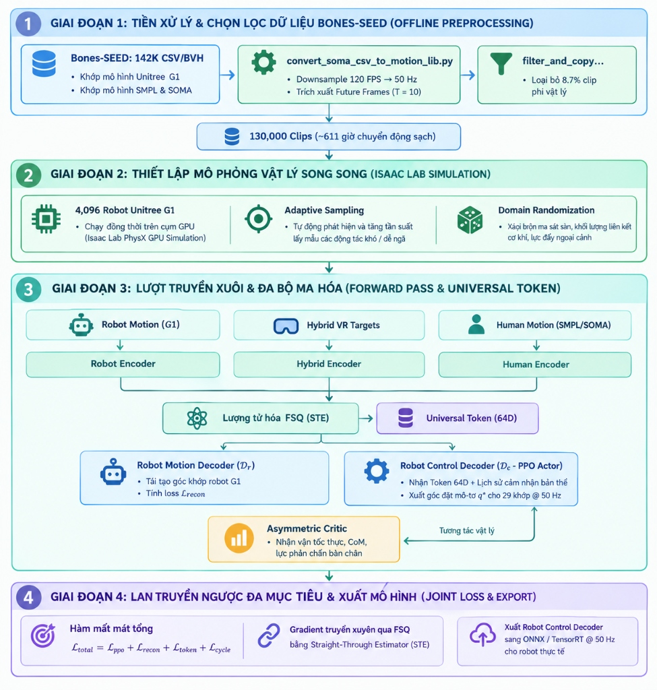
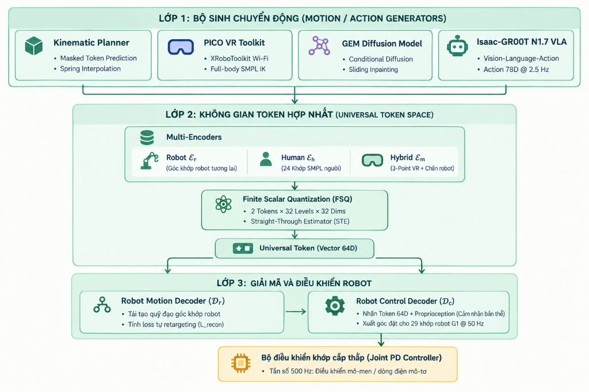
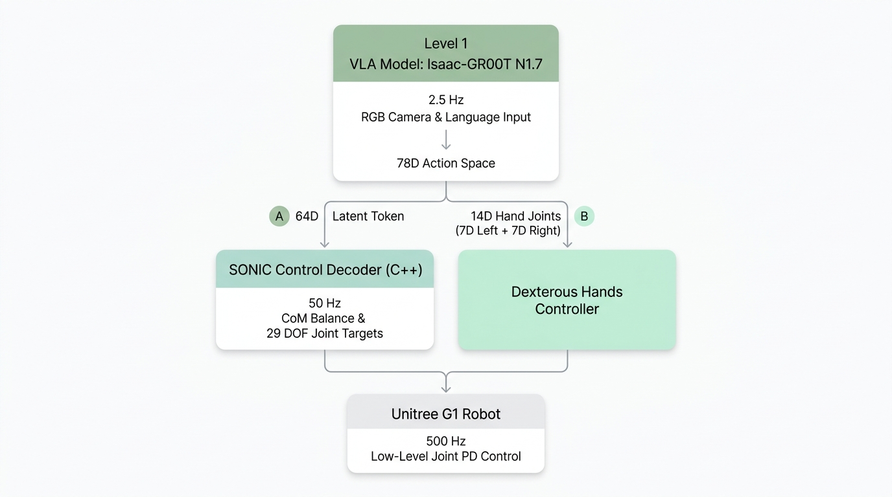

# Báo Cáo Rút Gọn: Kiến Trúc Và Thuật Toán Của GEAR-SONIC

> Báo cáo này là bản rút gọn của [SONIC_ARCHITECTURE_AND_ALGORITHMS_REPORT.md](./SONIC_ARCHITECTURE_AND_ALGORITHMS_REPORT.md), dựa trên paper *SONIC: Supersizing Motion Tracking for Natural Humanoid Whole-Body Control* (arXiv:2511.07820, NVIDIA) và repository [NVlabs/GR00T-WholeBodyControl](https://github.com/NVlabs/GR00T-WholeBodyControl). Các ví dụ tính toán chi tiết, lệnh chạy và danh mục tài liệu đầy đủ được giữ lại trong bản gốc.

## Tóm tắt

SONIC là hệ thống điều khiển toàn thân cho robot hình người Unitree G1 với 29 khớp. Hệ thống được huấn luyện để bắt chước một kho chuyển động người rất lớn, với ý tưởng rằng càng tăng quy mô dữ liệu và mô hình cho bài toán bám theo chuyển động thì robot càng cử động tự nhiên và vững vàng. Điểm then chốt trong kiến trúc là mọi nguồn lệnh, dù là quỹ đạo robot, chuyển động của người, tín hiệu từ kính VR hay đầu ra của một mô hình AI, đều được dịch về cùng một dạng biểu diễn chung gọi là Universal Token 64 chiều. Sau đó, một bộ điều khiển duy nhất đọc token này và biến nó thành chuyển động thật trên robot, đồng thời vẫn giữ được thăng bằng.

---

## 1. Huấn luyện với dữ liệu Bones-SEED trong Isaac Lab

Quá trình huấn luyện bắt đầu từ bộ dữ liệu Bones-SEED, gồm khoảng 142 nghìn đoạn chuyển động người được ghi bằng hệ thống mocap ở 120 khung hình mỗi giây. Dữ liệu này được hạ xuống 50 Hz để khớp với tần số điều khiển của robot, sau đó được chuyển sang góc khớp của G1. Những đoạn chuyển động cần điểm tựa bên ngoài, chẳng hạn leo thang, ngồi tựa ghế, đu xà hay nằm trên giường, bị loại bỏ vì robot không thể thực hiện chúng trên sàn phẳng. Sau bước lọc, khoảng 8,7% dữ liệu bị bỏ đi và còn lại khoảng 130 nghìn đoạn, tương đương 611 giờ chuyển động. Tại mỗi thời điểm, mô hình được cho xem trước 10 khung hình tương lai để biết động tác sắp diễn ra. Toàn bộ dữ liệu cũng được lật gương giữa bên trái và bên phải để robot không bị thiên lệch về một phía.

Việc huấn luyện diễn ra trong môi trường mô phỏng Isaac Lab, nơi 4.096 robot ảo tập luyện song song trên GPU. Hai kỹ thuật giúp quá trình này hiệu quả. Kỹ thuật thứ nhất là lấy mẫu thích ứng: đoạn chuyển động nào khiến robot hay ngã sẽ được chọn để tập lại thường xuyên hơn, nhờ đó robot dành phần lớn thời gian cho các động tác khó như xoay người gắt, ngồi xổm sâu hay nhảy, thay vì lặp lại những động tác đã thành thạo. Kỹ thuật thứ hai là ngẫu nhiên hóa môi trường. Ma sát sàn được thay đổi trong khoảng 0,4 đến 1,2, khối lượng các chi dao động 10%, robot bị đẩy bất ngờ với lực từ 20 đến 80 N, và độ trễ cảm biến được đặt ngẫu nhiên từ 10 đến 30 ms. Vì đã quen với một thế giới luôn thay đổi, bộ điều khiển không bị bất ngờ khi được đưa ra robot thật.

Ở mỗi bước mô phỏng, chuyển động mục tiêu được đưa qua một trong ba bộ mã hóa (dành cho robot, cho người và cho VR) rồi được nén thành token 64 chiều. Mạng Actor đọc token này cùng với dữ liệu cảm biến của robot để quyết định góc khớp mục tiêu, còn mạng Critic đánh giá chất lượng hành động đó. Toàn bộ hệ thống được huấn luyện đồng thời bằng một hàm mất mát tổng:

$$\mathcal{L}_{\text{total}} = \mathcal{L}_{\text{ppo}} + \mathcal{L}_{\text{recon}} + \mathcal{L}_{\text{token}} + \mathcal{L}_{\text{cycle}}$$

Trong đó, thành phần PPO dạy robot thực hiện động tác mà không ngã, còn ba thành phần còn lại dạy mô hình hiểu chuyển động của người và của robot bằng cùng một ngôn ngữ token. Ý nghĩa của từng thành phần được trình bày ở Mục 6.

Phần thưởng mà robot nhận được trong quá trình tập luyện phản ánh bốn mục tiêu. Robot được thưởng khi thân, hai cổ tay và các góc khớp bám sát chuyển động mẫu. Robot cũng được thưởng khi giữ trọng tâm nằm trong vùng đỡ của hai bàn chân và tiếp đất nhẹ nhàng. Ngược lại, robot bị phạt khi mô-men hay vận tốc khớp thay đổi giật cục, vì điều này gây rung và làm nóng động cơ. Cuối cùng, nếu thân robot nghiêng quá 60 độ hoặc đầu gối chạm sàn, lượt tập bị dừng ngay và đoạn chuyển động đó được ghi nhận là thất bại, giúp cơ chế lấy mẫu thích ứng biết cần cho robot tập lại động tác nào.

Khi huấn luyện xong, mạng Critic và bộ giải mã hình học không còn cần thiết nên bị loại bỏ. Chỉ bộ giải mã điều khiển được giữ lại, xuất sang định dạng ONNX, biên dịch thành TensorRT và chạy trên máy tính Jetson Orin gắn trên robot.

---

## 2. Kiến trúc điều khiển ba lớp

SONIC tổ chức việc điều khiển thành ba lớp, mỗi lớp hoạt động ở một tần số khác nhau. Lớp thứ nhất gồm các bộ sinh chuyển động, chạy ở khoảng 2,5 đến 30 Hz, có nhiệm vụ quyết định robot nên cử động như thế nào. Các nguồn ở lớp này gồm Kinematic Planner, kính VR, mô hình GEM và mô hình GR00T. Lớp thứ hai là không gian Universal Token, chạy ở 50 Hz, nơi mọi nguồn chuyển động được dịch về một token chung. Lớp thứ ba lo việc giải mã và thực thi. Bộ giải mã điều khiển chạy ở 50 Hz và xuất ra góc khớp mục tiêu $q^*$, sau đó bộ điều khiển PD trên bo mạch động cơ chạy ở 500 Hz để biến góc mục tiêu thành lực quay thực tế.

Công thức quan trọng nhất ở tầng thấp nhất là công thức của bộ điều khiển PD:

$$\tau = K_p(q^* - q) - K_d\,\dot{q}$$

Số hạng đầu tiên hoạt động giống một lò xo: khớp $q$ càng lệch xa góc mong muốn $q^*$ thì lực kéo về càng lớn. Số hạng thứ hai hoạt động giống một bộ giảm chấn: khớp quay càng nhanh thì lực hãm càng mạnh, nhờ đó khớp không bị rung hay vượt quá đích. Ví dụ, với khớp gối có $K_p = 100$ và $K_d = 4$, nếu gối đang lệch 0,1 rad so với mục tiêu và quay với vận tốc 0,2 rad/s thì mô-men cần tạo ra là $100 \times 0{,}1 - 4 \times 0{,}2 = 9{,}2$ Nm. Có thể hiểu đơn giản rằng mạng nơ-ron chỉ quyết định khớp nên ở góc nào, còn việc dùng bao nhiêu lực để đạt được góc đó thuộc về bộ điều khiển PD.

---

## 3. Kinematic Planner

Kinematic Planner là bộ lập kế hoạch chuyển động, chạy ở 10 Hz. Mỗi lần chạy, nó sinh ra một đoạn chuyển động toàn thân dài từ 0,8 đến 2,4 giây dựa trên lệnh đơn giản của người dùng, chẳng hạn gạt cần điều khiển để đi tới hay rẽ trái. Về bản chất, đây là bài toán điền chuyển động vào khoảng trống: planner biết tư thế hiện tại và tư thế đích, và phải tự sinh ra chuỗi tư thế ở giữa sao cho tự nhiên.

Để giải bài toán này, chuyển động được nén thành một chuỗi token, trong đó các token ở giữa bị che đi và mạng nơ-ron phải đoán lại chúng qua nhiều vòng. Việc đoán tuân theo một lịch hình cosine. Ở những vòng đầu, mạng chỉ chốt vài token mà nó chắc chắn nhất; càng về sau, khi đã có nhiều điểm tựa, mạng chốt nhanh hơn. Với bốn vòng, tỉ lệ token được chốt tăng dần từ 0% lên khoảng 8%, 29%, 62% và cuối cùng là 100%. Cách làm này tránh việc một lần đoán sai ở giai đoạn đầu kéo theo sai lệch cho toàn bộ chuỗi.

Khi người dùng đổi hướng đột ngột, vị trí và hướng của thân robot không được phép nhảy cóc sang giá trị mới, vì điều đó khiến động cơ bị giật và quá dòng. Planner vì vậy dùng một bộ lọc lò xo cản tới hạn, giúp giá trị tiến tới đích nhanh nhất có thể mà không vượt quá hay dao động qua lại. Quỹ đạo sau đó được nội suy lên 50 Hz, trong đó vị trí dùng nội suy tuyến tính và góc quay dùng nội suy cầu SLERP. Mỗi khi có kế hoạch mới, kế hoạch cũ và mới được hòa trộn dần trong 8 khung hình, tức khoảng 160 ms, để chuyển tiếp không bị giật. Ngoài ra, góc quay được biểu diễn bằng hai cột đầu của ma trận quay (biểu diễn 6D) thay vì góc Euler hay quaternion. Góc Euler gặp hiện tượng khóa trục, còn quaternion có hai giá trị đối nhau cùng biểu diễn một góc quay, và cả hai đặc điểm này đều gây khó khăn cho mạng nơ-ron. Biểu diễn 6D liên tục nên mạng học dễ hơn.

---

## 4. PICO VR Toolkit

PICO VR Toolkit cho phép người vận hành điều khiển robot từ xa bằng kính thực tế ảo PICO 4, với dữ liệu được truyền qua Wi-Fi ở tần số 60 đến 100 Hz. Công cụ này có hai chế độ hoạt động.

Ở chế độ toàn thân, người vận hành đeo kính, cầm hai tay cầm và gắn thêm hai thiết bị theo dõi ở cổ chân, tổng cộng năm điểm đo. Từ năm điểm này, hệ thống dùng động học nghịch để dựng lại toàn bộ khung xương người theo mô hình SMPL 24 khớp, và robot bắt chước theo khung xương đó.

Ở chế độ bán thân, người vận hành chỉ cần kính và hai tay cầm. Thân trên và thân dưới được xử lý tách biệt. Hai tay robot bắt chước trực tiếp tay người, trong khi người vận hành dùng cần analog trên tay cầm để ra lệnh vận tốc di chuyển. Lệnh vận tốc này được chuyển cho Kinematic Planner, và planner tự lo việc bước chân và giữ thăng bằng. Nhờ vậy, người vận hành có thể đứng yên một chỗ mà vẫn điều khiển được robot đi lại và thao tác bằng tay.

---

## 5. GEM: sinh chuyển động từ video, văn bản và âm nhạc

GEM là mô hình nền tảng của NVIDIA có khả năng sinh chuyển động người ba chiều từ nhiều loại đầu vào: video quay bằng một camera thông thường, một câu mô tả bằng văn bản hoặc một bản nhạc. Đầu ra là chuyển động theo khung xương SOMA 77 khớp, đủ chi tiết đến từng ngón tay.

Ý tưởng chính của GEM là xem việc ước lượng dáng người từ video cũng là một bài toán sinh chuyển động, chỉ khác ở chỗ chuyển động sinh ra phải khớp với các điểm khớp hai chiều nhìn thấy trong ảnh. Mô hình hoạt động theo cơ chế diffusion: nó bắt đầu từ nhiễu ngẫu nhiên và khử nhiễu dần qua nhiều bước cho tới khi thu được một chuyển động hợp lý. Để đạt tốc độ thời gian thực từ 60 khung hình mỗi giây trở lên, GEM xử lý dữ liệu theo các cửa sổ trượt gối đầu nhau, và phần nối giữa hai cửa sổ liên tiếp được sinh lại cho khớp với cả hai phía để chuyển động không bị giật.

---

## 6. Universal Control Policy

Universal Control Policy là trung tâm của SONIC. Khối này kết hợp học tăng cường với kỹ thuật lượng tử hóa để một bộ điều khiển duy nhất có thể nhận chuyển động từ mọi nguồn.

### 6.1. Actor và Critic bất đối xứng

Thuật toán học tăng cường được sử dụng là PPO với hai mạng có quyền truy cập thông tin khác nhau. Mạng Actor là mạng sẽ chạy trên robot thật, vì vậy nó chỉ được thấy những gì robot thật có thể đo được: token 64 chiều cùng dữ liệu cảm biến của 10 khung hình gần nhất, bao gồm góc khớp, vận tốc khớp và cảm biến quán tính, tất cả đều có nhiễu. Mạng Critic chỉ tồn tại trong mô phỏng và được thấy đầy đủ các đại lượng vật lý thật như vận tốc thân, vị trí trọng tâm, lực tiếp xúc của bàn chân với sàn và hệ số ma sát. Có thể hình dung Critic như một huấn luyện viên có sẵn đáp án. Nhờ Critic chấm điểm chính xác, Actor học nhanh và vững hơn, dù bản thân Actor chỉ dựa vào cảm biến thông thường.

### 6.2. Lượng tử hóa FSQ

Để biến đầu ra liên tục của các bộ mã hóa thành token rời rạc, SONIC dùng phương pháp lượng tử hóa vô hướng hữu hạn (FSQ):

$$z = \text{round}\!\left(\tanh(x)\cdot\frac{L-1}{2}\right)$$

Công thức này thực hiện ba việc theo thứ tự. Hàm tanh ép mỗi giá trị vào khoảng từ −1 đến 1, phép nhân trải khoảng đó ra thành $L$ nấc, và phép làm tròn đưa giá trị về đúng một nấc. Chẳng hạn, với $L = 5$ nấc gồm −2, −1, 0, 1 và 2, giá trị $x = 0{,}85$ cho $\tanh(x) \approx 0{,}69$, nhân với 2 được 1,38 và làm tròn thành 1. SONIC sử dụng hai token, mỗi token 32 chiều, tổng cộng 64 chiều.

Lý do SONIC chọn FSQ thay vì VQ-VAE nằm ở cách hai phương pháp tạo token. VQ-VAE phải tra cứu trong một từ điển vector, và khi dữ liệu quá đa dạng, phần lớn từ điển thường không bao giờ được dùng đến, hiện tượng được gọi là sụp đổ từ điển. FSQ không có từ điển mà chỉ làm tròn theo một lưới cố định, nên tránh được vấn đề này.

Phép làm tròn lại có đạo hàm bằng 0, nghĩa là gradient không thể truyền ngược qua nó để cập nhật các bộ mã hóa. SONIC giải quyết điều này bằng kỹ thuật Straight-Through Estimator: khi lan truyền ngược, bước làm tròn được coi như không tồn tại và đạo hàm của nó được xem bằng 1, nhờ đó gradient đi thẳng về các bộ mã hóa.

### 6.3. Bốn thành phần của hàm mất mát

Gọi $z_r$, $z_h$ và $z_m$ lần lượt là token do bộ mã hóa robot, người và VR tạo ra, $g_r$ là góc khớp đúng của robot, và $\mathcal{D}_r$ là bộ giải mã hình học. Hàm mất mát tổng gồm bốn thành phần, mỗi thành phần ép mô hình học một điều khác nhau.

Thành phần $\mathcal{L}_{\text{ppo}}$ là hàm mục tiêu chuẩn của thuật toán PPO. Nó khuyến khích robot tối đa hóa phần thưởng, tức là bám sát chuyển động mẫu mà không bị ngã.

Thành phần tái tạo yêu cầu rằng từ token của bất kỳ nguồn nào, bộ giải mã cũng phải khôi phục được đúng góc khớp robot:

$$\mathcal{L}_{\text{recon}} = \sum_{i \in \{r,h,m\}} \lVert \mathcal{D}_r(z_i) - g_r \rVert^2$$

Điều đáng chú ý là khi token đến từ chuyển động người, thành phần này buộc mô hình tự học cách chuyển đổi tư thế người sang tư thế robot, vốn được gọi là retargeting, mà không cần một bộ giải hình học riêng.

Thành phần căn chỉnh token yêu cầu rằng với cùng một động tác, token của robot, người và VR phải nằm gần nhau:

$$\mathcal{L}_{\text{token}} = \lVert z_r - z_h\rVert^2 + \lVert z_r - z_m\rVert^2 + \lVert z_m - z_h\rVert^2$$

Cuối cùng, thành phần nhất quán vòng lặp $\mathcal{L}_{\text{cycle}} = \lVert \mathcal{E}_r(\mathcal{D}_r(z_h)) - z_r \rVert^2$ kiểm tra rằng khi đi một vòng từ token người sang góc khớp robot rồi mã hóa ngược lại, kết quả vẫn trùng với token robot ban đầu. Điều này bảo đảm thông tin chuyển động không bị mất qua các lần mã hóa và giải mã.

### 6.4. Hai bộ giải mã

SONIC có hai bộ giải mã với vai trò rất khác nhau. Bộ giải mã hình học $\mathcal{D}_r$ chỉ nhận token và trả lời câu hỏi dáng này tương ứng với những góc khớp robot nào. Nó hoàn toàn không biết gì về vật lý: không biết robot đang nghiêng hay thẳng, cũng không biết chân có đang chạm đất hay không. Nếu đưa thẳng đầu ra của nó vào động cơ, robot sẽ ngã ngay. Vì vậy, $\mathcal{D}_r$ chỉ dùng để tính các hàm mất mát trong lúc huấn luyện và bị loại bỏ khi triển khai.

Bộ giải mã điều khiển $\mathcal{D}_c$ mới là bộ điều khiển thực sự chạy trên robot. Nó nhận cả token lẫn dữ liệu cảm biến cơ thể, và nhờ được huấn luyện bằng PPO trong môi trường có trọng lực, quán tính và ma sát, nó học được cách đạt dáng mong muốn trong khi vẫn giữ thăng bằng. Đầu ra của $\mathcal{D}_c$ được gửi xuống bộ điều khiển PD ở tần số 50 Hz.

---

## 7. Tích hợp với mô hình Isaac-GR00T N1.7

Isaac-GR00T N1.7 là mô hình thị giác, ngôn ngữ và hành động (VLA). Khi kết hợp với SONIC, hai hệ thống chia nhau trách nhiệm một cách rõ ràng. GR00T chạy ở 2,5 Hz và quyết định robot cần làm gì: nó nhìn hình ảnh từ camera, hiểu câu lệnh như nhặt chai nước, và đưa ra ý định hành động. SONIC chạy ở 50 Hz và 500 Hz, quyết định cách thực hiện ý định đó bằng cách tự điều phối trọng tâm, bước chân và tư thế để robot không bị ngã.

Ở mỗi lần suy luận, GR00T xuất ra một vector hành động 78 chiều:

$$\mathbf{a}_{\text{VLA}} = [\underbrace{\text{token SONIC}}_{64\text{D}},\ \underbrace{\text{khớp tay trái}}_{7\text{D}},\ \underbrace{\text{khớp tay phải}}_{7\text{D}}]$$

Cách chia này đã được đối chiếu với tài liệu chính thức trong repository ([vla_inference.md](./docs/source/tutorials/vla_inference.md), [vla_workflow.md](./docs/source/tutorials/vla_workflow.md)) và phần khai báo dữ liệu trong [features_sonic_vla.py](./gear_sonic/data/features_sonic_vla.py). Nhờ token SONIC, GR00T không cần tính quỹ đạo cho từng khớp chân hay khớp hông, mà chỉ cần diễn đạt ý định bằng ngôn ngữ token mà SONIC đã hiểu sẵn. Phần di chuyển của thân dưới nằm trong chính token 64 chiều này.

Quy trình sử dụng GR00T với SONIC gồm ba bước. Đầu tiên, người vận hành dùng kính VR để điều khiển robot làm mẫu một tác vụ khoảng 50 đến 100 lần, và dữ liệu được lưu theo định dạng LeRobot v2.1. Tiếp theo, mô hình GR00T N1.7 được tinh chỉnh trên bộ dữ liệu vừa thu. Cuối cùng, robot chạy tự hành, trong đó GR00T suy luận ở 2,5 Hz và SONIC điều khiển toàn thân ở 50 Hz.

---

## 8. Triển khai trên robot thật

Trên máy tính Jetson Orin của robot, hệ thống chạy bốn luồng song song với các tần số khác nhau. Luồng đầu vào đọc tín hiệu từ tay cầm, bàn phím hoặc kính VR ở 100 Hz. Luồng Kinematic Planner sinh quỹ đạo dài khoảng 2 giây ở 10 Hz, mỗi lần mất khoảng 12 ms. Luồng điều khiển chạy bộ mã hóa và policy ở 50 Hz, mỗi lần chỉ mất 1 đến 2 ms nhờ TensorRT kết hợp với CUDA Graph, kỹ thuật ghi sẵn chuỗi lệnh GPU để bỏ qua chi phí khởi tạo mỗi lần chạy. Luồng ghi lệnh gửi góc mục tiêu xuống bo mạch động cơ ở 500 Hz.

Hệ thống cũng có một chế độ an toàn. Nếu mất tín hiệu hoặc phát hiện vận tốc khớp bất thường, hệ số $K_p$ được đặt về 0 và chỉ giữ lại thành phần giảm chấn với $K_d = 8$. Khi đó robot không còn cố giữ tư thế mà mềm ra và hạ xuống từ từ, tránh ngã mạnh gây hỏng khung cơ khí.

---

## 9. Kết luận

Khả năng thực hiện nhiều loại động tác của SONIC đến từ quy mô huấn luyện: 130 nghìn đoạn chuyển động được luyện song song trên 4.096 robot ảo, với cơ chế tự động ưu tiên các động tác khó. Khả năng nhận lệnh từ nhiều nguồn khác nhau như kính VR, video hay mô hình GR00T đến từ việc quy mọi chuyển động về cùng một Universal Token 64 chiều thông qua FSQ và bốn hàm mất mát căn chỉnh. Cuối cùng, sự ổn định trên robot thật đến từ việc phân tầng tần số hợp lý: GR00T suy nghĩ ở 2,5 Hz, policy giữ thăng bằng ở 50 Hz, và bộ điều khiển PD xử lý lực ở 500 Hz.

## Tài liệu tham khảo chính

1. Schulman et al., [Proximal Policy Optimization Algorithms](https://arxiv.org/abs/1707.06347), 2017.
2. Pinto et al., [Asymmetric Actor Critic for Image-Based Robot Learning](https://arxiv.org/abs/1710.06537), RSS 2018.
3. Mentzer et al., [Finite Scalar Quantization: VQ-VAE Made Simple](https://arxiv.org/abs/2309.15505), ICLR 2024.
4. Guo et al., [MoMask: Generative Masked Modeling of 3D Human Motions](https://arxiv.org/abs/2312.00063), CVPR 2024.
5. Zhou et al., [On the Continuity of Rotation Representations in Neural Networks](https://arxiv.org/abs/1812.07035), CVPR 2019.
6. Li et al., [GenMo: A Generalist Model for Human Motion](https://arxiv.org/abs/2506.01234), ICCV 2025.
7. Loper et al., [SMPL: A Skinned Multi-Person Linear Model](https://smpl.is.tue.mpg.de/), ACM TOG 2015.
8. [XRoboToolkit](https://github.com/XR-Robotics/XRoboToolkit), [Isaac Lab](https://isaac-sim.github.io/IsaacLab/), [Bones-SEED Dataset](https://huggingface.co/datasets/bones-studio/seed), [NVIDIA TensorRT](https://developer.nvidia.com/tensorrt).
