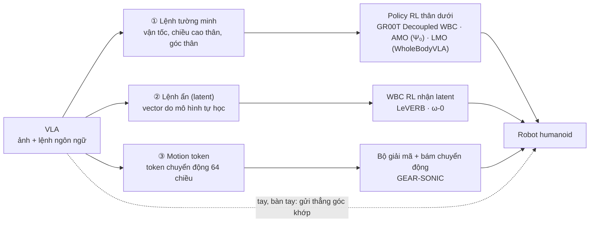

# Tổng hợp: VLA cho humanoid có dùng WBC (bộ điều khiển toàn thân)

> Tổng hợp ngày 29/09/2026 từ tóm tắt (abstract), trang dự án và tài liệu của từng bài, cùng code NVIDIA đã dùng trong dự án.
> Chưa đọc toàn văn từng bài. Chỗ nào nguồn không nói rõ thì ghi **?**. Chỗ nào là suy luận của người viết thì ghi *(suy luận)*.

---

## 1. Vì sao VLA cho humanoid cần WBC

VLA tốt ở việc hiểu ảnh và lệnh ngôn ngữ để quyết định **làm gì**. Nhưng humanoid phải **giữ thăng bằng** trong lúc với tay, bước đi hay ngồi xuống. Việc này cần phản xạ nhanh (50 Hz trở lên) và bám sát động lực học, mà VLA chạy chậm (vài Hz) nên không kham nổi.

Vì thế gần như mọi hệ VLA cho humanoid đều chia hai tầng:
- **VLA**: quyết định làm gì, điều khiển tay và bàn tay.
- **WBC** (whole-body controller): thường là một policy train bằng RL, lo chân, eo và thăng bằng.

Khác biệt chính giữa các hệ là **VLA gửi gì xuống cho WBC**.

| Kiểu giao diện | Ưu điểm | Nhược điểm |
|---|---|---|
| ① Lệnh tường minh | Dễ hiểu, dễ gỡ lỗi. Teleop thu dữ liệu dễ (tracker chân ra lệnh đi). | Chỉ làm được những gì bộ lệnh mô tả được, thường là đi, xoay, đổi độ cao thân. Khó làm động tác toàn thân linh hoạt. |
| ② Lệnh ẩn | Biểu diễn được động tác toàn thân phong phú hơn. | Khó diễn giải. VLA và WBC phải học khớp với nhau. |
| ③ Motion token | WBC đã được train trên rất nhiều chuyển động người, nên "miễn phí" có thăng bằng và chuyển động tự nhiên. | Phụ thuộc bộ mã hoá chuyển động. Cần dữ liệu có nhãn token. |

---

## 2. Bảng tổng hợp

| Model | Nhóm | Thời điểm | Robot | VLA gửi xuống WBC | WBC | Code / trọng số |
|---|---|---|---|---|---|---|
| **GR00T N1.5 / N1.6 + Decoupled WBC** | NVIDIA | 11/2025 | Unitree G1 | ① Chiều cao thân, góc thân (rpy), lệnh đi (vx, vy, yaw). Tay và bàn tay điều khiển trực tiếp. | Policy RL Balance / Walk, điều khiển 15 khớp chân + eo | Có (repo GR00T-WholeBodyControl) |
| **GR00T + GEAR-SONIC** | NVIDIA | 2025–2026 | Unitree G1 | ③ Motion token 64 chiều + 7 + 7 khớp bàn tay (78 chiều), VLA chạy 2.5 Hz | SONIC giải mã token thành lệnh khớp toàn thân ở 50 Hz | SONIC: có 3 checkpoint. VLA cho tag SONIC: chưa công bố |
| **Ψ₀ (Psi-Zero)** | Physical Superintelligence Lab | 03/2026, RSS'26 | Unitree G1 + bàn tay Dex3-1 (7 DoF/tay) | ① 8 lệnh thân dưới: góc thân rpy, chiều cao, vx, vy, vyaw, … Tổng hành động 36 chiều, chunk 16, 30 Hz | **AMO** (policy RL), gọi là "System 0" | Có repo GitHub. Bài hứa công bố trọng số, chưa kiểm tra |
| **WholeBodyVLA** | OpenDriveLab | ICLR 2026 | AgiBot X2 | ① Lệnh di chuyển (tiến, xoay, ngồi xuống). Latent chỉ dùng để học từ video không nhãn hành động. | **LMO** (policy RL cho loco-manipulation) | Có code + checkpoint (theo repo) |
| **LeVERB** | Berkeley (EMBER lab) | 06/2025 | humanoid thật, model **?** | ② "Latent verb": từ vựng hành động ẩn học từ demo chuyển động dựng trong sim | WBC train bằng RL | ? |
| **ω-0** | ? | 08/2026 | humanoid, model **?** | ② Latent hành động toàn thân "tương thích với controller" | controller nhận latent, chi tiết **?** | ? |
| **HAF** | ? | 08/2026 | humanoid, model **?** | ? Sinh hành động toàn thân theo 3 tầng: đi lại → tư thế eo → hai tay | ? | ? |

---

## 3. Chi tiết từng model

### 3.1. GR00T N1.5 / N1.6 + Decoupled WBC (NVIDIA)
- **Ý tưởng:** tách thân trên và thân dưới. VLA điều khiển trực tiếp góc khớp tay, bàn tay (và có thể cả eo). Thân dưới giao cho policy RL.
- **Giao diện:** theo code NVIDIA mà dự án đã dùng (`bridge/lower_body_policy.py`, làm theo `g1_decoupled_whole_body_policy.py`):
  - Policy **Balance** (đứng) hoặc **Walk** (đi) nhận quan sát 86 chiều × 6 bước.
  - Lệnh điều khiển gồm chiều cao thân (`height_cmd`), góc thân rpy, lệnh đi.
  - Đầu ra là mục tiêu cho **15 khớp chân + eo**.
- **Trong embodiment REAL_G1 của GR00T N1.7**, action có sẵn `base_height_command` (1) và `navigate_command` (3). Đây chính là chỗ VLA ra lệnh cho WBC.

### 3.2. GR00T + GEAR-SONIC (NVIDIA)
- **Ý tưởng:** VLA **không** ra góc khớp mà ra **motion token**. SONIC, một bộ bám chuyển động toàn thân đã train trên rất nhiều chuyển động người, giải mã token thành lệnh khớp.
- **Giao diện** (theo tài liệu GR00T-WholeBodyControl): mỗi bước VLA ra *"64-dim motion token + 7-dim left hand joints + 7-dim right hand joints"*, chạy **2.5 Hz**. SONIC giải mã ở **50 Hz**.
- Theo tài liệu, VLA chỉ cần *"reason about what to do — SONIC handles the how: balance, locomotion, and smooth whole-body coordination"*.
- **Tình trạng:** SONIC có 3 checkpoint cho G1. Chưa có checkpoint VLA hay dataset công khai cho tag `UNITREE_G1_SONIC` (memo mục 1).

### 3.3. Ψ₀ (Psi-Zero)
- **Kiến trúc 3 tầng**, bài tự đặt tên:
  - **System 2:** backbone Qwen3-VL-2B.
  - **System 1:** action expert MM-DiT khoảng 500M tham số, flow matching. Tổng cả model hơn 2.5B tham số, mỗi lần suy luận khoảng 160 ms.
  - **System 0:** **AMO**, policy RL bám lệnh thân dưới.
- **Hành động 36 chiều:** 14 khớp bàn tay + 14 khớp tay + 8 lệnh thân dưới. Chunk 16, 30 Hz.
- **Dữ liệu:**
  - Pretrain trên khoảng 829 giờ video người góc nhìn thứ nhất (EgoDex) + 31 giờ Humanoid Everyday.
  - Post-train trên khoảng 30 giờ teleop, gồm PICO4U + tracker cổ tay, găng MANUS cho ngón tay, tracker chân để ra lệnh đi.
- **Kết quả:** học một kỹ năng dài hạn mới chỉ với khoảng 80 quỹ đạo. Tỉ lệ thành công cao hơn ít nhất 40% so với baseline đứng thứ hai (**GR00T N1.6**). Các baseline khác: π0.5, InternVLA-M1, H-RDT, EgoVLA, Diffusion Policy, ACT.

### 3.4. WholeBodyVLA (OpenDriveLab, ICLR 2026)
- **Robot:** AgiBot X2.
- **Hai phần:**
  - *Unified latent learning*: cho VLA học từ video góc nhìn thứ nhất **không có nhãn hành động**, để bù cho việc có ít dữ liệu teleop humanoid.
  - **LMO**: policy RL chuyên cho các động tác loco-manipulation cốt lõi (tiến, xoay, ngồi xuống), nhận lệnh di chuyển từ VLA.
- **Kết quả:** hơn baseline trước đó 21.3%. Làm liên tiếp được: gắp bằng hai tay, bước ngang tới hộp, ngồi xuống đặt hộp, bê hộp rồi xoay đặt lên xe, đẩy vật nặng trên 50 kg.

### 3.5. LeVERB
- **Ý tưởng:** các VLA trước đây giả định có sẵn một "bộ từ vựng hành động" tự thiết kế (pose end-effector, vận tốc thân), nên chỉ làm được task gần như tĩnh. LeVERB để policy thị giác–ngôn ngữ **tự học từ vựng hành động ẩn** ("latent verb") từ demo chuyển động dựng trong sim. Một WBC train bằng RL thực thi các lệnh ẩn đó.
- **Benchmark LeVERB-Bench:** hơn 150 task thuộc 10 nhóm.
- **Kết quả:** 80% trên task điều hướng đơn giản, 58.5% tổng thể, hơn baseline 7.8 lần. Tác giả gọi đây là lần đầu điều khiển toàn thân humanoid thật bằng ảnh và ngôn ngữ, với kiến trúc latent phân tầng.

### 3.6. ω-0
- Là một **world action model**: vừa dự đoán tương lai trong không gian latent (nhúng quan sát tương lai, không dựng lại cả video), vừa sinh **latent hành động toàn thân tương thích với controller** bằng diffusion.
- Dùng mô phỏng qua controller để biến dữ liệu chuyển động người và dữ liệu công khai thành latent mà robot thực thi được.
- **Kết quả:** 11 task gia đình, dataset thật hơn 40 giờ (ω-HOME). Hơn các baseline imitation learning, VLA, humanoid và WAM. Làm được "vừa đi vừa thao tác" mượt.

### 3.7. HAF
- **HAF-VLA:** chỉnh một VLA tổng quát có sẵn để sinh hành động toàn thân theo **3 tầng nối tiếp**: đi lại → tư thế eo → hai tay. Các tầng nối với nhau bằng KV cache, để hành động toàn thân không bị rời rạc.
- **HAF-Steer:** tinh chỉnh bằng RL (SAC) trên một **không gian nhiễu thu gọn** (DCT), dựa vào tính khả nghịch của flow matching. Không động vào backbone VLA.
- **Kết quả:** 7 task thật, tốt hơn VLA một tầng. Bài không nói rõ VLA gốc là model nào, và bên dưới có WBC riêng hay không.

---

## 4. Liên quan nhưng không phải kiểu "VLA + WBC tách rời"

| Bài | Vì sao liên quan | Ghi chú |
|---|---|---|
| **HEX** (04/2026) | Thao tác toàn thân trên humanoid cỡ lớn, học từ dữ liệu nhiều loại robot | Dùng bộ dự đoán proprioception kiểu Mixture-of-Experts + action head flow matching, **không** dùng policy RL thân dưới riêng |
| **WOLF-VLA** (06/2026) | VLA sinh chính policy đi lại từ lệnh ngôn ngữ | Train trên chuyển động do tối ưu điều khiển (optimal control) tạo ra, 6 nhóm task đi lại. Robot: ? |
| **LEGS** (06/2026) | **Unitree G1**. Fine-tune **Ψ₀, π0.5, GR00T N1.6** hoàn toàn bằng dữ liệu tổng hợp | Là phương pháp tạo dữ liệu, không phải VLA mới. Dùng mesh robot/vật lồng lên nền Gaussian Splatting chụp từ cảnh thật. Policy train bằng dữ liệu tổng hợp bằng hoặc hơn policy train bằng teleop |
| **π0.7** (Physical Intelligence, 04/2026) | VLA mạnh nhất hiện tại về ghép kỹ năng và chuyển robot | **Không có humanoid**: chỉ tay máy, đế bánh xe, kẹp hai ngón (xem `PI/PAPER_PI07_VI.md`) |

---

## 5. Liên hệ với dự án GR00T N1.7 + SONIC (nhận xét riêng)

- **Dự án hiện đang ở kiểu ①.** `--lower-body balance` dùng chính policy Balance của Decoupled WBC (memo mục 5.2f). Tuy vậy VLA mới chỉ điều khiển tay, bàn tay và eo; chiều cao thân và lệnh đi đang cố định (`height_cmd` = 0.82, lệnh đi = 0). Hai trường `base_height_command` và `navigate_command` trong action REAL_G1 **chưa được dùng**.
- **Hướng ③ (SONIC)** là đích của nhánh SONIC, nhưng bị chặn vì chưa có checkpoint VLA hay dataset cho tag `UNITREE_G1_SONIC`.
- **Ψ₀ là bài đối chiếu gần nhất:** cùng G1, cùng bàn tay 7 DoF, cùng kiến trúc "VLA ra lệnh thân dưới, policy RL thực thi", và so trực tiếp với GR00T N1.6. Cách họ chọn 8 lệnh thân dưới là mẫu tốt nếu dự án muốn cho VLA ra lệnh chiều cao thân và đi lại. *(suy luận)*
- **LEGS** gần với hướng dữ liệu của dự án: sinh dữ liệu trong sim thay vì teleop, trên G1, fine-tune GR00T N1.6. Kỹ thuật nền Gaussian Splatting có thể giúp giảm chênh lệch hình ảnh giữa sim và thật. *(suy luận)*
- **WholeBodyVLA** có code + checkpoint công khai, phù hợp để tham khảo cách huấn luyện LMO nếu cần động tác ngồi xổm hay bê vật nặng.

---

## 6. Nguồn

- [NVlabs/GR00T-WholeBodyControl (GitHub)](https://github.com/NVlabs/GR00T-WholeBodyControl) · [Tài liệu: VLA workflow với SONIC](https://nvlabs.github.io/GR00T-WholeBodyControl/tutorials/vla_workflow.html)
- [Ψ₀, arXiv 2603.12263](https://arxiv.org/html/2603.12263.pdf) · [GitHub physical-superintelligence-lab/Psi0](https://github.com/physical-superintelligence-lab/Psi0)
- [WholeBodyVLA, arXiv 2512.11047](https://arxiv.org/abs/2512.11047) · [GitHub OpenDriveLab/WholebodyVLA](https://github.com/OpenDriveLab/WholebodyVLA)
- [LeVERB, arXiv 2506.13751](https://arxiv.org/abs/2506.13751)
- [ω-0, arXiv 2608.06375](https://arxiv.org/abs/2608.06375)
- [HAF, arXiv 2608.16837](https://arxiv.org/abs/2608.16837)
- [HEX, arXiv 2604.07993](https://arxiv.org/abs/2604.07993)
- [WOLF-VLA, arXiv 2606.25591](https://arxiv.org/abs/2606.25591)
- [LEGS, arXiv 2606.01458](https://arxiv.org/abs/2606.01458)
- Code trong dự án: `bridge/lower_body_policy.py`, `third_party/GR00T-WholeBodyControl` (memo mục 5.2f)
