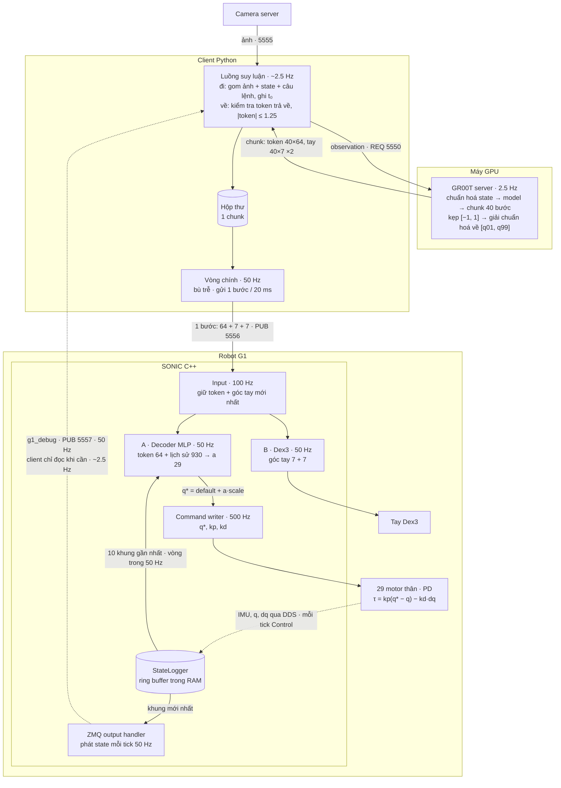
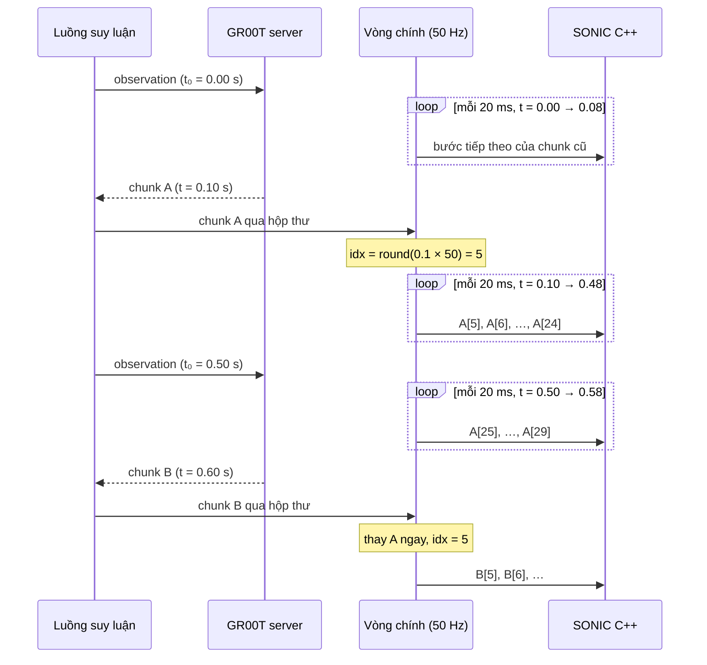
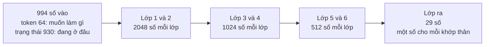
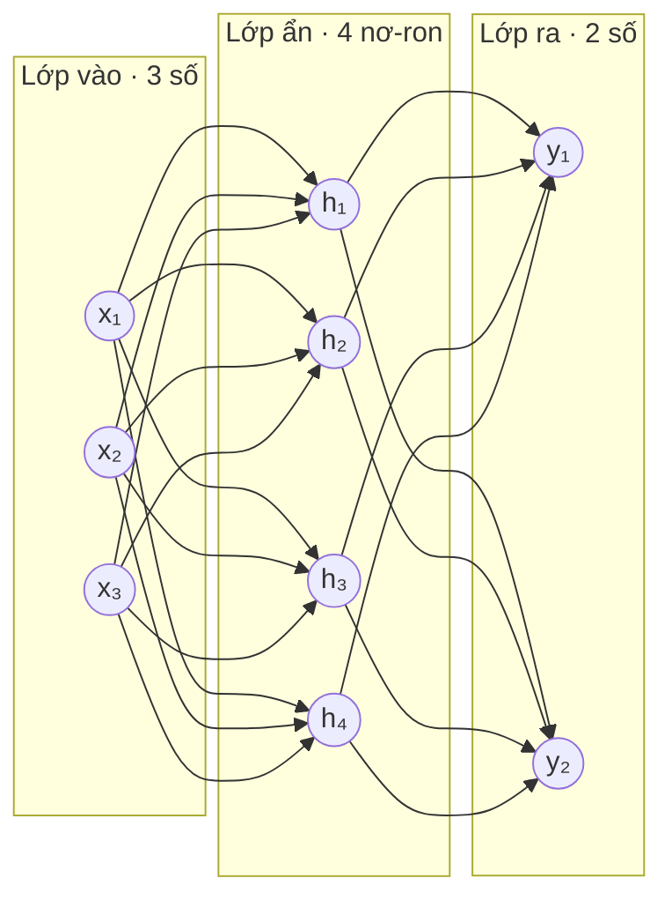
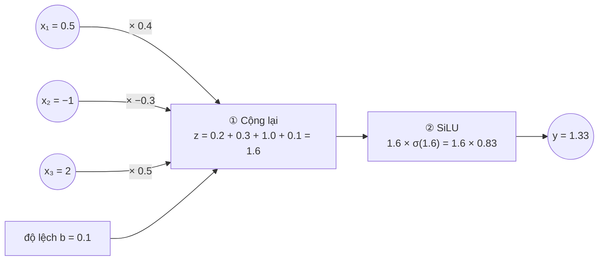

# GR00T N1.7 ↔ GEAR-SONIC: luồng kết nối và tiền xử lý dữ liệu

Ngày: 28/09/2026.

Tài liệu mô tả cách **NVIDIA** nối VLA GR00T với bộ điều khiển toàn thân SONIC, theo code gốc. Những chỗ repo này đang làm khác nằm ở [PLAN_SONIC_INTEGRATION.md](PLAN_SONIC_INTEGRATION.md).

Tham chiếu:
- `third_party/GR00T-WholeBodyControl` @ `b042411`
- `third_party/Isaac-GR00T` @ `51d4c89`
- Checkpoint `checkpoints/GEAR-SONIC/` (bản `sonic_release`)
- Paper SONIC, arXiv 2511.07820v4

Slide minh hoạ: https://claude.ai/artifact/HxDH4cvi5ev4GZxe5ck4hT

---

## 0. Tóm tắt

- Hai model nói chuyện với nhau bằng **token 64 số**:
  - GR00T dự đoán token;
  - decoder của SONIC biến token thành góc cho 29 khớp thân.
- Hai model chạy ở **hai nhịp khác nhau**, nối bằng một **client Python** ở giữa:
  - GR00T: khoảng 2.5 Hz, mỗi lần ra một chunk 40 bước;
  - client: gửi sang SONIC 1 bước mỗi 20 ms (50 Hz).
- Có **hai vòng kín lồng nhau**:
  - vòng ngoài 2.5 Hz: GR00T nhìn ảnh và quyết định làm gì;
  - vòng trong 50 Hz: SONIC dùng token cộng trạng thái thật của robot để giữ thăng bằng và bám chuyển động.
- Góc hai bàn tay (7 + 7) đi cùng message nhưng **không qua decoder**. Chúng đi thẳng tới Dex3.
- Giá trị token được **server kẹp** về khoảng của dataset trước khi gửi đi. Phép kiểm tra 1.25 ở client chỉ là lớp dự phòng.

### Thuật ngữ: "khung" (frame)

Trong tài liệu này, **"khung" là một thời điểm của dữ liệu chuyển động hoặc trạng thái**: một "ảnh chụp" tư thế robot dưới dạng **các con số**, không phải khung hình camera.

Ví dụ một khung trong đầu vào của encoder:

```
khung tại thời điểm t:
  29 góc khớp        [0.12, −0.31, 0.67, …]
  29 vận tốc khớp    [0.05,  0.00, −0.20, …]
  hướng thân (6D)    [0.99,  0.01, …]
```

"10 khung" xuất hiện ở hai chỗ, ý nghĩa khác nhau:

| Chỗ | Một khung là | Số khung | Cách nhau | Tổng thời gian | Nguồn |
|---|---|---|---|---|---|
| **Encoder** (tạo token, lúc gán nhãn dữ liệu) | tư thế **mong muốn** trong **tương lai**: 29 góc khớp, 29 vận tốc khớp, hướng thân | 10 | 0.1 s (`step5` ở 50 Hz) | khoảng 1 s tới | `motion_*_10frame_step5` trong `observation_config.yaml` |
| **Decoder** (lịch sử 930 số, mỗi tick) | trạng thái **đo được** trong **quá khứ**: gyro, q − default, dq, action trước, trọng lực | 10 | 0.02 s (`step1` ở 50 Hz) | 0.2 s vừa qua | `his_*_10frame_step1` trong `observation_config.yaml` |

Các cách dùng khác của chữ "khung/bước":
- **Một bước của chunk** (40 bước, cách nhau 0.02 s) cũng là một khung dữ liệu 50 Hz.
- **Khung hình camera** thật chỉ có ở đầu vào của GR00T: `ego_view`, **1 khung** ở cấu hình `unitree_g1_sonic`. Encoder và decoder của SONIC **không bao giờ nhìn ảnh**.

Hệ quả: mỗi token mô tả 1 s chuyển động **tính từ thời điểm của nó**. Hàng thứ k trong chunk ứng với `t₀ + k × 20 ms`, nên hai token liền nhau chồng lên nhau khoảng 98% thời gian. Nhờ vậy mục tiêu gửi cho decoder thay đổi từ từ, và chuyển động liền mạch.

---

## 1. Thành phần và cổng

| Thành phần | Chạy ở đâu | File chính | Cổng |
|---|---|---|---|
| GR00T PolicyServer | máy có GPU | `Isaac-GR00T/gr00t/eval/run_gr00t_server.py` | 5550 (REP) |
| Client VLA | máy inference (có thể trùng máy GPU) | `gear_sonic/scripts/run_vla_inference.py` | gọi 5550 (REQ), phát 5556 (PUB), nhận 5555 và 5557 (SUB) |
| Camera server | trên robot | dịch vụ systemd | 5555 |
| SONIC C++ deploy | trên robot | `gear_sonic_deploy/.../g1_deploy_onnx_ref.cpp` | nhận 5556, phát state 5557 (topic `g1_debug`) |

Mọi địa chỉ mặc định trong client là `localhost`. Khi tách máy, truyền IP qua tham số dòng lệnh.

---

## 2. Sơ đồ



<details>
<summary>Bản ASCII (khi trình xem không hỗ trợ mermaid)</summary>

```
 Camera ──5555──┐                       ┌──────── GPU: GR00T server (2.5 Hz) ────────┐
                ▼                       │ chuẩn hoá state → model → chunk 40 bước    │
 ┌──────── Client Python ────────┐ 5550 │ kẹp [−1, 1] → giải chuẩn hoá về [q01, q99] │
 │ Luồng suy luận ─── REQ/REP ───┼──────►  (token luôn ≤ 1)                          │
 │   kiểm tra |token| ≤ 1.25     │◄─────┴────────────────────────────────────────────┘
 │ Vòng chính 50 Hz              │
 │   bù trễ, gửi 1 bước / 20 ms  │
 └──────┬─────────────────▲──────┘
   5556 │ PUB             │ 5557 SUB (state: q, tay, base_quat)
        ▼                 │
 ┌──────── SONIC C++ (trên robot) ───────────────────────────────┐
 │ Input 100 Hz: nhận message, giữ token + góc tay mới nhất      │
 │ Control 50 Hz:                                                │
 │   A. token 64 + lịch sử 930 → decoder MLP → 29 góc đích       │
 │   B. góc tay 7 + 7 → Dex3                                     │
 │ Command writer 500 Hz: q*, kp, kd → motor thân                │
 └──────┬─────────────────────────────────────────▲──────────────┘
        ▼                                         │ IMU, q, dq
 ┌──────── Unitree G1: PD ở motor ────────────────┴───┐
 └────────────────────────────────────────────────────┘
```

</details>

---

## 3. Luồng theo từng bước

### 3.0. Khởi động

Mục đích: đưa robot từ lúc bật máy tới trạng thái đứng vững ở một tư thế biết trước, rồi mới giao quyền điều khiển cho GR00T.

Theo `docs/source/tutorials/vla_inference.md` ("Typical Workflow"). Script `gear_sonic/scripts/launch_inference.py` mở một phiên tmux 4 ô: C++ deploy, keyboard publisher, client VLA, data exporter. Phím được gõ ở ô **keyboard publisher**; chương trình này gửi phím qua ZMQ tới client.

| Bước | Thao tác | Điều xảy ra |
|---|---|---|
| 1 | Chạy các thành phần, nhấn Enter ở ô C++ | C++ vào trạng thái `INIT`: kéo robot từ từ về dáng đứng mặc định, rồi chờ ở `WAIT_FOR_CONTROL`. Client khởi động ở trạng thái **tạm dừng** (`pause_loop = True`, `run_vla_inference.py:366`): chưa gọi GR00T, chưa gửi token |
| 2 | Phím `k` | Client gửi lệnh "start" (topic `command`) → C++ vào `CONTROL`, chế độ **PLANNER**: kinematic planner `planner_sonic.onnx` sinh chuyển động đứng hoặc đi, encoder đổi thành token, decoder giữ robot đứng. Chưa có token từ GR00T |
| 3 | Phím `i` | Client chuyển C++ sang chế độ **POSE** (nhận token từ bên ngoài), rồi gửi **token tư thế ban đầu** `LATENT_INITIAL_MOTION_TOKEN` (`gear_sonic/utils/inference/initial_poses.py`). Nếu trước đó đã gửi token thì trộn tuyến tính từ token cũ sang token này trong 1 s (50 bước). Client xoá chunk cũ, đặt lại `frame_index`, và tạm dừng |
| 4 | Phím `p` | Bỏ tạm dừng: client bắt đầu gọi GR00T và gửi token mỗi 20 ms. Robot làm theo VLA |
| 5 | `p` / `k` | `p` tạm dừng lại (C++ vẫn giữ token cuối); `k` tắt vòng điều khiển C++ |

Lưu ý về token tư thế ban đầu:
- Nó nên khớp với dáng mở đầu của các demo đã dùng để fine-tune, vì GR00T chỉ quen với các tình huống bắt đầu như vậy.
- Nó **gắn với checkpoint SONIC**: mỗi checkpoint có không gian token riêng, đổi checkpoint thì phải đổi token này.
- Phím `[` / `]` chọn tay trái / phải mở hay nắm ở tư thế ban đầu. Phím `t <câu>` đổi câu lệnh khi đang chạy.

Từ bước 4, robot chỉ nghe token do client gửi. Kinematic planner không còn tham gia.

### 3.1. Client thu quan sát

Luồng suy luận, gọi khoảng 2.5 Hz. Code: `run_vla_inference.py:212` (`prepare_observation_from_sensors`).

| Dữ liệu | Nguồn | Tiền xử lý ở client |
|---|---|---|
| Ảnh `ego_view` | camera server, 5555 | thêm hai chiều batch và thời gian: `[1, 1, H, W, 3]` |
| Góc khớp thân `body_q` (29) và góc tay (7 + 7) | C++, 5557 | chép dữ liệu ngón trỏ sang ngón giữa ở tay trái (`left_hand_q[5] = [3]`, `[6] = [4]`, do ghép cơ khí); dựng `q` toàn thân rồi tách thành 7 nhóm: `left_leg`, `right_leg`, `waist`, `left_arm`, `right_arm`, `left_hand`, `right_hand` |
| `base_quat` | C++, 5557 | tính `projected_gravity` (3) = vector [0, 0, −1] xoay vào khung thân |
| Câu lệnh | tham số `--prompt`, đổi được bằng phím `t` | đặt vào `annotation.human.task_description` |

Ngay trước khi gọi server, client ghi lại thời điểm `t₀`.

### 3.2. Server GR00T suy luận

Code: `Isaac-GR00T/gr00t/policy/gr00t_policy.py` và `gr00t/data/state_action/state_action_processor.py`.

**Chuẩn hoá state.** Với embodiment `unitree_g1_sonic`, mỗi chiều của state được chuẩn hoá min-max về [−1, 1], rồi kẹp:

```
chuẩn_hoá = 2 · (x − q01) / (q99 − q01) − 1      → clip về [−1, 1]
```

- GR00T N1.7 mặc định `use_percentiles = True`, nên dùng **q01/q99** thay cho min/max.
- Không bật mã hoá sin/cos (`apply_sincos_state_encoding = False`).

**Chạy model.** Model sinh ra một chunk gồm 40 bước (action horizon = 40, tức 0.8 s ở 50 Hz), ở thang đã chuẩn hoá.

**Giải chuẩn hoá action.** Code: `gr00t/data/utils.py:151`.

```python
thật = (clip(model_ra, -1, 1) + 1) / 2 * (q99 - q01) + q01
```

| Bước | Phép tính | Khoảng giá trị sau bước |
|---|---|---|
| 1 | `clip(model_ra, −1, 1)` | [−1, 1] |
| 2 | `+ 1` | [0, 2] |
| 3 | `/ 2` (ra tỉ lệ phần trăm) | [0, 1] |
| 4 | `× (q99 − q01)` (nhân độ rộng) | [0, q99 − q01] |
| 5 | `+ q01` (dịch về điểm đầu) | [q01, q99] |

Ví dụ với một chiều có q01 = −0.5, q99 = 0.75 (độ rộng 1.25):

| Model ra | Sau clip | Tỉ lệ | Giá trị thật |
|---|---|---|---|
| 0.2 | 0.2 | 60% | 0.6 × 1.25 − 0.5 = **0.25** |
| 1.8 | 1.0 | 100% | **0.75** (= q99) |
| −3 | −1.0 | 0% | **−0.5** (= q01) |

**Đầu ra của server:** ba mảng riêng, không phải một vector 78 chiều.

| Key | Shape | Đơn vị |
|---|---|---|
| `motion_token` | [40, 64] | không đơn vị (mã ẩn) |
| `left_hand_joints` | [40, 7] | rad |
| `right_hand_joints` | [40, 7] | rad |

Cả ba nhóm đều là `ABSOLUTE` (cấu hình `embodiment_configs.py:67`).

#### q01 và q99

- **q01** là giá trị có 1% dữ liệu nhỏ hơn nó.
- **q99** là giá trị có 99% dữ liệu nhỏ hơn nó.
- Khoảng [q01, q99] chứa 98% dữ liệu ở giữa. Dùng percentile thay min/max để một vài mẫu lạ không kéo giãn thang chuẩn hoá.
- Mỗi chiều có một cặp riêng: 64 cặp cho token, 7 + 7 cặp cho tay. Chúng được tính từ dataset lúc fine-tune và lưu cùng checkpoint.
- Hệ quả: GR00T **không bao giờ** sinh được giá trị nằm trong 1% ngoài cùng của dataset ở mỗi chiều.

### 3.3. Client nhận chunk

Luồng suy luận. Code: `run_vla_inference.py:278`.

1. Bỏ các key `task_progress`.
2. **Kiểm tra:** nếu `np.abs(motion_token).max() > 1.25` thì trả `None`, tức bỏ cả chunk.
   - Chỉ kiểm tra token, không kiểm tra góc tay.
   - Chỉ cần 1 trong 40 × 64 = 2 560 số vượt ngưỡng là cả chunk bị bỏ.
3. `concat_action`: chỉ bỏ tiền tố `"action."` khỏi tên key, không đổi giá trị.
4. Đưa `(chunk, t₀)` vào `result_queue`. Hộp thư này chỉ chứa **một** chunk: chunk mới đè chunk cũ chưa dùng.

**Nhận xét.** Theo mục 3.2, token server trả về luôn nằm trong [q01, q99] ⊂ [−1, 0.9375], nên với cấu hình chuẩn **phép kiểm tra 1.25 không thể kích hoạt**. Nó chỉ có tác dụng khi:
- dùng server khác, không có bước kẹp;
- key token được cấu hình chuẩn hoá mean-std (kiểu này không kẹp);
- file stats bị sai.

Đây là kết luận suy ra từ code, chưa đo trên hệ thật.

### 3.4. Client phát từng bước

Vòng chính, 50 Hz. Code: `run_vla_inference.py:640-752`.

Mỗi tick 20 ms:

1. **Có chunk mới trong hộp thư?** Nếu có:
   - thay chunk cũ ngay, **không trộn**;
   - tính chỉ số bắt đầu (bù trễ).
2. **Có cần gọi GR00T lần mới?** Có nếu chưa có chunk nào, hoặc luồng suy luận đang rảnh **và** đã qua 0.4 s kể từ lần nhận chunk trước. Khi đó đánh thức luồng suy luận; vòng chính không chờ.
3. **Gửi một bước:** lấy hàng `idx` của cả ba mảng, đóng gói, phát qua 5556.
4. **Tiến bước:** `idx = min(idx + 1, 39)`. Nếu hết chunk mà chưa có chunk mới thì gửi lặp bước 39. Sau đó ngủ nốt phần còn lại của 20 ms.

**Bù trễ.** Code: `gear_sonic/utils/inference/vla_utils.py:65`.

```
Δ   = thời điểm nhận chunk − t₀
idx = clip(round(Δ × 50), 0, 39)
```

Chunk là kế hoạch tính từ lúc chụp ảnh `t₀`. Khi chunk về, robot đã ở `t₀ + Δ`, nên các bước đầu đã thuộc về quá khứ. Ví dụ Δ = 0.12 s cho `idx = 6`: bỏ bước 0–5, gửi bước 6 ngay tick đầu.

**Ví dụ dòng thời gian** với Δ = 0.1 s:



Chunk A chỉ được dùng từ bước 5 tới bước 29; mười bước cuối không bao giờ được gửi.

**Message ZMQ (protocol v4).** Code: `run_vla_inference.py:137`, `gear_sonic/utils/teleop/zmq/zmq_planner_sender.py`.

```
["pose"][header JSON, đệm 0 cho đủ 1280 B][token_state][frame_index][left_hand_joints][right_hand_joints]
   4 B              1280 B                  f32[1,64]    i64[1]       f32[1,7]          f32[1,7]
                                             256 B        8 B          28 B              28 B
```

Tổng cộng 1 604 byte. Header liệt kê tên, kiểu và shape của từng trường, dạng little-endian. Comment trong code ghi header 1024 byte, nhưng `HEADER_SIZE` thực tế là 1280.

### 3.5. SONIC C++

Code: `gear_sonic_deploy/src/g1/g1_deploy_onnx_ref/src/g1_deploy_onnx_ref.cpp`.

| Luồng | Tần số | Việc làm |
|---|---|---|
| Input | 100 Hz | hỏi giao diện ZMQ, giữ token và góc tay mới nhất |
| Control | 50 Hz | dựng quan sát, chạy decoder, tính góc đích, gửi góc tay |
| Planner | 10 Hz | lập quỹ đạo cho chế độ planner, không dùng khi chạy VLA |
| Command writer | 500 Hz | gửi q*, kp, kd mới nhất xuống 29 motor thân qua DDS |

**Nhận token** (`:3033`):
- Kiểm tra đúng 64 số. Sai kích thước thì không chép.
- Chép vào `token_state_data_`, tức chỗ vốn dành cho output của encoder, và đặt `is_using_encoder_ = false`.
- Decoder hiểu được token của GR00T vì nhãn `motion_token` lúc fine-tune chính là output của encoder SONIC khi teleop.

**Đọc cảm biến** (`:2862`):

```
body_q[i]  = q[mujoco_to_isaaclab[i]] − default_angles[mujoco_to_isaaclab[i]]   (thứ tự IsaacLab)
body_dq[i] = dq[mujoco_to_isaaclab[i]]
```

Kèm gyro pelvis và hướng trọng lực. Tất cả được ghi vào bộ đệm lịch sử `state_logger_`.

**Dựng quan sát 994 số** theo `observation_config.yaml`. Các khối **xếp theo loại**, mỗi khối là 10 khung liên tiếp từ cũ đến mới (0.2 s). Ở đây "khung" là trạng thái robot **đo được** ở một tick 50 Hz trong quá khứ, không phải khung hình camera (xem mục "Thuật ngữ" ở §0):

```
[ token 64 | gyro 10×3 | q − default 10×29 | dq 10×29 | action trước 10×29 | trọng lực 10×3 ]
   64          30             290               290             290               30      = 994
```

Nguồn của các con số:
- 64 = 2 token FSQ × 32 chiều;
- 29 = số khớp thân G1 (12 chân + 3 eo + 14 tay), không tính ngón tay;
- 10 = `actor_prop_history_length`.

**A. Decoder.** `model_decoder.onnx`, là một MLP:

```
994 → 2048 → 2048 → 1024 → 1024 → 512 → 512 → 29      (SiLU, 10.2 triệu tham số)
```

- Không có bộ nhớ, nên lịch sử phải được đưa vào ở mỗi tick.
- Đầu ra `a[29]` là độ lệch đã chuẩn hoá so với tư thế gốc, theo thứ tự IsaacLab.
- Decoder là một policy RL, train bằng PPO trong sim. Thăng bằng là hành vi nó học được; không có bước tính trọng tâm (CoM) tường minh.

#### Các lớp của MLP

Nguồn: đồ thị `checkpoints/GEAR-SONIC/model_decoder.onnx`. Tên trọng số trong file là `module.decoders.g1_dyn.module.{0,2,4,…}`.

##### Bước 1. Bức tranh lớn: một cái phễu



- Dữ liệu đi **một chiều từ trái sang phải**, qua 7 lớp.
- Con số trong mỗi ô là **có bao nhiêu số** đang chảy qua ở chặng đó. Mỗi số như vậy do một **nơ-ron** tính ra.
- Mạng **phình ra** (994 → 2048) rồi **thu hẹp dần** (→ 1024 → 512 → 29): ban đầu tách thông tin ra thành nhiều đặc trưng trung gian, sau đó gom lại thành 29 lệnh. Mình không biết chính xác từng nơ-ron "hiểu" gì; chúng được học tự động.

##### Bước 2. "Nơ-ron" và "nối đầy đủ", trên một mạng thu nhỏ

Để dễ nhìn, đây là một mạng tí hon chỉ có 3 số vào, 4 nơ-ron ẩn, 2 số ra:



- **Mỗi vòng tròn là một nơ-ron**: nó giữ một con số.
- **Mỗi mũi tên là một trọng số**: một con số được học lúc train, cho biết số bên trái ảnh hưởng tới số bên phải mạnh hay yếu, cùng chiều hay ngược chiều.
- **Nối đầy đủ** (fully connected): mỗi nơ-ron nhận mũi tên từ **tất cả** nơ-ron của lớp trước. Mạng tí hon này có 3 × 4 + 4 × 2 = 20 mũi tên. Lớp 1 của decoder thật có 994 × 2048 ≈ **2 triệu** mũi tên.

##### Bước 3. Bên trong một nơ-ron, tính tay

Phóng to nơ-ron h₁ ở trên, với số liệu minh hoạ:



Một nơ-ron làm đúng hai việc:

**① Cộng có trọng số (phần "Linear").** Nhân mỗi số vào với trọng số của mũi tên tương ứng, cộng tất cả lại, cộng thêm độ lệch `b`:

```
z = 0.5×0.4 + (−1)×(−0.3) + 2×0.5 + 0.1 = 0.2 + 0.3 + 1.0 + 0.1 = 1.6
```

Viết gọn cho cả lớp: `z = W·x + b`, với `W` là bảng chứa mọi trọng số của lớp.

**② SiLU, một "công tắc mềm".** Công thức `y = z · σ(z)`, với `σ(z) = 1 / (1 + e^(−z))` là một số nằm giữa 0 và 1:

```
σ(1.6) = 1 / (1 + e^(−1.6)) = 0.83    →    y = 1.6 × 0.83 = 1.33
```

| z vào | σ(z) | y = z · σ(z) | Hiểu nôm na |
|---|---|---|---|
| −4 | 0.018 | −0.07 | gần như **tắt** |
| −1 | 0.269 | −0.27 | yếu |
| 0 | 0.5 | 0 | |
| 1 | 0.731 | 0.73 | |
| 4 | 0.982 | 3.93 | gần như **cho qua nguyên** |

Vì sao cần bước ②: nếu chỉ có bước ①, nối 7 lớp lại vẫn chỉ tương đương **một** phép cộng có trọng số. Mạng khi đó chỉ vẽ được "đường thẳng", không thể học hành vi phức tạp như "nghiêng trái nhiều thì bước chân, nghiêng ít thì chỉ ngả hông". Công tắc mềm cho phép mỗi nơ-ron "bật" trong tình huống này và "tắt" trong tình huống khác.

##### Bước 4. Áp vào decoder thật

Decoder thật chính là mạng ở Bước 2, chỉ to hơn nhiều. Mọi nơ-ron đều làm đúng hai việc ở Bước 3.

| Lớp | Số nơ-ron | Mỗi nơ-ron nhận | Có SiLU? | Số tham số = nơ-ron × (nhận + 1) |
|---|---|---|---|---|
| 1 | 2048 | 994 số | có | 2048 × 995 = 2 037 760 |
| 2 | 2048 | 2048 | có | 2048 × 2049 = 4 196 352 |
| 3 | 1024 | 2048 | có | 1024 × 2049 = 2 098 176 |
| 4 | 1024 | 1024 | có | 1024 × 1025 = 1 049 600 |
| 5 | 512 | 1024 | có | 512 × 1025 = 524 800 |
| 6 | 512 | 512 | có | 512 × 513 = 262 656 |
| ra | 29 | 512 | **không** | 29 × 513 = 14 877 |
| | | | | **Tổng 10 184 221** |

"+ 1" trong cột cuối là độ lệch `b` của mỗi nơ-ron. Tổng khớp đúng với số đếm từ file ONNX.

##### Bước 5. Những điểm cần nhớ

- **Ở lớp 1, mỗi nơ-ron nhìn cả 64 số token lẫn 930 số trạng thái.** Mục tiêu và hiện trạng được trộn với nhau ngay từ đầu.
- **Lớp ra không có SiLU**, vì lệnh cho khớp cần nhận được cả số âm lẫn số dương với độ lớn tuỳ ý. Giới hạn biên độ được làm sau đó, bằng `g1_action_scale` và bộ PD.
- **Không ai viết tay các trọng số.** Cả 10 triệu con số được học bằng PPO trong sim: robot thử, được thưởng khi bám đúng chuyển động mà không ngã, và trọng số được chỉnh dần.
- **Không có bộ nhớ.** Mỗi tick mạng tính lại từ đầu, nên lịch sử 0.2 s phải nằm sẵn trong 994 số đầu vào.
- **Lúc train và lúc chạy:** lúc train, đầu ra là giá trị trung bình của một phân phối Gaussian 29 chiều, và action được lấy mẫu quanh đó để robot khám phá. Bản ONNX chỉ giữ giá trị trung bình, nên cùng đầu vào luôn cho cùng đầu ra.
- **Phần tách rồi ghép ở đầu file ONNX** (token `[0:64]` và trạng thái `[64:994]`, rồi nối lại) chỉ là dấu vết khi xuất file, không đổi giá trị nào.
- **Chi phí:** khoảng 10 triệu phép nhân-cộng mỗi tick, tức khoảng 0.5 tỉ phép mỗi giây ở 50 Hz, rất nhẹ với máy tính trên robot.
- Paper (Table S1) ghi decoder lớn hơn, với các lớp ẩn [4096, 4096, 2048, 2048, 1024, 1024, 512, 512]. Checkpoint `sonic_release` là bản nhỏ hơn như trên.

**Đổi thành lệnh motor** (`:3155`):

```
q*[i] = default_angles[i] + a[isaaclab_to_mujoco[i]] · g1_action_scale[i]
```

- `default_angles` là dáng đứng gập gối nhẹ (gối 0.669 rad), nên `a = 0` nghĩa là "đứng yên ở tư thế gốc".
- `g1_action_scale` riêng từng khớp, từ 0.075 (cổ tay) tới 0.548 (hip yaw).
- `kp`, `kd` cũng riêng từng khớp.
- `a` thô được lưu lại làm "action trước đó" cho tick sau.

**B. Tay** (`:3991`): góc tay 7 + 7 được gửi qua `dex3_hands_.setAllJointsCommand` ngay trong vòng Control, có giới hạn độ khép `SetMaxCloseRatio` (chỉnh bằng phím X/C).

**An toàn:**
- chưa nhận token nào thì dùng token toàn 0;
- quá 200 ms (`TOKEN_TIMEOUT_MS`) không có token mới thì in cảnh báo và giữ token cuối;
- token sai kích thước thì không chép.

### 3.5b. State: ghi ở đâu, gửi về client thế nào

Mỗi tick, vòng Control chạy theo thứ tự (comment ở `g1_deploy_onnx_ref.cpp:3815`):

1. `GatherRobotStateToLogger`: đọc state và **ghi vào StateLogger**.
2. Lấy token và góc tay mới nhất.
3. `GatherObservations`: dựng 994 số, đọc lịch sử **từ StateLogger**.
4. Ghi token vừa dùng vào cùng dòng log.
5. Chạy decoder, tạo lệnh motor.
6. Gửi góc tay tới Dex3.
7. **Phát state qua ZMQ**, đọc dòng mới nhất **từ StateLogger**.

**Ghi ở đâu.** `StateLogger` (`include/state_logger.hpp`) là một **ring buffer trong RAM** của chương trình C++:
- mỗi tick ghi một dòng gồm IMU pelvis và thân, `body_q`, `body_dq`, góc tay, action trước;
- dòng mới đẩy dòng cũ nhất ra khi đầy;
- tuỳ chọn ghi thêm ra file CSV để phân tích sau.

Dữ liệu gốc lấy từ bộ đệm DDS của Unitree (`LowState` cho motor, `IMUState` cho IMU thân). Khi ghi, góc khớp được đổi sang thứ tự IsaacLab và trừ `default_angles`.

**Hai nơi đọc StateLogger:**

| Người đọc | Cách lấy | Nhịp | Dùng để |
|---|---|---|---|
| Decoder (cùng chương trình) | đọc trực tiếp 10 dòng gần nhất, không qua mạng | 50 Hz | lịch sử 930 số, **vòng trong** |
| `ZMQOutputHandler` (`include/output_interface/zmq_output_handler.hpp`) | lấy dòng mới nhất, đóng gói msgpack, gửi không chặn | 50 Hz | phát ra ngoài qua cổng 5557, topic `g1_debug` |

Trước khi phát, `ZMQOutputHandler` đổi góc khớp **ngược lại** sang thứ tự MuJoCo và cộng lại `default_angles`, nên client nhận được góc tuyệt đối. Message có khoảng 30 key; client dùng `body_q` [29], `left_hand_q` [7], `right_hand_q` [7] và `base_quat` [4].

**Phía client** (`gear_sonic/utils/data_collection/zmq_state_subscriber.py`): `ZMQStateSubscriber` là socket SUB với:
- `CONFLATE = 1`: hàng đợi chỉ giữ **message mới nhất**, message cũ bị đè;
- đọc không chặn (`RCVTIMEO = 0`);
- `get_msg()` chỉ được gọi khi luồng suy luận dựng observation, khoảng 2.5 Hz.

Như vậy **C++ phát state 50 Hz**, nhưng client **chỉ lấy khoảng 2.5 lần mỗi giây**, và lần nào cũng là state mới nhất. Không có một kênh riêng chạy ở 2.5 Hz; nhịp 2.5 Hz đến từ tần suất client đọc.

Nếu từ lần đọc trước tới giờ chưa có message mới, `get_msg()` trả `None`, và lần suy luận đó bị bỏ qua.

### 3.6. Motor: bộ PD

```
τ = kp · (q* − q) − kd · dq
```

| Ký hiệu | Nghĩa |
|---|---|
| `q*` | góc đích SONIC gửi xuống |
| `q`, `dq` | góc và vận tốc đo được tại khớp |
| `kp` | độ cứng, như lò xo kéo về `q*` |
| `kd` | giảm chấn, chống rung và vọt quá đích |
| `τ` | mô-men motor tạo ra |

SONIC không ra lực trực tiếp; driver của motor tự tính `τ`. Cảm biến (IMU, q, dq) quay về theo hai ngả:
- vào decoder ở tick sau (vòng trong 50 Hz);
- qua client vào GR00T ở lần suy luận sau (vòng ngoài 2.5 Hz).

---

## 4. Token FSQ

- Encoder SONIC lượng tử hoá bằng **FSQ**: mỗi số bị ép qua `tanh`, làm tròn về một trong **32 mức**, rồi chia 16. Kết quả luôn là `k/16` với `k = −16 … 15`, tức 32 giá trị từ −1 tới 0.9375.
  - Đã kiểm chứng bằng cách chạy `model_encoder.onnx` với 1 200 đầu vào ngẫu nhiên, biên độ từ 0.1 tới 1000.
- Cấu hình **FSQ-32-32 với 2 token** (`fsq_level_list: 32`, `max_num_tokens: 2`) cho ra 64 số.
- Từng số riêng lẻ **không có nghĩa vật lý** và không có đơn vị. Cả vector 64 số mới là bản nén của khoảng 1 s chuyển động toàn thân sắp tới: encoder nhìn 10 khung tương lai cách nhau 0.1 s, mỗi khung là tư thế **mong muốn** gồm 29 góc khớp, 29 vận tốc khớp và hướng thân, tổng khoảng 640 số, rồi nén còn 64. Token không chứa ngón tay (tay đi riêng 7 + 7). Xem mục "Thuật ngữ" ở §0.
- GR00T là mô hình hồi quy nên ra số thực, không nằm đúng 32 mức. Lệch nhẹ khỏi lưới là bình thường.
- Theo paper (Table 1B), dùng token FSQ làm action space giúp VLA học dễ hơn hẳn so với tư thế SMPL tường minh: 60% so với 0% ở bài bỏ lon vào thùng rác.

---

## 5. Vào/ra của từng khối

| # | Khối | Nhịp | Vào | Ra |
|---|---|---|---|---|
| 1 | GR00T server | 2.5 Hz | ảnh, câu lệnh, state 7 nhóm khớp + `projected_gravity` | chunk: token [40, 64], tay [40, 7] × 2, đã kẹp về [q01, q99] |
| 2 | Client · suy luận | 2.5 Hz | chunk + `t₀` | chunk hợp lệ vào hộp thư, hoặc bỏ nếu > 1.25 |
| 3 | Client · vòng chính | 50 Hz | chunk mới nhất, độ trễ Δ | 1 message / 20 ms: token [64], tay [7] + [7], `frame_index` |
| 4 | SONIC · decoder | 50 Hz | token [64] + lịch sử [930] | `a` [29] |
| 5 | SONIC · ra lệnh | 50 Hz tính, 500 Hz gửi | `a` [29], góc tay | thân: q*, kp, kd [29]; tay: lệnh Dex3 |
| 6 | Motor · PD | trong driver | q*, kp, kd + q, dq đo được | lực τ; cảm biến quay về khối 4 và khối 1 |

---

## 6. Tham chiếu code

| Nội dung | Vị trí |
|---|---|
| Thu quan sát | `GR00T-WholeBodyControl/gear_sonic/scripts/run_vla_inference.py:212` |
| Kiểm tra 1.25 | `run_vla_inference.py:291` |
| Luồng suy luận | `run_vla_inference.py:309` |
| Vòng chính | `run_vla_inference.py:640-752` |
| Đóng gói message | `run_vla_inference.py:137`, `gear_sonic/utils/teleop/zmq/zmq_planner_sender.py` |
| Bù trễ, điều kiện gọi lại | `gear_sonic/utils/inference/vla_utils.py:65`, `:85` |
| `projected_gravity` | `gear_sonic/utils/data_collection/transforms.py:74` |
| Cấu hình embodiment | `Isaac-GR00T/gr00t/configs/data/embodiment_configs.py:67` |
| Chuẩn hoá state | `Isaac-GR00T/gr00t/data/state_action/state_action_processor.py:234-266` |
| Giải chuẩn hoá action | `Isaac-GR00T/gr00t/data/utils.py:151` |
| Nhận token | `gear_sonic_deploy/.../g1_deploy_onnx_ref.cpp:3033` |
| Đọc cảm biến (`body_q`) | `g1_deploy_onnx_ref.cpp:2862` |
| Dựng lịch sử | `g1_deploy_onnx_ref.cpp:1453` (`GatherHis…`) |
| Ra lệnh motor | `g1_deploy_onnx_ref.cpp:3155` |
| Tay Dex3 | `g1_deploy_onnx_ref.cpp:3991` |
| Timeout token | `g1_deploy_onnx_ref.cpp:360` |
| Quan sát decoder | `checkpoints/GEAR-SONIC/observation_config.yaml` |
| FSQ, lịch sử | `checkpoints/GEAR-SONIC/sonic_release/config.yaml` |

---

## 7. Điểm chưa kiểm chứng trên hệ thật

1. Phép kiểm tra 1.25 không kích hoạt với server chuẩn: suy ra từ code (mục 3.3).
2. Độ trễ thực tế Δ của GR00T trên phần cứng cụ thể, và do đó số bước thực sự được dùng trong mỗi chunk.
3. Tần số chạy vòng PD bên trong driver motor của Unitree.
