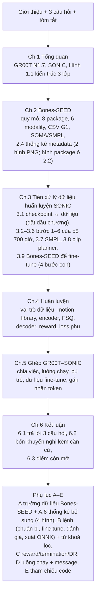

# Memo báo cáo: Bones-SEED, GEAR-SONIC và ghép nối với GR00T N1.7

Ngày: 30/09/2026.

Bản ghi quyết định, số liệu đã kiểm chứng và việc còn dở cho report gửi mentor (anh Trần Ngọc Sơn). Đọc file này trước khi sửa report; cập nhật lại sau mỗi lần sửa.

- Nguồn LaTeX: [Nvidia_groot.tex](Nvidia_groot.tex)
- PDF: [Nvidia_groot.pdf](Nvidia_groot.pdf), 64 trang, thân bài (Chương 1–6) 36 trang
- Bản report cũ trước khi thiết kế lại: [Nvidia_groot_backup_20260930.tex](Nvidia_groot_backup_20260930.tex)
- Memo dự án chung: [../MEMO_VLA_FINETUNE.md](../MEMO_VLA_FINETUNE.md)

---

## 0. Tóm tắt

- Report trả lời 3 câu hỏi của mentor:
  1. Bones-SEED gồm những gì, có những modality nào.
  2. SONIC được huấn luyện trên dữ liệu nào, dữ liệu được tiền xử lý ra sao.
  3. GR00T N1.7 ghép với GEAR-SONIC thế nào.
- Ba kết luận quan trọng nhất, đều đã đối chiếu nguồn:
  - **Model trong bài báo SONIC** được train trên **khoảng 700 giờ** mocap, lọc còn **611 giờ** (317.189 clip). Bài báo không nêu tên bộ này. Trang Bones Studio tự nhận đó là **Bones RP01** (bản thương mại, không công khai).
  - **Checkpoint mặc định** mà NVIDIA phát hành (`sonic_release`, nhóm đang dùng) theo `config.yaml` lưu kèm được train trên **Bones-SEED**, decoder nhỏ hơn bài báo. Hai biến thể `sonic_v1_1` và `low_latency` mới gần với model trong bài báo.
  - Bones-SEED **không có SMPL, không có video**. SONIC chỉ dùng phần chuyển động; mô tả ngôn ngữ, nhãn phân đoạn và metadata không được dùng.
- Mọi hình vẽ đều bằng TikZ. Chỉ 7 hình thống kê metadata là ảnh PNG (3 trong thân bài: Hình 2.1 package, 2.2 độ dài clip, 2.3 tư thế; 4 ở Phụ lục A.6), sinh bằng [../tools/plot_bones_seed_metadata.py](../tools/plot_bones_seed_metadata.py).

---

## 1. Quy ước viết

| Quy ước | Chi tiết |
|---|---|
| Nguồn tham chiếu | Chỉ dùng code NVIDIA trong `third_party/`: Isaac-GR00T `51d4c89`, GR00T-WholeBodyControl `b042411`. Bài báo SONIC arXiv:2511.07820v4. Không trích code của repo này (bridge, sim, tools) làm nguồn |
| Mức chắc chắn | Mỗi ý ghi rõ nguồn: **bài báo**, **code**, **thẻ dữ liệu**, **trang Bones Studio** (nhà cung cấp tự công bố), hay **suy ra** từ tên thư mục và config |
| Thuật ngữ | Giữ tiếng Anh cho thuật ngữ kỹ thuật, giải thích một lần trong Bảng thuật ngữ. Từ thông thường viết tiếng Việt: **mô hình** (không viết "model", trừ "model card"), **bộ dữ liệu** (không viết "dataset", trừ tên riêng). **root** = pelvis, không dùng chữ "gốc" cho nghĩa này. **clip** = một đoạn chuyển động. **reference motion**, **episode**, **bin**, **khung** (một thời điểm dữ liệu) |
| Văn phong | Report gửi mentor: **trang trọng nhưng dễ hiểu**. Không dùng văn nói ("ghi thẳng", "ai cũng tải được", "lộ ra", "tốn công", "khựng", "nó", "thì" mở đầu mệnh đề, "điểm thật/điểm đoán"); cũng không dùng từ Hán Việt nặng ("bộc lộ", "diễn giải", "khởi tạo"). Câu ngắn, giọng trung tính. Đề xuất viết "nhóm thực hiện đề xuất…", không viết câu mệnh lệnh. Khuyến nghị có 4 phần: Nội dung / Căn cứ / Mức độ tin cậy / Phương pháp kiểm chứng |
| Hình | TikZ, dùng chung các style `data`, `proc`, `model`, `robot`, `grp`, `lbl` ở preamble. Không dùng ảnh AI trong `../assets/` (xem mục 5) |
| Build | `cd report && ./compile.sh`. Kiểm tra link mục lục: `uv run --no-project --with pypdf python build/tools/check_toc_links.py Nvidia_groot.pdf build/Nvidia_groot_build.toc`. Bản sao lưu trước khi sửa hình: `build/backup/`. Chế độ `watch` chỉ cập nhật `build/Nvidia_groot_build.pdf`, không chép ra `report/Nvidia_groot.pdf` |
| Lỗi LaTeX hay gặp | `\code{}` phải escape `_` thành `\_`. `\path`/`\file` không dùng được trong `\caption`. Trong TikZ, toạ độ `$(...)$` bên trong `fit` phải bọc bằng `{}`; không đặt tên style trùng khoá có sẵn của TikZ như `step`. Không bỏ `\phantomsection` trong `\titleformat`, vì link mục lục sẽ lệch trang |

---

## 2. Cấu trúc report hiện tại



| Phần | Trang in | Hình, bảng chính |
|---|---|---|
| 1. Tổng quan | 1–2 | Hình 1.1 kiến trúc 3 lớp (TikZ, vẽ lại từ ảnh gốc, bỏ mũi tên D_r → D_c; dấu ngoặc "Universal Control Policy" bao ba encoder, FSQ và hai decoder, không gồm Lớp 1 và PD, theo Hình 6 và Mục 3.2 của bài báo; cả hình bọc `\resizebox{\textwidth}` cho vừa lề). Đoạn văn trước hình nêu: Lớp 2 = "universal token space"; khối = `UniversalTokenModule` = Actor PPO |
| 2. Bones-SEED | 3–9 | Bảng 2.1 Bones-SEED so với RP01; 2.2 package; 2.3 modality; 2.4 cột CSV; Hình 2.1 package, 2.2 độ dài clip, 2.3 tư thế. Hình category, cờ nội dung, diễn viên, thời gian quay đã chuyển sang Phụ lục A.6 (Hình A.1–A.4) |
| 3. Tiền xử lý | 10–19 | Mục 3.1 checkpoint ↔ dữ liệu đặt đầu chương (Bảng 3.1), vì nó quyết định phần còn lại áp dụng cho checkpoint nào; Hình 3.1 luồng 6 bước nằm ở đầu Mục 3.2; Hình 3.2 bốn bước tiền xử lý Bones-SEED, vẽ thành hai làn (phía robot nhóm tự xử lý / phía người SMPL NVIDIA làm sẵn) kèm chú giải màu; Bảng 3.2 chia tập; 3.3 motion library; 3.4 bộ 700 giờ so với Bones-SEED; 3.5 kết quả lọc theo package; Hình 3.3 quy trình fine-tune 6 bước (chuẩn bị → kiểm tra → fine-tune → đánh giá → xuất ONNX → chạy), ngưỡng hội tụ success_rate > 0,97, mpjpe_l < 30 mm, mpjpe_g < 200 mm |
| 4. Huấn luyện | 20–25 | Hình 4.1 một bước huấn luyện: 7 bước đánh số gom thành 3 giai đoạn (① tạo token, ② điều khiển robot ảo, ③ chấm điểm và học), mỗi giai đoạn một dòng ví dụ, danh sách giải thích ngay dưới hình; dùng gói `pifont` cho ký hiệu ①②③; có ô Critic của PPO và dấu ngoặc đánh dấu Actor = encoder + FSQ + decoder (thư viện TikZ `decorations.pathreplacing`); Hình 4.2 dòng thời gian cửa sổ khung encoder đọc; Hình 4.3 (Mục 4.4) minh hoạ FSQ theo 4 bước: encoder ra 64 số → xếp 2 hàng × 32 ô (2 token) → làm tròn từng ô về 1 trong 32 nấc k/16 → nối lại 64 số cho decoder và GR00T; nhấn mạnh "32" có hai nghĩa (32 ô mỗi token, 32 nấc mỗi ô). Căn cứ: `sonic_release/config.yaml:187-189` (`num_fsq_levels: 32`, `fsq_level_list: 32`, `max_num_tokens: 2`), `base_module.py:186-187` (đầu ra MLP nhân số token rồi reshape); Bảng 4.1 vai trò dữ liệu; 4.2 đầu vào encoder; 4.3 loss phụ |
| 5. Ghép nối | 26–29 | Hình 5.1 luồng chạy (tổng quan); Hình 5.2 luồng chạy chi tiết: luồng, tần số, cổng ZMQ, StateLogger (vẽ lại từ `docs/VLA_SONIC_DATAFLOW.md` §2); Hình 5.3 dòng thời gian bù trễ (Δ = 0,1 s, gọi lại 0,4 s sau khi nhận chunk → hai lần gọi cách 0,5 s); Bảng 5.1 embodiment `unitree_g1_sonic` |
| 6. Kết luận | 30–34 | 6.1 trả lời 3 câu hỏi; 6.2 Khuyến nghị: Bảng 6.1 tóm tắt, Bảng 6.2 khác biệt 3 checkpoint, mỗi khuyến nghị có Khuyến nghị / Căn cứ / Mức chắc chắn / Cách kiểm chứng; 6.3 điểm còn mở |
| Phụ lục A–E | 35–48 | A.1 51 cột metadata, A.2 29 cột khớp CSV, cây thư mục, JSONL, PKL, A.6 thống kê bổ sung (Hình A.1–A.4); B.1 từ khoá lọc; C.1 reward; D.1 message v4; E bảng tham chiếu code kèm số dòng |

---

## 3. Số liệu đã kiểm chứng

### 3.1. Bones-SEED

Nguồn: thẻ dữ liệu Hugging Face và `seed_metadata_v004.parquet` ở thư mục gốc repo.

| Mục | Giá trị |
|---|---|
| Số clip | 142.220 = 71.132 quay thật + 71.088 lật gương (cột `is_mirror`) |
| Thời lượng | 288,3 giờ, tính cả bản lật gương; phần quay thật khoảng 144,2 giờ |
| Diễn viên | 522 `actor_uid`: 253 nữ, 269 nam; 101 người có từ 500 clip trở lên; 170 người đóng nhiều nhất chiếm 66% số clip |
| Ngày quay | 31/05/2021 đến 18/09/2024, 124 ngày quay |
| Phân loại | 8 package, 20 category; Locomotion chiếm khoảng 52%; category nhỏ nhất là Martial Arts, 20 clip |
| Định dạng | SOMA Proportional BVH, SOMA Uniform BVH (khung xương NOVA 78 khớp, kể cả root), G1 CSV (29 khớp, 120 Hz, cm và độ) |
| Chú thích | 4 câu mô tả tự nhiên, 1 câu kỹ thuật, nhãn ngắn; nhãn phân đoạn do NVIDIA làm (dự án Kimodo); metadata 51 cột |
| Ai làm gì | Bones Studio quay. NVIDIA làm retarget SOMA và G1, và nhãn phân đoạn (mục Acknowledgments của thẻ dữ liệu) |
| Dung lượng | 114,4 GB: g1 23,5 GB; soma_uniform 45,2 GB; soma_proportional 45,5 GB; metadata khoảng 0,2 GB. Truy cập gated (tự duyệt sau khi đồng ý điều khoản) |
| SMPL | Không có trong Bones-SEED. NVIDIA phát hành riêng: `download_from_hf.py --training`, khoảng 30 GB, khoảng 131 nghìn PKL |

### 3.2. Bộ 700 giờ trong bài báo, nhiều khả năng là RP01

| Mục | Giá trị | Nguồn |
|---|---|---|
| Thời lượng | Khoảng 700 giờ → 611 giờ sau lọc, hơn 100 triệu khung ở 50 Hz | Abstract và Mục 3.1 của bài báo |
| Retarget | GMR + PyRoki (không mô tả hàm mục tiêu) | Mục 3.1 |
| Lọc | Bỏ leo cầu thang, các hoạt động ngồi (không nói cách lọc) | Mục 3.1 |
| Chia tập | Train: 317.189 clip, 611 giờ, 8.447 nhóm con. Test-content: 7.016 clip, 15 giờ, 182 nhóm con. Test-repetition: 9.395 clip, 12 giờ, 1.088 nhóm con | Bảng 2 |
| Phân loại | 33 nhóm lớn, 8.447 nhóm con | Mục 3.1 |
| Tên RP01 | "BONES RP1 data powered SONIC"; 700+ giờ, 170+ diễn viên, Vicon 120 fps, BVH/FBX, 3 video mỗi lần quay, tối đa 5 mô tả, 21 category | `bones.studio/datasets`, **nhà cung cấp tự công bố** |
| Bài báo có nhắc RP01? | **Không.** Chỉ nhắc Bones-SEED là "a substantial portion of our motion-capture dataset" | |
| RP01 có công khai? | **Không.** Phải mua giấy phép | Trang Bones Studio |

Quan hệ giữa Bones-SEED và RP01: nhiều khả năng lấy từ cùng thư viện và cùng các buổi quay. Có hai dấu hiệu:
- Trang Bones Studio nêu tên 16 category của RP01; 15 tên có trong Bones-SEED, chỉ thiếu Combat.
- Thư mục nội bộ `bones_update_240924` có ngày 24/09/2024, sáu ngày sau buổi quay cuối của Bones-SEED.

Tuy vậy, **chưa chứng minh được Bones-SEED là tập con từng clip của RP01.**

### 3.3. Checkpoint phát hành ↔ dữ liệu

Nguồn: `config.yaml` trong `checkpoints/GEAR-SONIC/`.

| Checkpoint | Lớp ẩn decoder | Dữ liệu robot | Dữ liệu SMPL |
|---|---|---|---|
| `sonic_release` (mặc định, là các ONNX ở thư mục gốc) | 2048 → 512, khoảng 10,2 triệu tham số (đọc từ `model_decoder.onnx`) | `motion_lib_bones_seed/robot_filtered/` | `motion_lib_bones_seed/1215_bones_seed_filtered/` |
| `sonic_v1_1` | 4096 → 512 (bằng Bảng S1 của bài báo) | `training_mixes/train_pyroki_v081_0414_26/` | `smpl_retarget/1215/` |
| `low_latency` | 4096 → 512 | `training_mixes/train_pyroki_0213_26/` | `smpl_retarget/1215/` |

Model card ghi: `low_latency` dùng cho teleoperation phản hồi nhanh và chạy VLA; `sonic_v1_1` dùng cho các policy VLA dựa trên SONIC.

### 3.4. Tiền xử lý và huấn luyện, theo code `b042411`

| Bước | Chi tiết | File |
|---|---|---|
| Chuyển đổi | cm → m, độ → rad, Euler xyz → quaternion, `pose_aa` = trục × góc, **120 → 30 Hz** (giữ 1 khung trong 4) | `gear_sonic/data_process/convert_soma_csv_to_motion_lib.py` |
| Lọc | 40 từ khoá theo tên tệp, bỏ khoảng 8,7%, còn khoảng 130 nghìn clip | `filter_and_copy_bones_data.py:209` |
| SOMA (tuỳ chọn) | FK trên 78 khớp, giữ 26, 120 → 30 Hz | `extract_soma_joints_from_bvh.py` |
| Nạp | Nội suy **30 → 50 Hz** (SLERP cho góc quay, tuyến tính cho vị trí); đóng băng khung 10%; adaptive sampling theo bin 50 khung, 10% chọn đều, trần 200× | `utils/motion_lib/` |
| Encoder G1 | Khung tại t và 9 khung sau, cách 0,1 s (t → t + 0,9 s): 29 góc + 29 vận tốc + 6D = 640 số | `observations.py:570`, `commands.py:360` |
| Encoder SMPL | 10 khung cách 0,02 s: 24 khớp + 6D + 6 góc cổ tay robot | `observations.py:1716` |
| FSQ | 2 token × 32 chiều × 32 nấc = 64 số; giá trị k/16 với k từ −16 đến 15 | `all_mlp_v1.yaml` |
| Decoder | Quan sát 994 = 64 + 10 × 93; MLP 994 → 2048 → 2048 → 1024 → 1024 → 512 → 512 → 29, SiLU | ONNX, config |
| Loss phụ | `g1_recon` 0,01; ba loss căn chỉnh token 1,0; `reencoded_smpl_g1_latent` 1,0 (cycle) | `aux_losses/universal_token/` |
| Fine-tune | `+checkpoint=sonic_release/last.pt`; khuyến nghị learning rate 5e-6 (mặc định 2e-5), `desired_kl=0.005` | `docs/source/user_guide/configuration.md` |
| Dấu vết pipeline nội bộ | `data/bones_gmr/0903_all/`, `process_bones_to_motionlib.py` (120 → 30), `bones_update_240924/anims_uniform_novaskel_v1` | Tham số mặc định và docstring |
| Clip do planner sinh | Tiền tố `2025`, `sonic_walking`, `balance`...; ghép thân trên với xác suất 50%. **Bài báo không nhắc** | Config ba checkpoint, `motion_lib_base.py` |

Bài báo Mục 3.3 và phụ lục cho biết thêm: Kinematic Planner được train trên cùng bộ dữ liệu, cắt đoạn 0,8–2,4 s, xoay hướng ngẫu nhiên; khi chạy, planner xuất 30 fps rồi resample lên 50 Hz.

### 3.5. Kết quả chạy lại bộ lọc 40 từ khoá trên metadata v004

Quy tắc: chuỗi con, không phân biệt hoa thường, trên `<ngày>/<filename>` (`filter_and_copy_bones_data.py:21,75`).

| Mục | Giá trị |
|---|---|
| Bị bỏ | 12.435 clip (8,74%), 23,8 giờ |
| Còn lại | 129.785 clip, 264,5 / 288,3 giờ (khớp "~130K" của `training.md`) |
| Theo package | Everyday 26,1%, Locomotion 11,8%, Sport 10,3%, Interactions 8,2%, Gaming 2,9%, Dances 1,5%, Communication 0,5%, Other 0% |
| Từ khoá nhiều nhất | `sitting` 3.719, `50cm_box_` 3.402, `sit_` 2.428, `crutch` 976, `table` 708, `chair` 702 |
| Bỏ nhầm | `table` khớp `vegetables`: 144 clip |
| Bỏ sót | 3.589 clip còn lại có tư thế bò/quỳ/nằm/ngồi (`content_body_position`); 20.749 clip có đạo cụ |

### 3.6. Chi tiết tiền xử lý đã kiểm chứng thêm (30/09)

- `move_name` ≠ `filename` ở 52.508 clip (tên chuẩn hoá); script làm việc theo `filename`. Bản lật gương có hậu tố `_M`.
- Thẻ dữ liệu ghi metadata **v003**, nhóm dùng **v004**. Nhãn phân đoạn: `seed_metadata_v002_temporal_labels.jsonl`, trường `filename`, `num_events`, `events[{start_time, end_time, description}]`.
- Lỗi dễ mắc: docstring của `convert_soma_csv_to_motion_lib.py` dùng `--fps 50` không có `--fps_source` → không hạ tần số nhưng ghi fps=50 → chuyển động chậm 2,4 lần, không báo lỗi. Phải dùng `--fps 30 --fps_source 120`.
- Ghép SMPL: `<smpl_motion_file>/<basename>.pkl` ở cấp đầu (`motion_lib_base.py:264`), thư mục SMPL phải phẳng; clip thiếu SMPL được điền 0. `smpl_joints`/`transl` không nội suy, assert cùng số khung với robot sau khi lên 50 Hz (dòng 1914–1935) → suy ra bản SMPL lưu ở 50 Hz.
- SMPL tải từ `nvidia/GEAR-SONIC`, `bones_seed_smpl.tar.part_aa..ag`. `--sample` tải `sample_data/` để chạy thử.
- `--filter_file`: chỉ giữ tệp có tên chứa một dòng trong danh sách → dùng metadata để chọn tập con (đề xuất của nhóm, ghi rõ trong report).

### 3.7. Căn cứ cho bốn khuyến nghị ở Mục 6.2 (kiểm chứng 01/10)

| Khuyến nghị | Căn cứ | Nguồn |
|---|---|---|
| 1. Chốt một checkpoint trước khi thu dữ liệu | "each checkpoint has its own latent space — the same token produces different poses across checkpoints"; dùng encoder, decoder, observation config của cùng biến thể | WBC `docs/source/tutorials/vla_inference.md` mục Customizing the Initial Pose; README; model card |
| | G1 encoder: `sonic_release`, `sonic_v1_1` có `dt_future_ref_frames: 0.1` (t → t + 0,9 s); `low_latency` có `0.02` (t → t + 0,18 s). SMPL: 10/10/4 khung cách 0,02 s. `sonic_v1_1` dùng quan sát `*_ori_heading`, hai bản kia dùng `*_ori_b` | `config.yaml` của từng checkpoint |
| 2. Đánh giá `sonic_v1_1` | README/model card: dành cho "SONIC-backed VLA policies", có mục riêng trong `vla_inference.md`; phát hành 23/07/2026; wrist-pose augmentation; Kp/Kd cổ chân (motor 4, 10) × 1,5 là "tested deployment tuning" | README mục News, model card |
| | Bài báo (gián tiếp): 1,2 M → 42 M tham số, test-content 98,0% → 99,6% success, MPJPE-L 27,7 → 23,8 mm, cải thiện rõ nhất ở OOD | Bài báo, mục Scaling |
| | Ngưỡng hội tụ `success_rate` > 0,97, `mpjpe_l` < 30 mm, `mpjpe_g` < 200 mm; công cụ `eval_agent_trl.py` | WBC `docs/source/user_guide/training.md` |
| 3. Kiểm tra khứ hồi | Bộ lọc bỏ `sitting` 3.719, `sit_` 2.428, `table` 708, `chair` 702 clip (một clip có thể chứa nhiều từ khoá, không cộng được); bài báo: 98,5% success trên test-content trong MuJoCo (mô hình bài báo, mocap người) | Mục 3.5 memo; bài báo |
| 4. Độ trễ ≤ 0,2 s | `rate = 1/0.4`, `action_horizon = 40`, `action_publish_rate = 50` (`run_vla_inference.py:72-78`); `last_inference_time` chỉ đặt lại lúc **nhận** chunk (dòng 652) → gọi lại 0,4 s sau khi nhận, hai lần gọi cách nhau T + Δ; chỉ số kẹp ở 39 (dòng 741) → lặp token cuối. Điều kiện fΔ + f(T + Δ) ≤ H → Δ ≤ (0,8 − 0,4)/2 = 0,2 s | Suy ra từ code |

### 3.8. MotionBricks và Kinematic Planner (kiểm chứng 01/10, upstream qua GitHub API)

| Mục | Giá trị | Nguồn |
|---|---|---|
| MotionBricks là gì | Mô hình sinh chuyển động động học thời gian thực (VQVAE + pose + root), bản preview 27/04/2026, arXiv:2604.24833; đầu ra qpos G1 36 số, 30 fps; demo chỉ `mj_forward`, không vật lý | `motionbricks/README.md`, `docs/motion_representation.md:83-89`, `scripts/interactive_demo_g1.py` |
| Kinematic Planner của SONIC làm bằng MotionBricks | "It is trained with the motionbricks code" (ZhengyiLuo, 26/06/2026) | GitHub issue #192 |
| `planner_sonic.onnx` khớp MotionBricks | Đầu vào `context_mujoco_qpos [1,4,36]`, `has_specific_target`, `specific_target_positions`, `allowed_pred_num_tokens [1,11]`; đầu ra `mujoco_qpos [1,64,36]`; module `mmm_net`, `decoder`. Các tên này có trong `motion_backbone/demo/full_agent.py`, `neural_modules/root_backbone.py` | Đọc ONNX; code MotionBricks |
| Dùng chung cho 3 checkpoint, kể cả v1.1 | `PLANNER_FILE` là giá trị dùng chung | `download_from_hf.py:51` |
| Chưa có | Exporter từ checkpoint MotionBricks (.pt) sang `planner_sonic.onnx` (KevinMi2023p, 09/07/2026); "full release embedded in GEAR-SONIC" vẫn là roadmap; bản SOMA đang làm, chưa có lịch (tingwuwang, 06/07/2026) | Issue #207 (đang mở), README |
| Upstream | `main` không có commit sau `b042411` (kiểm tra 01/10/2026); các nhánh khác cũ hơn `main`, không đổi file MotionBricks | GitHub API |
| Chưa rõ | `planner_sonic.onnx` có cùng phiên bản với checkpoint preview trong `motionbricks/out/` không | |

---

## 4. Các đính chính đã làm

Các lỗi này từng có trong report cũ hoặc trong câu trả lời trước đây. Không đưa lại vào report.

| Sai | Đúng |
|---|---|
| Hạ Bones-SEED thẳng từ 120 xuống 50 Hz | 120 → 30 Hz lúc chuyển đổi, nội suy lên 50 Hz lúc nạp |
| Bones-SEED 130 nghìn clip = 611 giờ | 611 giờ là bộ 700 giờ trong bài báo. Bones-SEED 288 giờ tính cả lật gương |
| Bones-SEED có bản SMPL | Không có; NVIDIA phát hành bản SMPL riêng |
| "Phía người dùng SOMA chứ không phải SMPL" | Checkpoint phát hành dùng SMPL; SOMA là encoder thứ 4 tuỳ chọn |
| Domain randomization: ma sát 0,4–1,2, lực đẩy 20–80 N, độ trễ 10–30 ms, nghiêng 60° | Theo config: ma sát tĩnh 0,3–1,6, động 0,3–1,2; nhân khối lượng 0,8–2,5; đẩy bằng vận tốc mỗi 4–6 s; termination theo Phụ lục B |
| Mũi tên D_r → D_c (ảnh kiến trúc 3 lớp) | Hai decoder nhận token song song |
| GR00T đổ qua encoder | GR00T xuất thẳng token vào chỗ vốn dành cho output của encoder |
| "Checkpoint phát hành được train trên RP01" | Model trong **bài báo** được train trên 700 giờ; checkpoint **mặc định** được train trên Bones-SEED (theo config) |
| "522 diễn viên mâu thuẫn với 170+" | "170+" là cận dưới, không mâu thuẫn |
| Bản CSV G1 của Bones-SEED "nhiều khả năng" làm bằng GMR | Chưa rõ; thẻ dữ liệu không nói phương pháp |
| "Bộ PD của động cơ chạy 500 Hz" (Hình 1.1, 5.1, Giới thiệu, Mục 1.2) | 500 Hz là luồng Command writer gửi lệnh qua DDS (bài báo phụ lục triển khai, `g1_deploy_onnx_ref.cpp:21`); tần số vòng PD trong driver Unitree không được nêu |
| Encoder G1 dùng "10 khung tương lai, phủ 1 s" | Khung tại t và 9 khung sau, độ lệch 0, 5, …, 45 bước, từ t tới t + 0,9 s (`commands.py:360`, `future_time_steps` dòng 3285). SMPL: t tới t + 0,18 s. Gần cuối clip thì khung vượt quá được thay bằng khung cuối |
| "Decoder `g1_dyn`, tức Actor PPO" | Actor trong code là cả `UniversalTokenModule`: encoders + FSQ + decoders `g1_dyn`, `g1_kin` (`sonic_release/config.yaml:70`); hành động lấy từ `g1_dyn`. Critic là MLP riêng, 1 đầu ra, đầu vào `PrivilegedCfg`. Tên đầy đủ: G1 Dynamic Decoder / G1 Kinematic Decoder (`docs/source/references/training_code.md:239-240`) |
| Client gọi GR00T mỗi 0,4 s kể từ lúc bắt đầu gọi; ngưỡng Δ ≤ 0,38 s (đã ghi nhầm ngày 01/10) | Gọi lại 0,4 s sau khi **nhận** chunk (`last_inference_time` đặt ở dòng 652), nên chu kỳ là 0,4 s + Δ, tần số tối đa 2,5 Hz; ngưỡng Δ ≤ 0,2 s. Hình 5.3 dùng chu kỳ 0,5 s với Δ = 0,1 s là đúng |
| "`planner_sonic.onnx` là Kinematic Planner của bài báo, không phải MotionBricks"; "MotionBricks chưa có trong v1.1" (trả lời nhầm 01/10) | Kinematic Planner (`planner_sonic.onnx`, dùng chung cho cả v1.1) được huấn luyện bằng code MotionBricks (issue #192, I/O ONNX khớp code). Chưa có: exporter, pipeline huấn luyện tích hợp, bản SOMA |
| "Không nguồn nào nói Vicon" | Trang Bones Studio nói Vicon, nhưng cho **RP01**, không phải Bones-SEED |
| RP01 có 21 category "gần như trùng" với Bones-SEED | Trang chỉ nêu tên 16; 15 tên có trong Bones-SEED |

---

## 5. Tài liệu không dùng được làm nguồn

| Tài liệu | Lý do |
|---|---|
| `../BONES_SEED_DATA_COLLECTION_REPORT.md` | Ghi Bones-SEED có SMPL; video/âm thanh đồng bộ; ví dụ động tác tự đặt |
| `../BONES_SEED_DATA_PROCESSING_REPORT.md` | Tự đặt Butterworth, công thức IK có CoM; chia việc giữa Bones và NVIDIA sai; "Bones không lật gương" |
| `../SONIC_SIMPLIFIED_REPORT.md` | Nguồn của các lỗi ở mục 4 (120 → 50 Hz, 611 giờ, số liệu DR, L_recon) |
| `../assets/bones_seed_training_pipeline.jpg`, `bones_seed_sonic_flow.jpg` | Số liệu sai như trên |
| `../assets/sonic_3layer_control_architecture.jpg` | Mũi tên D_r → D_c sai; đã vẽ lại bằng TikZ |
| `../assets/vla_gr00t_sonic_flow.jpg` | Nội dung đúng nhưng trùng Hình 5.1 |

Ba file markdown trên vẫn chưa được sửa.

---

## 6. Điểm còn mở

1. Checkpoint phát hành nào là model trong bài báo: chưa có tài liệu nào xác nhận. Đường dẫn dữ liệu của `sonic_release` có thể đã được sửa trước khi phát hành.
2. Bones-SEED có phải tập con từng clip của RP01: không so được vì không có RP01.
3. NVIDIA không công bố script tiền xử lý bộ 700 giờ. Các bước 3–6 dựa trên bài báo và dấu vết trong code.
4. Tỉ lệ clip do Kinematic Planner sinh trong dữ liệu huấn luyện: không rõ.
5. Độ trễ thực tế của GR00T và tần số thực của vòng PD trong driver Unitree: chưa đo.

---

## 7. Việc tiếp theo

- [x] ~~Mục lục "mapping nhầm"~~: link của 2.3, 3.4, 5.4 nhảy sớm 1–2 trang, còn số trang in trong mục lục vẫn đúng. Nguyên nhân: `titlesec` đặt anchor hyperref trước khoảng trắng phía trên tiêu đề, nên khi ngắt trang rơi vào đó thì anchor nằm lại trang trước. Đã sửa bằng `\phantomsection` trong `\titleformat` của section và subsection (30/09)
- [ ] Xoá các file cũ `build/Nvidia_groot.*` (25/09), chờ đồng ý.
- [ ] Xoá 3 ảnh JPG không dùng nữa trong `figures/`, chờ đồng ý.
- [ ] Sửa hoặc đánh dấu 3 file markdown ở mục 5 nếu nhóm còn dùng.
- [ ] Cân nhắc đổi sang checkpoint `low_latency` hoặc `sonic_v1_1` trước khi thu dữ liệu fine-tune GR00T (Mục 3.1, khuyến nghị 1–2 ở Mục 6.2).
- [x] ~~Thống nhất "model" → "mô hình", "dataset" → "bộ dữ liệu" trong văn xuôi; thêm Mục 6.2 Khuyến nghị kèm căn cứ (4 khuyến nghị), tách Kết luận thành 6.1/6.2/6.3~~ (01/10). Sao lưu: `build/backup/Nvidia_groot_before_terms_recommend.tex`
- [x] ~~Rà văn phong toàn report theo hướng trang trọng, dễ hiểu (khoảng 140 chỗ trong thân bài, caption, Bảng thuật ngữ; viết lại Mục 6.2–6.3)~~ (01/10). Sao lưu: `build/backup/Nvidia_groot_before_formal_style.tex`
- [x] ~~Hình 5.3 và Khuyến nghị 4 sửa theo cơ chế gọi thật: gọi lại 0,4 s sau khi nhận chunk → chu kỳ 0,4 s + Δ = 0,5 s (Δ = 0,1 s), A[5..29]; ngưỡng Δ ≤ 0,2 s; "khoảng 2,5 Hz" → "tối đa 2,5 Hz" ở Giới thiệu, Ch.5, Phụ lục D và các hình~~ (01/10). Sao lưu: `build/backup/Nvidia_groot_before_fix_period.tex`
- [x] ~~Hình 1.1 thêm dấu ngoặc Universal Control Policy + câu giải thích trong chú thích và thân bài~~ (01/10). Sao lưu: `build/backup/Nvidia_groot_before_fig11_ucp.tex`
- [x] ~~Thêm đoạn "Kinematic Planner và MotionBricks" ngay sau Hình 1.1 (trích lời Zhengyi Luo, issue #192; I/O của `planner_sonic.onnx`; chưa có exporter, issue #207); ô Kinematic Planner trong Hình 1.1 ghi "MotionBricks"; thêm 3 tài liệu tham khảo `motionbricks`, `issue192`, `issue207`~~ (01/10). Đặt đoạn này sau hình, không đặt trong danh sách Lớp 1, để Hình 1.1 vẫn nằm ở trang 2. Sao lưu: `build/backup/Nvidia_groot_before_motionbricks.tex`
- [x] ~~Thêm đoạn "GEM" sau đoạn MotionBricks: GEM = Generalist Model for human motion, bài báo trích là GENMO (ICCV 2025, [50] trong bài báo); repo công khai chỉ có ví dụ GEM-X (repo riêng NVlabs/GEM-X): webcam → SOMA 77 khớp → `soma_to_smpl.py` → SMPL 24 khớp → encoder SMPL (`docs/source/tutorials/live_camera_teleop.md`); sinh từ văn bản/nhạc không có trong mã nguồn công khai. Ô GEM trong Hình 1.1 ghi "GEM (GENMO)"; thêm tài liệu `genmo`, `gemx`~~ (01/10). Sao lưu: `build/backup/Nvidia_groot_before_gem.tex`
- [x] ~~Thêm Hình 4.3 minh hoạ FSQ (2 token × 32 ô × 32 nấc) và đoạn giải thích trong Mục 4.4~~ (01/10). Lưu ý TikZ: không đặt tên style `step` (trùng khoá có sẵn). Sao lưu: `build/backup/Nvidia_groot_before_fig_fsq.tex`
- [x] ~~Thêm Hình 4.4 (Mục 4.4) dòng thời gian 10 khung proprioception = 0,2 s vừa qua, 10 × 93 = 930, token 64 + 930 = 994; thứ tự ghép theo `observation_config.yaml` (gom theo đại lượng: vận tốc góc, góc khớp, vận tốc khớp, lệnh trước, trọng lực); câu giải thích "vì sao cần 10 khung" và câu bổ sung ở mục Decoder của Chương 1~~ (01/10). Sao lưu: `build/backup/Nvidia_groot_before_fig_prop.tex`
- [x] ~~Vẽ lại Hình 4.4 thành 3 phần: (a) dòng thời gian 10 khung, (b) 1 khung = 3 + 29 + 29 + 29 + 3 = 93, (c) đầu vào decoder: token 64 | 3×10=30 | 29×10=290 | 29×10=290 | 29×10=290 | 3×10=30, ngoặc "30+290+290+290+30 = 930 = 10×93" và "64+930 = 994"; đoạn văn Mục 4.4 ghi phép tính tường minh~~ (01/10). Sao lưu: `build/backup/Nvidia_groot_before_fig_prop_v2.tex`
- [x] ~~Thêm đoạn "Proprioception, 930 số" ngay sau Hình 1.1 (trước đoạn MotionBricks): 0,2 s = 10 bước × 0,02 s; 3 + 29 + 29 + 29 + 3 = 93; 10 × 93 = 930; 64 + 930 = 994; trỏ Mục 4.4 và Hình 4.4~~ (01/10). Các đoạn giải thích Hình 1.1 đặt sau hình để hình vẫn ở trang 2. Sao lưu: `build/backup/Nvidia_groot_before_ch1_930.tex`
- Đã thử đưa phép tính 930 vào Hình 1.1 (ô chú thích dưới Proprioception) rồi **revert theo yêu cầu** (01/10). Hình 1.1 giữ "10 khung, 930 số"; giải thích 930 nằm ở đoạn ngay sau hình và Hình 4.4
- [ ] Câu chuyện 700 giờ/RP01 lặp lại ở nhiều chỗ (Giới thiệu, 2.1, đầu Ch.3, 3.1, 3.2, Kết luận): chỉ kể đầy đủ ở 2.1, làm cùng đợt rút gọn
- [x] ~~Mentor hỏi: Bones-SEED gồm những trường nào, tiền xử lý thế nào để fine-tune~~: thêm Phụ lục A (đủ các trường), viết lại Mục 3.9 thành 4 bước con có Hình 3.2, Bảng 3.5, lỗi dễ mắc và kiểm tra sau xử lý (30/09)
- [x] ~~Đưa mục checkpoint ↔ dữ liệu lên đầu Ch.3 (thành 3.1); giữ 3 hình thống kê trong thân bài, chuyển 4 hình sang Phụ lục A.6~~ (01/10). Sao lưu trước khi sửa: `build/backup/Nvidia_groot_before_reorder_ch3_fig24.tex`
- [ ] (Đề xuất, chờ đồng ý) Rút gọn thân bài tiếp thay cho bản tóm tắt riêng, vì phần Giới thiệu đã có tóm tắt 1 trang: Ch.4 còn 2–3 trang, chi tiết FSQ/decoder/loss phụ và Hình 4.2 chuyển xuống Phụ lục C; gộp Mục 3.2–3.6 (bộ 700 giờ) thành khoảng 2 trang
- [ ] (Tuỳ chọn) Thêm câu "NVIDIA không nhắc tên RP01 trong bài báo" vào Mục 2.1.
- [x] ~~Viết lại report theo 3 câu hỏi của mentor~~
- [x] ~~Rút gọn thân bài, chuyển chi tiết tra cứu xuống phụ lục~~
- [x] ~~Tách "model trong bài báo" với "checkpoint phát hành"~~
- [x] ~~Mục 3.9 tiền xử lý Bones-SEED để fine-tune SONIC~~
- [x] ~~Sửa ghi chú 522/170+~~

---

## 8. Lệnh hay dùng

```bash
# Build report
cd report && ./compile.sh            # ra report/Nvidia_groot.pdf
./compile.sh watch                   # tự build lại, chỉ cập nhật build/Nvidia_groot_build.pdf

# Vẽ lại hình thống kê metadata (máy không có pandas thì dùng uv)
uv run --no-project --with pandas --with pyarrow --with matplotlib \
    python tools/plot_bones_seed_metadata.py seed_metadata_v004.parquet

# Kiểm tra link mục lục trỏ đúng trang
pdfinfo -dests report/Nvidia_groot.pdf | grep -E "chapter|section"

# Đường dẫn dữ liệu trong config của các checkpoint
grep -n "motion_file:" -A1 checkpoints/GEAR-SONIC/*/config.yaml
```
