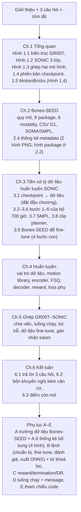

# Memo báo cáo: Bones-SEED, GEAR-SONIC và ghép nối với GR00T N1.7

Ngày: 30/09/2026.

Bản ghi quyết định, số liệu đã kiểm chứng và việc còn dở cho report gửi mentor (anh Trần Ngọc Sơn và anh Nguyễn Văn Thái). Đọc file này trước khi sửa report; cập nhật lại sau mỗi lần sửa.

- Nguồn LaTeX: [Nvidia_groot.tex](Nvidia_groot.tex)
- PDF: [Nvidia_groot.pdf](Nvidia_groot.pdf), 90 trang (14/10, sau khi viết lại Mục 4.5 reward/termination/DR có 3 hình)
- Bản report cũ trước khi thiết kế lại: [Nvidia_groot_backup_20260930.tex](Nvidia_groot_backup_20260930.tex)
- Memo dự án chung: [../MEMO_VLA_FINETUNE.md](../MEMO_VLA_FINETUNE.md)

---

## 0. Tóm tắt

- Report trả lời 3 câu hỏi của mentor:
  1. Bones-SEED gồm những gì, có những modality nào.
  2. SONIC được huấn luyện trên dữ liệu nào, dữ liệu được tiền xử lý ra sao.
  3. GR00T N1.7 ghép với GEAR-SONIC thế nào.
- Ba kết luận quan trọng nhất, đều đã đối chiếu nguồn:
  - **Model trong bài báo SONIC** được train trên **khoảng 700 giờ** mocap, lọc còn **611 giờ** (317.189 clip). Bài báo không nêu tên bộ này. Trang Bones Studio tự nhận đó là **Bones RP01** (bản thương mại, không công khai).
  - **Checkpoint mặc định** mà NVIDIA phát hành (`sonic_release`, nhóm đang dùng) theo `config.yaml` lưu kèm được train trên **Bones-SEED**, decoder nhỏ hơn bài báo. Hai biến thể `sonic_v1_1` và `low_latency` mới gần với model trong bài báo.
  - Bones-SEED **không có SMPL, không có video**. SONIC chỉ dùng phần chuyển động; mô tả ngôn ngữ, nhãn phân đoạn và metadata không được dùng.
- Mọi hình vẽ đều bằng TikZ. Chỉ 7 hình thống kê metadata là ảnh PNG (3 trong thân bài: Hình 2.1 package, 2.2 độ dài clip, 2.3 tư thế; 4 ở Phụ lục A.6), sinh bằng [../tools/plot_bones_seed_metadata.py](../tools/plot_bones_seed_metadata.py).

---

## 1. Quy ước viết

| Quy ước | Chi tiết |
|---|---|
| Nguồn tham chiếu | Chỉ dùng code NVIDIA trong `third_party/`: Isaac-GR00T `51d4c89`, GR00T-WholeBodyControl `b042411`. Bài báo SONIC arXiv:2511.07820v4. Không trích code của repo này (bridge, sim, tools) làm nguồn |
| Mức chắc chắn | Mỗi ý ghi rõ nguồn: **bài báo**, **code**, **thẻ dữ liệu**, **trang Bones Studio** (nhà cung cấp tự công bố), hay **suy ra** từ tên thư mục và config |
| Thuật ngữ | Giữ tiếng Anh cho thuật ngữ kỹ thuật, giải thích một lần trong Bảng thuật ngữ. Từ thông thường viết tiếng Việt: **mô hình** (không viết "model", trừ "model card"), **bộ dữ liệu** (không viết "dataset", trừ tên riêng). **root** = pelvis, không dùng chữ "gốc" cho nghĩa này. **clip** = một đoạn chuyển động. **reference motion**, **episode**, **bin**, **khung** (một thời điểm dữ liệu) |
| Văn phong | Report gửi mentor: **trang trọng nhưng dễ hiểu**. Không dùng văn nói ("ghi thẳng", "ai cũng tải được", "lộ ra", "tốn công", "khựng", "nó", "thì" mở đầu mệnh đề, "điểm thật/điểm đoán"); cũng không dùng từ Hán Việt nặng ("bộc lộ", "diễn giải", "khởi tạo"). Câu ngắn, giọng trung tính. Đề xuất viết "nhóm thực hiện đề xuất…", không viết câu mệnh lệnh. Khuyến nghị có 4 phần: Nội dung / Căn cứ / Mức độ tin cậy / Phương pháp kiểm chứng. **Cấu trúc kiểu báo cáo:** mỗi chương mở bằng đoạn nêu mục đích và lộ trình các mục; Chương 2–5 kết bằng đoạn "**Tóm lại,**" 2–3 câu, dẫn sang chương sau; danh sách và bảng luôn có câu dẫn ("Từ Bảng 3.1, có thể rút ra…", "… như trình bày ở Hình …"). **Thân bài chỉ mô tả bằng lời:** không ghi tên tệp, số dòng, tên biến/hàm/tham số, khoá cấu hình ("script lọc", "tệp cấu hình lưu kèm checkpoint", "tỉ lệ thành công, MPJPE cục bộ/toàn cục"). Chỉ giữ tên riêng: tên checkpoint (`sonic_release`, `sonic_v1_1`, `low_latency`), `unitree_g1_sonic`, `g1_dyn`/`g1_kin`. Không nhắc phím bấm (kể cả Phụ lục D.1): viết theo thao tác của người vận hành ("người vận hành chuyển SONIC sang chế độ nhận token…", "cho phép client bắt đầu gửi token"). Chi tiết code để ở Phụ lục B, D, E |
| Chú thích hình | Chữ nghiêng để phân biệt với thân bài (`\captionsetup[figure]{textfont=it}`, 01/10); nhãn "Hình x.y:" vẫn đậm, chữ thẳng. Chú thích bảng giữ chữ thẳng |
| Hình | Ngoại lệ PNG (14/10): Hình 1.4 `fig:mb_onion` là ảnh dựng từ kết quả chạy thật của `planner_sonic.onnx` (không phải ảnh minh hoạ), sinh bằng `tools/render_motionbricks_planner.py`. Còn lại: TikZ, dùng chung các style `data`, `proc`, `model`, `robot`, `grp`, `lbl` ở preamble. Không dùng ảnh AI trong `../assets/` (xem mục 5) |
| Build | `cd report && ./compile.sh`. Bắt buộc XeLaTeX (`fontspec`): build bằng pdfLaTeX dừng ở `fontspec.sty:45 cannot-use-pdftex`. VS Code LaTeX Workshop dùng recipe XeLaTeX trong `.vscode/settings.json` ở gốc repo (14/10), ghi vào `build/Nvidia_groot.*` rồi chép PDF ra `report/`. Kiểm tra link mục lục: `uv run --no-project --with pypdf python build/tools/check_toc_links.py Nvidia_groot.pdf build/Nvidia_groot_build.toc`. Bản sao lưu trước khi sửa hình: `build/backup/`. Chế độ `watch` chỉ cập nhật `build/Nvidia_groot_build.pdf`, không chép ra `report/Nvidia_groot.pdf` |
| Lỗi LaTeX hay gặp | `\code{}` phải escape `_` thành `\_`. `\path`/`\file` không dùng được trong `\caption`. Trong TikZ, toạ độ `$(...)$` bên trong `fit` phải bọc bằng `{}`; không đặt tên style trùng khoá có sẵn của TikZ như `step`, `cap` (lỗi "key '/tikz/cap' requires a value"). Không bỏ `\phantomsection` trong `\titleformat`, vì link mục lục sẽ lệch trang |

---

## 2. Cấu trúc report hiện tại



| Phần | Trang in | Hình, bảng chính |
|---|---|---|
| 1. Tổng quan | 1–5 | Hình 1.1 kiến trúc GR00T N1.7 (Mục 1.1); Hình 1.3 kiến trúc khi ghép (Mục 1.3, mới 02/10). Hình 1.2 (trước 02/10 là Hình 1.1) kiến trúc 3 lớp SONIC (TikZ, vẽ lại từ ảnh gốc, bỏ mũi tên D_r → D_c; dấu ngoặc "Universal Control Policy" bao ba encoder, FSQ và hai decoder, không gồm Lớp 1 và PD, theo Hình 6 và Mục 3.2 của bài báo; cả hình bọc `\resizebox{\textwidth}` cho vừa lề). Đoạn văn trước hình nêu: Lớp 2 = "universal token space"; khối = `UniversalTokenModule` = Actor PPO. **Mục 1.5 `sec:motionbricks` (14/10, trang in 8–9, bản rút gọn):** 3 mục con 1.5.1 Cách hoạt động (4 giai đoạn, danh sách ngắn), 1.5.2 Dữ liệu huấn luyện (Bones-SEED ⊂ bộ 350k, chênh lệch số liệu), 1.5.3 Cách SONIC sử dụng; Hình 1.4 `fig:motionbricks` (4 giai đoạn + hàng SONIC chạy phải → trái). Không có bảng. Người dùng yêu cầu **không giải thích quá dài và chi tiết**; chi tiết đầy đủ nằm ở mục 3.8 memo này và bản sao lưu `build/backup/Nvidia_groot_before_shorten_motionbricks.tex` |
| 2. Bones-SEED | 3–9 | Bảng 2.1 Bones-SEED so với RP01; 2.2 package; 2.3 modality; 2.4 cột CSV; Hình 2.1 package, 2.2 độ dài clip, 2.3 tư thế. Hình category, cờ nội dung, diễn viên, thời gian quay đã chuyển sang Phụ lục A.6 (Hình A.1–A.4) |
| 3. Tiền xử lý | 10–19 | Mục 3.1 checkpoint ↔ dữ liệu đặt đầu chương (Bảng 3.1), vì nó quyết định phần còn lại áp dụng cho checkpoint nào; Hình 3.1 luồng 6 bước nằm ở đầu Mục 3.2; Hình 3.2 bốn bước tiền xử lý Bones-SEED, vẽ thành hai làn (phía robot nhóm tự xử lý / phía người SMPL NVIDIA làm sẵn) kèm chú giải màu; Bảng 3.2 chia tập; 3.3 motion library; 3.4 bộ 700 giờ so với Bones-SEED; 3.5 kết quả lọc theo package; Hình 3.3 quy trình fine-tune 6 bước (chuẩn bị → kiểm tra → fine-tune → đánh giá → xuất ONNX → chạy), ngưỡng hội tụ success_rate > 0,97, mpjpe_l < 30 mm, mpjpe_g < 200 mm |
| 4. Huấn luyện | 20–25 | Hình 4.1 một bước huấn luyện: 7 bước đánh số gom thành 3 giai đoạn (① tạo token, ② điều khiển robot ảo, ③ chấm điểm và học), mỗi giai đoạn một dòng ví dụ, danh sách giải thích ngay dưới hình; dùng gói `pifont` cho ký hiệu ①②③; có ô Critic của PPO và dấu ngoặc đánh dấu Actor = encoder + FSQ + decoder (thư viện TikZ `decorations.pathreplacing`); Hình 4.2 dòng thời gian cửa sổ khung encoder đọc; Hình 4.3 (Mục 4.4) minh hoạ FSQ theo 4 bước: encoder ra 64 số → xếp 2 hàng × 32 ô (2 token) → làm tròn từng ô về 1 trong 32 nấc k/16 → nối lại 64 số cho decoder và GR00T; nhấn mạnh "32" có hai nghĩa (32 ô mỗi token, 32 nấc mỗi ô). Căn cứ: `sonic_release/config.yaml:187-189` (`num_fsq_levels: 32`, `fsq_level_list: 32`, `max_num_tokens: 2`), `base_module.py:186-187` (đầu ra MLP nhân số token rồi reshape); Bảng 4.1 vai trò dữ liệu; 4.2 đầu vào encoder. **Mục 4.5 `sec:reward` (14/10, viết lại, trang in 34–37):** đoạn mở 3 thành phần → 4.5.1 `sec:reward_terms` (PT 4.1 $w\exp(-\bar e^2/\sigma^2)$, Hình 4.5 `fig:reward_curve` đường cong σ = 0,1/0,3/1,0, 3 mức root/14 khâu/3 điểm then chốt, ví dụ trôi 10 cm → 0,89, Bảng 4.3 `tab:reward` 7 bám + 5 phạt, chuyển từ Phụ lục C vào thân bài) → 4.5.2 `sec:termination` (4 điều kiện, nới 0,75 m khi pelvis clip < 0,5 m, 3 tác dụng; Hình 4.6 `fig:reward_body` người que (a) reward (b) termination) → 4.5.3 `sec:dr` (4 thời điểm, Hình 4.7 `fig:dr_timeline`; đoạn v1.1). Phụ lục C.1–C.3 viết lại thành cách tính + khác biệt với Bảng S3/S4. **Mục 4.6 `sec:ppo` (14/10, trang in 35–38, bản thứ ba, độ dài vừa phải theo yêu cầu "dài và chi tiết hơn một xíu" sau bản rút gọn):** đoạn mở (vì sao học tăng cường, PT 4.1 mục tiêu, γ = 0,99 ≈ 2 s, lộ trình) → 4.6.1 `sec:ppo_iter` Một vòng lặp (nhiễu thăm dò, danh sách 4 bước, Hình 4.5 `fig:ppo_iter` có hình minh hoạ từng bước, đoạn quy mô) → 4.6.2 `sec:ppo_adv` Advantage (PT 4.2 δ, PT 4.3 GAE, ý nghĩa λ, ranh giới episode, chuẩn hoá) → 4.6.3 `sec:ppo_loss` Hàm loss (PT 4.4 clip, Hình 4.6 `fig:ppo_clip`, PT 4.5 loss tổng, 3 ý gradient đi đâu) → 4.6.4 `sec:ppo_stable` (3 cơ chế ổn định; đoạn Critic). Phụ lục C.4 `app:ppo` chỉ giữ phần không có trong thân bài: mức giới hạn 0,2 là mặc định TRL, bộ tối ưu chung, đầu vào Critic đầy đủ, episode, quy mô kèm lưu ý, Bảng C.2 siêu tham số. Bảng loss phụ thành 4.3 |
| 5. Ghép nối | 26–29 | Hình 5.1 luồng chạy (tổng quan); Hình 5.2 luồng chạy chi tiết: luồng, tần số, cổng ZMQ, StateLogger (vẽ lại từ `docs/VLA_SONIC_DATAFLOW.md` §2); Hình 5.3 dòng thời gian bù trễ (Δ = 0,1 s, gọi lại 0,4 s sau khi nhận chunk → hai lần gọi cách 0,5 s); Bảng 5.1 embodiment `unitree_g1_sonic` |
| 6. Kết luận | 30–34 | 6.1 trả lời 3 câu hỏi; 6.2 Khuyến nghị: Bảng 6.1 tóm tắt, Bảng 6.2 khác biệt 3 checkpoint, mỗi khuyến nghị có Khuyến nghị / Căn cứ / Mức chắc chắn / Cách kiểm chứng; 6.3 điểm còn mở |
| Phụ lục A–E | 35–48 | A.1 51 cột metadata, A.2 29 cột khớp CSV, cây thư mục, JSONL, PKL, A.6 thống kê bổ sung (Hình A.1–A.4); B.1 từ khoá lọc; C.1 reward; D.1 message v4; E bảng tham chiếu code kèm số dòng |

---

## 3. Số liệu đã kiểm chứng

### 3.1. Bones-SEED

Nguồn: thẻ dữ liệu Hugging Face và `seed_metadata_v004.parquet` ở thư mục gốc repo.

| Mục | Giá trị |
|---|---|
| Số clip | 142.220 = 71.132 quay thật + 71.088 lật gương (cột `is_mirror`) |
| Thời lượng | 288,3 giờ, tính cả bản lật gương; phần quay thật khoảng 144,2 giờ |
| Diễn viên | 522 `actor_uid`: 253 nữ, 269 nam; 101 người có từ 500 clip trở lên; 170 người đóng nhiều nhất chiếm 66% số clip |
| Ngày quay | 31/05/2021 đến 18/09/2024, 124 ngày quay |
| Phân loại | 8 package, 20 category; Locomotion chiếm khoảng 52%; category nhỏ nhất là Martial Arts, 20 clip |
| Định dạng | SOMA Proportional BVH, SOMA Uniform BVH (khung xương NOVA 78 khớp, kể cả root), G1 CSV (29 khớp, 120 Hz, cm và độ) |
| Chú thích | 4 câu mô tả tự nhiên, 1 câu kỹ thuật, nhãn ngắn; nhãn phân đoạn do NVIDIA làm (dự án Kimodo); metadata 51 cột |
| Ai làm gì | Bones Studio quay. NVIDIA làm retarget SOMA và G1, và nhãn phân đoạn (mục Acknowledgments của thẻ dữ liệu) |
| Dung lượng | 114,4 GB: g1 23,5 GB; soma_uniform 45,2 GB; soma_proportional 45,5 GB; metadata khoảng 0,2 GB. Truy cập gated (tự duyệt sau khi đồng ý điều khoản) |
| SMPL | Không có trong Bones-SEED. NVIDIA phát hành riêng: `download_from_hf.py --training`, khoảng 30 GB, khoảng 131 nghìn PKL |

### 3.2. Bộ 700 giờ trong bài báo, nhiều khả năng là RP01

| Mục | Giá trị | Nguồn |
|---|---|---|
| Thời lượng | Khoảng 700 giờ → 611 giờ sau lọc, hơn 100 triệu khung ở 50 Hz | Abstract và Mục 3.1 của bài báo |
| Retarget | GMR + PyRoki (không mô tả hàm mục tiêu) | Mục 3.1 |
| Lọc | Bỏ leo cầu thang, các hoạt động ngồi (không nói cách lọc) | Mục 3.1 |
| Chia tập | Train: 317.189 clip, 611 giờ, 8.447 nhóm con. Test-content: 7.016 clip, 15 giờ, 182 nhóm con. Test-repetition: 9.395 clip, 12 giờ, 1.088 nhóm con | Bảng 2 |
| Phân loại | 33 nhóm lớn, 8.447 nhóm con | Mục 3.1 |
| Tên RP01 | "BONES RP1 data powered SONIC"; 700+ giờ, 170+ diễn viên, Vicon 120 fps, BVH/FBX, 3 video mỗi lần quay, tối đa 5 mô tả, 21 category | `bones.studio/datasets`, **nhà cung cấp tự công bố** |
| Bài báo có nhắc RP01? | **Không.** Chỉ nhắc Bones-SEED là "a substantial portion of our motion-capture dataset" | |
| RP01 có công khai? | **Không.** Phải mua giấy phép | Trang Bones Studio |

Quan hệ giữa Bones-SEED và RP01: nhiều khả năng lấy từ cùng thư viện và cùng các buổi quay. Có hai dấu hiệu:
- Trang Bones Studio nêu tên 16 category của RP01; 15 tên có trong Bones-SEED, chỉ thiếu Combat.
- Thư mục nội bộ `bones_update_240924` có ngày 24/09/2024, sáu ngày sau buổi quay cuối của Bones-SEED.

Tuy vậy, **chưa chứng minh được Bones-SEED là tập con từng clip của RP01.**

### 3.3. Checkpoint phát hành ↔ dữ liệu

Nguồn: `config.yaml` trong `checkpoints/GEAR-SONIC/`.

| Checkpoint | Lớp ẩn decoder | Dữ liệu robot | Dữ liệu SMPL |
|---|---|---|---|
| `sonic_release` (mặc định, là các ONNX ở thư mục gốc) | 2048 → 512, khoảng 10,2 triệu tham số (đọc từ `model_decoder.onnx`) | `motion_lib_bones_seed/robot_filtered/` | `motion_lib_bones_seed/1215_bones_seed_filtered/` |
| `sonic_v1_1` | 4096 → 512 (bằng Bảng S1 của bài báo) | `training_mixes/train_pyroki_v081_0414_26/` | `smpl_retarget/1215/` |
| `low_latency` | 4096 → 512 | `training_mixes/train_pyroki_0213_26/` | `smpl_retarget/1215/` |

Model card ghi: `low_latency` dùng cho teleoperation phản hồi nhanh và chạy VLA; `sonic_v1_1` dùng cho các policy VLA dựa trên SONIC.

### 3.4. Tiền xử lý và huấn luyện, theo code `b042411`

| Bước | Chi tiết | File |
|---|---|---|
| Chuyển đổi | cm → m, độ → rad, Euler xyz → quaternion, `pose_aa` = trục × góc, **120 → 30 Hz** (giữ 1 khung trong 4) | `gear_sonic/data_process/convert_soma_csv_to_motion_lib.py` |
| Lọc | 40 từ khoá theo tên tệp, bỏ khoảng 8,7%, còn khoảng 130 nghìn clip | `filter_and_copy_bones_data.py:209` |
| SOMA (tuỳ chọn) | FK trên 78 khớp, giữ 26, 120 → 30 Hz | `extract_soma_joints_from_bvh.py` |
| Nạp | Nội suy **30 → 50 Hz** (SLERP cho góc quay, tuyến tính cho vị trí); đóng băng khung 10%; adaptive sampling theo bin 50 khung, 10% chọn đều, trần 200× | `utils/motion_lib/` |
| Encoder G1 | Khung tại t và 9 khung sau, cách 0,1 s (t → t + 0,9 s): 29 góc + 29 vận tốc + 6D = 640 số | `observations.py:570`, `commands.py:360` |
| Encoder SMPL | 10 khung cách 0,02 s: 24 khớp + 6D + 6 góc cổ tay robot | `observations.py:1716` |
| FSQ | 2 token × 32 chiều × 32 nấc = 64 số; giá trị k/16 với k từ −16 đến 15 | `all_mlp_v1.yaml` |
| Decoder | Quan sát 994 = 64 + 10 × 93; MLP 994 → 2048 → 2048 → 1024 → 1024 → 512 → 512 → 29, SiLU | ONNX, config |
| Loss phụ | `g1_recon` 0,01; ba loss căn chỉnh token 1,0; `reencoded_smpl_g1_latent` 1,0 (cycle) | `aux_losses/universal_token/` |
| Fine-tune | `+checkpoint=sonic_release/last.pt`; khuyến nghị learning rate 5e-6 (mặc định 2e-5), `desired_kl=0.005` | `docs/source/user_guide/configuration.md` |
| Dấu vết pipeline nội bộ | `data/bones_gmr/0903_all/`, `process_bones_to_motionlib.py` (120 → 30), `bones_update_240924/anims_uniform_novaskel_v1` | Tham số mặc định và docstring |
| Clip do planner sinh | Tiền tố `2025`, `sonic_walking`, `balance`...; ghép thân trên với xác suất 50%. **Bài báo không nhắc** | Config ba checkpoint, `motion_lib_base.py` |

Bài báo Mục 3.3 và phụ lục cho biết thêm: Kinematic Planner được train trên cùng bộ dữ liệu, cắt đoạn 0,8–2,4 s, xoay hướng ngẫu nhiên; khi chạy, planner xuất 30 fps rồi resample lên 50 Hz.

### 3.5. Kết quả chạy lại bộ lọc 40 từ khoá trên metadata v004

Quy tắc: chuỗi con, không phân biệt hoa thường, trên `<ngày>/<filename>` (`filter_and_copy_bones_data.py:21,75`).

| Mục | Giá trị |
|---|---|
| Bị bỏ | 12.435 clip (8,74%), 23,8 giờ |
| Còn lại | 129.785 clip, 264,5 / 288,3 giờ (khớp "~130K" của `training.md`) |
| Theo package | Everyday 26,1%, Locomotion 11,8%, Sport 10,3%, Interactions 8,2%, Gaming 2,9%, Dances 1,5%, Communication 0,5%, Other 0% |
| Từ khoá nhiều nhất | `sitting` 3.719, `50cm_box_` 3.402, `sit_` 2.428, `crutch` 976, `table` 708, `chair` 702 |
| Bỏ nhầm | `table` khớp `vegetables`: 144 clip |
| Bỏ sót | 3.589 clip còn lại có tư thế bò/quỳ/nằm/ngồi (`content_body_position`); 20.749 clip có đạo cụ |

### 3.6. Chi tiết tiền xử lý đã kiểm chứng thêm (30/09)

- `move_name` ≠ `filename` ở 52.508 clip (tên chuẩn hoá); script làm việc theo `filename`. Bản lật gương có hậu tố `_M`.
- Thẻ dữ liệu ghi metadata **v003**, nhóm dùng **v004**. Nhãn phân đoạn: `seed_metadata_v002_temporal_labels.jsonl`, trường `filename`, `num_events`, `events[{start_time, end_time, description}]`.
- Lỗi dễ mắc: docstring của `convert_soma_csv_to_motion_lib.py` dùng `--fps 50` không có `--fps_source` → không hạ tần số nhưng ghi fps=50 → chuyển động chậm 2,4 lần, không báo lỗi. Phải dùng `--fps 30 --fps_source 120`.
- Ghép SMPL: `<smpl_motion_file>/<basename>.pkl` ở cấp đầu (`motion_lib_base.py:264`), thư mục SMPL phải phẳng; clip thiếu SMPL được điền 0. `smpl_joints`/`transl` không nội suy, assert cùng số khung với robot sau khi lên 50 Hz (dòng 1914–1935) → suy ra bản SMPL lưu ở 50 Hz.
- SMPL tải từ `nvidia/GEAR-SONIC`, `bones_seed_smpl.tar.part_aa..ag`. `--sample` tải `sample_data/` để chạy thử.
- `--filter_file`: chỉ giữ tệp có tên chứa một dòng trong danh sách → dùng metadata để chọn tập con (đề xuất của nhóm, ghi rõ trong report).

### 3.7. Căn cứ cho bốn khuyến nghị ở Mục 6.2 (kiểm chứng 01/10)

| Khuyến nghị | Căn cứ | Nguồn |
|---|---|---|
| 1. Chốt một checkpoint trước khi thu dữ liệu | "each checkpoint has its own latent space — the same token produces different poses across checkpoints"; dùng encoder, decoder, observation config của cùng biến thể | WBC `docs/source/tutorials/vla_inference.md` mục Customizing the Initial Pose; README; model card |
| | G1 encoder: `sonic_release`, `sonic_v1_1` có `dt_future_ref_frames: 0.1` (t → t + 0,9 s); `low_latency` có `0.02` (t → t + 0,18 s). SMPL: 10/10/4 khung cách 0,02 s. `sonic_v1_1` dùng quan sát `*_ori_heading`, hai bản kia dùng `*_ori_b` | `config.yaml` của từng checkpoint |
| 2. Đánh giá `sonic_v1_1` | README/model card: dành cho "SONIC-backed VLA policies", có mục riêng trong `vla_inference.md`; phát hành 23/07/2026; wrist-pose augmentation; Kp/Kd cổ chân (motor 4, 10) × 1,5 là "tested deployment tuning" | README mục News, model card |
| | Bài báo (gián tiếp): 1,2 M → 42 M tham số, test-content 98,0% → 99,6% success, MPJPE-L 27,7 → 23,8 mm, cải thiện rõ nhất ở OOD | Bài báo, mục Scaling |
| | Ngưỡng hội tụ `success_rate` > 0,97, `mpjpe_l` < 30 mm, `mpjpe_g` < 200 mm; công cụ `eval_agent_trl.py` | WBC `docs/source/user_guide/training.md` |
| 3. Kiểm tra khứ hồi | Bộ lọc bỏ `sitting` 3.719, `sit_` 2.428, `table` 708, `chair` 702 clip (một clip có thể chứa nhiều từ khoá, không cộng được); bài báo: 98,5% success trên test-content trong MuJoCo (mô hình bài báo, mocap người) | Mục 3.5 memo; bài báo |
| 4. Độ trễ ≤ 0,2 s | `rate = 1/0.4`, `action_horizon = 40`, `action_publish_rate = 50` (`run_vla_inference.py:72-78`); `last_inference_time` chỉ đặt lại lúc **nhận** chunk (dòng 652) → gọi lại 0,4 s sau khi nhận, hai lần gọi cách nhau T + Δ; chỉ số kẹp ở 39 (dòng 741) → lặp token cuối. Điều kiện fΔ + f(T + Δ) ≤ H → Δ ≤ (0,8 − 0,4)/2 = 0,2 s | Suy ra từ code |

### 3.8. MotionBricks và Kinematic Planner (kiểm chứng 01/10, upstream qua GitHub API)

| Mục | Giá trị | Nguồn |
|---|---|---|
| MotionBricks là gì | Mô hình sinh chuyển động động học thời gian thực (VQVAE + pose + root), bản preview 27/04/2026, arXiv:2604.24833; đầu ra qpos G1 36 số, 30 fps; demo chỉ `mj_forward`, không vật lý | `motionbricks/README.md`, `docs/motion_representation.md:83-89`, `scripts/interactive_demo_g1.py` |
| Kinematic Planner của SONIC làm bằng MotionBricks | "It is trained with the motionbricks code" (ZhengyiLuo, 26/06/2026) | GitHub issue #192 |
| `planner_sonic.onnx` khớp MotionBricks | Đầu vào `context_mujoco_qpos [1,4,36]`, `has_specific_target`, `specific_target_positions`, `allowed_pred_num_tokens [1,11]`; đầu ra `mujoco_qpos [1,64,36]`; module `mmm_net`, `decoder`. Các tên này có trong `motion_backbone/demo/full_agent.py`, `neural_modules/root_backbone.py` | Đọc ONNX; code MotionBricks |
| Dùng chung cho 3 checkpoint, kể cả v1.1 | `PLANNER_FILE` là giá trị dùng chung | `download_from_hf.py:51` |
| Chưa có | Exporter từ checkpoint MotionBricks (.pt) sang `planner_sonic.onnx` (KevinMi2023p, 09/07/2026); "full release embedded in GEAR-SONIC" vẫn là roadmap; bản SOMA đang làm, chưa có lịch (tingwuwang, 06/07/2026) | Issue #207 (đang mở), README |
| Upstream | `main` không có commit sau `b042411` (kiểm tra 01/10/2026); các nhánh khác cũ hơn `main`, không đổi file MotionBricks | GitHub API |
| Chưa rõ | `planner_sonic.onnx` có cùng phiên bản với checkpoint preview trong `motionbricks/out/` không (demo 11 kiểu, planner V2 27 kiểu) | |
| Bài báo (kiểm chứng 14/10, `motionbricks_siggraph_2026.pdf` ở gốc repo) | ACM TOG 45(4), SIGGRAPH 2026, doi 10.1145/3811334. In-betweening: 4 khung ngữ cảnh + 1–4 khung đích → 24–64 khung ở 30 fps (6–16 token × 4 khung). 4 giai đoạn: smart primitive → root module (~50M) → pose module (16 lớp, 1024, ~150M, masked token prediction) → decoder tokenizer (Conv1D, tách root–pose). Train 32 GPU H100, 2M bước, batch 256/GPU; tokenizer 7 ngày, root 3, pose 7. 2 ms, 15.000 FPS trên RTX 5090; 5 ms trên Orin (bài báo SONIC: <5 ms laptop, ~12 ms Orin). Bảng 3 (350k): FID 1,054 vs 1,201; Reach 99,6% vs 87,7%; win 86,5% (40 người). FSQ ≈ VQ-VAE, VQ-VAE nhỉnh hơn (Phụ lục B) | Bài báo Mục 3–7, Phụ lục A–C |
| Checkpoint phát hành | VQ 8 đầu × 10 mã = 1e8, mỗi đầu 32 chiều (code_dim 256); bài báo khuyến nghị 128–256 mã/đầu, ~1e9. 4 nút × 8 GPU, 2.000.001 bước | `out/motionbricks_vqvae/version_1/hparams.yaml:17,26,81,85-86`; `quantize_cnn_multihead.py:16` |
| Dữ liệu (bài báo) | Bộ 350k: ~700 giờ, 315.162 train / 35.018 test, 36 category, ~9.300 kỹ năng, "over 163 performers"; G1 retarget bằng GMR sửa đổi (README lại ghi SOMA Retargeter, không thống nhất) | Bảng 2, Mục 7.1, 7.4; README |
| **Bones-SEED là tập con của bộ 350k** | Phụ lục E: ~140k clip, ~40% chuyển động, 17/36 category, 152/203 activity, 3.829/9.285 content, 163/163 diễn viên; chia 129.661 / 7.166 / 6.965 = 143.792. **Không khớp** thẻ dữ liệu (142.220 clip) và metadata v004 (20 category, 522 `actor_uid`); bài báo không giải thích. "Bộ 350k = bộ 700 giờ của SONIC" là **suy luận** (cùng quy mô, chung tác giả, SONIC nói planner train cùng dữ liệu với policy), số clip hai bài báo khác nhau | Bài báo Phụ lục E |
| Planner V2 trong SONIC | 11 đầu vào (6 chính: ngữ cảnh 4×36, target_vel, mode, movement/facing direction, height), 27 mode (4 di chuyển, 6 sát đất, 7 đấm bốc, 10 phong cách). Luồng 10 Hz; replan khi đổi mode/facing/height, hoặc định kỳ 0,1 s chạy / 0,2 s bò / 1 s còn lại; ngữ cảnh lấy từ quỹ đạo planner (không từ trạng thái đo); 30 → 50 Hz; cross-fade 8 khung = 160 ms. Teleop VR_3PT: planner sinh thân dưới | `docs/source/references/planner_onnx.md:95,360,387,398`; `deploy.sh:242`; `vr_wholebody_teleop.md:147`; bài báo SONIC 2.4, 3.3, S1.2–S1.3 |

---

### 3.9. PPO của SONIC (kiểm chứng 14/10, code `b042411` + `config.yaml` lưu kèm checkpoint + bài báo Bảng S2)

| Mục | Giá trị | Nguồn |
|---|---|---|
| Trainer | `TRLAuxLossPPOTrainer` ⊂ `TRLPPOTrainer`, xây trên TRL 0.28.0 (ghim ở `gear_sonic/pyproject.toml:98`) | `gear_sonic/trl/trainer/ppo_trainer.py:320`, `ppo_trainer_aux_loss.py` |
| Vòng lặp | rollout 24 bước × 4.096 môi trường/GPU (98.304 bước chuyển) → Critic + GAE → 5 lượt × 4 mini-batch (24.576) = 20 bước cập nhật → đồng bộ running mean/std (mỗi vòng), adaptive sampling (mỗi 200 vòng, mặc định code) → bỏ dữ liệu | `ppo_trainer.py:885, 1635, 1734, 1936, 1961` |
| Số GPU | `world_size: 128` → ~12,58 triệu bước chuyển/vòng | config dòng 255 |
| γ, λ | 0,99; 0,95. GAE tính ngược, `next_is_not_terminal`; hết clip (time_out) → reward += γ·V; advantage chuẩn hoá trên mọi GPU | `ppo_trainer.py:994, 2096` |
| Loss | clip ε = 0,2 và value clip 0,2 lấy **mặc định TRL** (`cliprange`, `cliprange_value`; config `clip_param: 0.2` không được đọc nhưng bằng nhau); vf_coef 1,0; entropy 0,01 (bài báo 0,013); loss = pg + 1,0·vf + 0,01·(−H) + aux | `ppo_trainer.py:1334-1444`; TRL `trl/experimental/ppo/ppo_config.py:272,280` |
| LR theo KL | KL > 2×0,01 → LR/1,5; KL < 0,01/2 → LR×1,5; kẹp [1e-5, 2e-4]; bắt đầu 2e-5; kiểm tra trước **mỗi** bước cập nhật, KL trung bình trên GPU | `ppo_trainer.py:1373-1383, 2154` |
| Bộ tối ưu | Một optimizer (HF Trainer `create_optimizer_and_scheduler`) cho cả Actor + Critic, chung LR. `critic_learning_rate: 0.001` (config + Bảng S2) **không được mã nguồn công khai đọc** (grep toàn repo) | `ppo_trainer.py:581` |
| Cắt gradient | `max_grad_norm` 0,1; gradient NaN/Inf → bỏ bước | `ppo_trainer.py:2044` |
| Nhiễu hành động | Gaussian chéo, std 29 tham số không phụ thuộc trạng thái, khởi tạo 0,05, kẹp [0,001; 0,5] (`use_clampped_std`) | `actor_critic_modules.py:111-120, 192`; config 242, 256-258 |
| Critic | Bất đối xứng: tương lai reference motion, anchor pos/ori, vị trí/hướng mọi khâu, vận tốc tịnh tiến thân, proprioception 10 khung (không có trọng lực), **không nhiễu** (`enable_corruption` chỉ ở policy, tokenizer), **không nhận token**; `running_mean_std: true` (Actor false). release: 6 lớp ẩn 2048…512; v1.1, low_latency, bài báo: 8 lớp từ 4096 | config dòng 47-66, 470-530 |
| Reset episode | adaptive sampling chọn clip + thời điểm; robot đặt đúng tư thế, vận tốc reference + nhiễu nhỏ | `envs/manager_env/mdp/commands.py:2839, 3069` |
| Kết thúc | termination hoặc **hết clip** (`tracking_time_out`, time_out=true). `episode_length_s: 10` có trong config nhưng không có điều kiện dừng 10 s; `init_at_random_ep_len` không được code công khai đọc | `terminations.py:245`; config 750-753 |
| Nạp lại clip | mỗi 250 vòng lặp `resample_motion` nạp tập clip mới rồi reset mọi môi trường | `im_resample_callback.py`; `manager_env_wrapper.py:1063` |
| Số vòng lặp | `last.pt`: release `global_step` 41.550, `tot_timesteps` 522.819.993.600 (= 41.550 × 12.582.912); v1.1 và low_latency 100.000, 1,258e12. Release là lượt resume, chưa rõ có gộp lượt cha | đọc pickle `data.pkl` trong `last.pt` |
| Bài báo | Bảng S2 trùng config trừ entropy 0,013; mô hình bài báo train 50k vòng lặp ("performance usually plateaus"); 128 GPU × 7 ngày ≈ 21k giờ GPU | Bài báo Mục Scaling, Bảng S1–S2 |

### 3.10. Reward, termination, DR (kiểm chứng 14/10, `config.yaml` ba checkpoint + `gear_sonic/envs/manager_env/mdp/{rewards,terminations,commands}.py` + bài báo Bảng S3–S4)

| Mục | Cấu hình (code) | Bài báo | Nguồn |
|---|---|---|---|
| Điểm then chốt (w 2,0, σ 0,1) | **3 điểm**: torso_link + offset z 0,5 m (thay đầu), hai wrist_yaw; cả 3 checkpoint | 5 điểm: đầu, 2 cổ tay, 2 cổ chân | config `reward_point_body`; `commands.py:149`; `rewards.py:350` |
| 14 khâu theo dõi | pelvis, hip_roll×2, knee×2, ankle_roll×2, torso, shoulder_roll×2, elbow×2, wrist_yaw×2 | — | config `body_names` |
| Root | anchor = pelvis, so trong hệ thế giới; khâu: reference dời về root robot (`body_pos_relative_w`) | | `rewards.py:60, 82, 435, 459` |
| Undesired contacts | trừ ankle_roll, wrist_yaw, **elbow**; > 1 N | trừ cổ chân, cổ tay | config regex |
| Anti-shake | wrist×2 + head_link, mean(relu(‖ω‖−1,5)²), w −0,005 | ‖ω‖²·1[‖ω‖>1,5] | `rewards.py:577` |
| Joint limit | Isaac Lab, cộng phần vượt | đếm số khớp | `mdp/__init__.py:3` (`from isaaclab.envs.mdp import *`) |
| Feet acc | **−2,5e-6**, chỉ khớp `.*ankle.*` | −2,5e-6 | config |
| Termination | pelvis z 0,15; ori² 0,2 (≈26°); ankle+wrist z 0,15; foot xyz 0,2 (relative); adaptive 0,75 khi `running_ref_root_height` < 0,5; time_out = hết clip | | `terminations.py:97, 160, 182, 206, 245` |
| DR khối lượng | release **0,8–1,5**; v1.1, low_latency 0,8–2,5 | không có | config `mass_distribution_params` |
| DR trọng tâm torso | ±2,5 / ±5 / ±5 cm | ±7,5 / ±10 / ±10 cm | config `base_com` |
| Đẩy | đặt vận tốc mỗi 4–6 s | "push duration 1–3 s" | config `push_robot` |
| Sai lệch lúc reset | pose ±5 cm (z ±1 cm), roll/pitch ±0,1, yaw ±0,2; vận tốc như đẩy; khớp ±0,1 rad → áp vào **trạng thái ban đầu robot** | bài báo gọi là "target motion perturbations" | config `pose_range` …; `commands.py:3000-3070` |
| Nhiễu quan sát Actor | trọng lực ±0,05, ω ±0,2, q ±0,01, q̇ ±0,5 (Critic không nhiễu) | không có | config observations.policy |
| v1.1 thêm | reward w 0,4 σ 0,1 (hướng cổ tay) và năng lượng −1e-4 | | diff config |

## 4. Các đính chính đã làm

Các lỗi này từng có trong report cũ hoặc trong câu trả lời trước đây. Không đưa lại vào report.

| Sai | Đúng |
|---|---|
| Reward "năm điểm: thân, hai bàn tay, hai cổ chân" (Mục 4.5, Phụ lục C cũ, theo bài báo) | Cả ba checkpoint dùng 3 điểm: hai cổ tay + điểm cao hơn thân 0,5 m (14/10) |
| Phạt "gia tốc khớp" −2,5 × 10⁻⁷ cho mọi khớp; "rung thân" | −2,5 × 10⁻⁶, chỉ khớp cổ chân; "rung" là vận tốc góc hai cổ tay và đầu vượt 1,5 rad/s (14/10) |
| DR khối lượng cổ tay, thân 0,8–2,5 cho `sonic_release` (Phụ lục C cũ) | `sonic_release` 0,8–1,5; 2,5 là của v1.1 và low_latency (14/10) |
| "Khâu khác bàn chân chạm đất" bị phạt | Được phép chạm: bàn chân, cổ tay, khuỷu tay (14/10) |
| Hạ Bones-SEED thẳng từ 120 xuống 50 Hz | 120 → 30 Hz lúc chuyển đổi, nội suy lên 50 Hz lúc nạp |
| Bones-SEED 130 nghìn clip = 611 giờ | 611 giờ là bộ 700 giờ trong bài báo. Bones-SEED 288 giờ tính cả lật gương |
| Bones-SEED có bản SMPL | Không có; NVIDIA phát hành bản SMPL riêng |
| "Phía người dùng SOMA chứ không phải SMPL" | Checkpoint phát hành dùng SMPL; SOMA là encoder thứ 4 tuỳ chọn |
| Domain randomization: ma sát 0,4–1,2, lực đẩy 20–80 N, độ trễ 10–30 ms, nghiêng 60° | Theo config: ma sát tĩnh 0,3–1,6, động 0,3–1,2; nhân khối lượng 0,8–2,5; đẩy bằng vận tốc mỗi 4–6 s; termination theo Phụ lục B |
| Mũi tên D_r → D_c (ảnh kiến trúc 3 lớp) | Hai decoder nhận token song song |
| GR00T đổ qua encoder | GR00T xuất thẳng token vào chỗ vốn dành cho output của encoder |
| "Checkpoint phát hành được train trên RP01" | Model trong **bài báo** được train trên 700 giờ; checkpoint **mặc định** được train trên Bones-SEED (theo config) |
| "522 diễn viên mâu thuẫn với 170+" | "170+" là cận dưới, không mâu thuẫn |
| Bản CSV G1 của Bones-SEED "nhiều khả năng" làm bằng GMR | Chưa rõ; thẻ dữ liệu không nói phương pháp |
| "Bộ PD của động cơ chạy 500 Hz" (Hình 1.1, 5.1, Giới thiệu, Mục 1.2) | 500 Hz là luồng Command writer gửi lệnh qua DDS (bài báo phụ lục triển khai, `g1_deploy_onnx_ref.cpp:21`); tần số vòng PD trong driver Unitree không được nêu |
| Encoder G1 dùng "10 khung tương lai, phủ 1 s" | Khung tại t và 9 khung sau, độ lệch 0, 5, …, 45 bước, từ t tới t + 0,9 s (`commands.py:360`, `future_time_steps` dòng 3285). SMPL: t tới t + 0,18 s. Gần cuối clip thì khung vượt quá được thay bằng khung cuối |
| "Decoder `g1_dyn`, tức Actor PPO" | Actor trong code là cả `UniversalTokenModule`: encoders + FSQ + decoders `g1_dyn`, `g1_kin` (`sonic_release/config.yaml:70`); hành động lấy từ `g1_dyn`. Critic là MLP riêng, 1 đầu ra, đầu vào `PrivilegedCfg`. Tên đầy đủ: G1 Dynamic Decoder / G1 Kinematic Decoder (`docs/source/references/training_code.md:239-240`) |
| Client gọi GR00T mỗi 0,4 s kể từ lúc bắt đầu gọi; ngưỡng Δ ≤ 0,38 s (đã ghi nhầm ngày 01/10) | Gọi lại 0,4 s sau khi **nhận** chunk (`last_inference_time` đặt ở dòng 652), nên chu kỳ là 0,4 s + Δ, tần số tối đa 2,5 Hz; ngưỡng Δ ≤ 0,2 s. Hình 5.3 dùng chu kỳ 0,5 s với Δ = 0,1 s là đúng |
| "`planner_sonic.onnx` là Kinematic Planner của bài báo, không phải MotionBricks"; "MotionBricks chưa có trong v1.1" (trả lời nhầm 01/10) | Kinematic Planner (`planner_sonic.onnx`, dùng chung cho cả v1.1) được huấn luyện bằng code MotionBricks (issue #192, I/O ONNX khớp code). Chưa có: exporter, pipeline huấn luyện tích hợp, bản SOMA |
| "Phím `p` bắt đầu gọi GR00T"; "phím `i` chuyển dần sang token ban đầu trong 1 s" (Phụ lục D.1 cũ) | Client khởi động với `pause_loop = True` (`run_vla_inference.py:366`) nhưng vẫn nhận chunk và gọi GR00T trong lúc tạm dừng (dòng 645–676); `p` chỉ bắt đầu **gửi** token. Lần bấm `i` đầu tiên đặt thẳng token ban đầu, vì chưa có token trước đó để nội suy (dòng 448–450) |
| "Không nguồn nào nói Vicon" | Trang Bones Studio nói Vicon, nhưng cho **RP01**, không phải Bones-SEED |
| RP01 có 21 category "gần như trùng" với Bones-SEED | Trang chỉ nêu tên 16; 15 tên có trong Bones-SEED |

---

## 5. Tài liệu không dùng được làm nguồn

| Tài liệu | Lý do |
|---|---|
| `../BONES_SEED_DATA_COLLECTION_REPORT.md` | Ghi Bones-SEED có SMPL; video/âm thanh đồng bộ; ví dụ động tác tự đặt |
| `../BONES_SEED_DATA_PROCESSING_REPORT.md` | Tự đặt Butterworth, công thức IK có CoM; chia việc giữa Bones và NVIDIA sai; "Bones không lật gương" |
| `../SONIC_SIMPLIFIED_REPORT.md` | Nguồn của các lỗi ở mục 4 (120 → 50 Hz, 611 giờ, số liệu DR, L_recon) |
| `../assets/bones_seed_training_pipeline.jpg`, `bones_seed_sonic_flow.jpg` | Số liệu sai như trên |
| `../assets/sonic_3layer_control_architecture.jpg` | Mũi tên D_r → D_c sai; đã vẽ lại bằng TikZ |
| `../assets/vla_gr00t_sonic_flow.jpg` | Nội dung đúng nhưng trùng Hình 5.1 |

Ba file markdown trên vẫn chưa được sửa.

---

## 6. Điểm còn mở

1. Checkpoint phát hành nào là model trong bài báo: chưa có tài liệu nào xác nhận. Đường dẫn dữ liệu của `sonic_release` có thể đã được sửa trước khi phát hành.
2. Bones-SEED có phải tập con từng clip của RP01: không so được vì không có RP01.
3. NVIDIA không công bố script tiền xử lý bộ 700 giờ. Các bước 3–6 dựa trên bài báo và dấu vết trong code.
4. Tỉ lệ clip do Kinematic Planner sinh trong dữ liệu huấn luyện: không rõ.
5. Độ trễ thực tế của GR00T và tần số thực của vòng PD trong driver Unitree: chưa đo.
6. Bones-SEED theo bài báo MotionBricks (143.792 clip, 17 category, 163 diễn viên) không khớp thẻ dữ liệu và metadata (142.220 clip, 20 category, 522 `actor_uid`). Chưa rõ nguyên nhân.

---

## 7. Việc tiếp theo

- [x] ~~Mục lục "mapping nhầm"~~: link của 2.3, 3.4, 5.4 nhảy sớm 1–2 trang, còn số trang in trong mục lục vẫn đúng. Nguyên nhân: `titlesec` đặt anchor hyperref trước khoảng trắng phía trên tiêu đề, nên khi ngắt trang rơi vào đó thì anchor nằm lại trang trước. Đã sửa bằng `\phantomsection` trong `\titleformat` của section và subsection (30/09)
- [ ] Xoá các file cũ `build/Nvidia_groot.*` (25/09), chờ đồng ý.
- [ ] Xoá 3 ảnh JPG không dùng nữa trong `figures/`, chờ đồng ý.
- [ ] Sửa hoặc đánh dấu 3 file markdown ở mục 5 nếu nhóm còn dùng.
- [ ] Cân nhắc đổi sang checkpoint `low_latency` hoặc `sonic_v1_1` trước khi thu dữ liệu fine-tune GR00T (Mục 3.1, khuyến nghị 1–2 ở Mục 6.2).
- [x] ~~Thống nhất "model" → "mô hình", "dataset" → "bộ dữ liệu" trong văn xuôi; thêm Mục 6.2 Khuyến nghị kèm căn cứ (4 khuyến nghị), tách Kết luận thành 6.1/6.2/6.3~~ (01/10). Sao lưu: `build/backup/Nvidia_groot_before_terms_recommend.tex`
- [x] ~~Rà văn phong toàn report theo hướng trang trọng, dễ hiểu (khoảng 140 chỗ trong thân bài, caption, Bảng thuật ngữ; viết lại Mục 6.2–6.3)~~ (01/10). Sao lưu: `build/backup/Nvidia_groot_before_formal_style.tex`
- [x] ~~Hình 5.3 và Khuyến nghị 4 sửa theo cơ chế gọi thật: gọi lại 0,4 s sau khi nhận chunk → chu kỳ 0,4 s + Δ = 0,5 s (Δ = 0,1 s), A[5..29]; ngưỡng Δ ≤ 0,2 s; "khoảng 2,5 Hz" → "tối đa 2,5 Hz" ở Giới thiệu, Ch.5, Phụ lục D và các hình~~ (01/10). Sao lưu: `build/backup/Nvidia_groot_before_fix_period.tex`
- [x] ~~Hình 1.1 thêm dấu ngoặc Universal Control Policy + câu giải thích trong chú thích và thân bài~~ (01/10). Sao lưu: `build/backup/Nvidia_groot_before_fig11_ucp.tex`
- [x] ~~Thêm đoạn "Kinematic Planner và MotionBricks" ngay sau Hình 1.1 (trích lời Zhengyi Luo, issue #192; I/O của `planner_sonic.onnx`; chưa có exporter, issue #207); ô Kinematic Planner trong Hình 1.1 ghi "MotionBricks"; thêm 3 tài liệu tham khảo `motionbricks`, `issue192`, `issue207`~~ (01/10). Đặt đoạn này sau hình, không đặt trong danh sách Lớp 1, để Hình 1.1 vẫn nằm ở trang 2. Sao lưu: `build/backup/Nvidia_groot_before_motionbricks.tex`
- [x] ~~Thêm đoạn "GEM" sau đoạn MotionBricks: GEM = Generalist Model for human motion, bài báo trích là GENMO (ICCV 2025, [50] trong bài báo); repo công khai chỉ có ví dụ GEM-X (repo riêng NVlabs/GEM-X): webcam → SOMA 77 khớp → `soma_to_smpl.py` → SMPL 24 khớp → encoder SMPL (`docs/source/tutorials/live_camera_teleop.md`); sinh từ văn bản/nhạc không có trong mã nguồn công khai. Ô GEM trong Hình 1.1 ghi "GEM (GENMO)"; thêm tài liệu `genmo`, `gemx`~~ (01/10). Sao lưu: `build/backup/Nvidia_groot_before_gem.tex`
- [x] ~~Thêm Hình 4.3 minh hoạ FSQ (2 token × 32 ô × 32 nấc) và đoạn giải thích trong Mục 4.4~~ (01/10). Lưu ý TikZ: không đặt tên style `step` (trùng khoá có sẵn). Sao lưu: `build/backup/Nvidia_groot_before_fig_fsq.tex`
- [x] ~~Thêm Hình 4.4 (Mục 4.4) dòng thời gian 10 khung proprioception = 0,2 s vừa qua, 10 × 93 = 930, token 64 + 930 = 994; thứ tự ghép theo `observation_config.yaml` (gom theo đại lượng: vận tốc góc, góc khớp, vận tốc khớp, lệnh trước, trọng lực); câu giải thích "vì sao cần 10 khung" và câu bổ sung ở mục Decoder của Chương 1~~ (01/10). Sao lưu: `build/backup/Nvidia_groot_before_fig_prop.tex`
- [x] ~~Vẽ lại Hình 4.4 thành 3 phần: (a) dòng thời gian 10 khung, (b) 1 khung = 3 + 29 + 29 + 29 + 3 = 93, (c) đầu vào decoder: token 64 | 3×10=30 | 29×10=290 | 29×10=290 | 29×10=290 | 3×10=30, ngoặc "30+290+290+290+30 = 930 = 10×93" và "64+930 = 994"; đoạn văn Mục 4.4 ghi phép tính tường minh~~ (01/10). Sao lưu: `build/backup/Nvidia_groot_before_fig_prop_v2.tex`
- [x] ~~Thêm đoạn "Proprioception, 930 số" ngay sau Hình 1.1 (trước đoạn MotionBricks): 0,2 s = 10 bước × 0,02 s; 3 + 29 + 29 + 29 + 3 = 93; 10 × 93 = 930; 64 + 930 = 994; trỏ Mục 4.4 và Hình 4.4~~ (01/10). Các đoạn giải thích Hình 1.1 đặt sau hình để hình vẫn ở trang 2. Sao lưu: `build/backup/Nvidia_groot_before_ch1_930.tex`
- Đã thử đưa phép tính 930 vào Hình 1.1 (ô chú thích dưới Proprioception) rồi **revert theo yêu cầu** (01/10). Hình 1.1 giữ "10 khung, 930 số"; giải thích 930 nằm ở đoạn ngay sau hình và Hình 4.4
- [x] ~~Sắp xếp các đoạn giải thích sau Hình 1.1 theo lớp, từ trên xuống: "Lớp 1 – Kinematic Planner và MotionBricks", "Lớp 1 – GEM", "Lớp 3 – Proprioception, 930 số"; Lớp 2 đã giải thích ở đoạn trước hình~~ (01/10). Quy ước: đoạn giải thích hình đi theo thứ tự xuất hiện trong hình. Sao lưu: `build/backup/Nvidia_groot_before_reorder_fig11_paras.tex`
- [x] ~~Gộp ba đoạn đó vào ngay danh sách ba lớp ở Mục 1.2 (danh sách con: Lớp 1 có "Kinematic Planner và MotionBricks", "GEM"; Lớp 2 thêm "universal token space"; Lớp 3 có "Proprioception, 930 số"); đặt Hình 1.1 trước danh sách với `[!t]` để hình lên đầu trang 2, không còn trang trống nửa~~ (01/10). Sao lưu: `build/backup/Nvidia_groot_before_merge_layers.tex`
- [x] ~~Thêm câu dẫn trước các mục con của Lớp 1 và Lớp 3 ở Mục 1.2; mỗi mục con mở bằng vai trò của khối ("đây là nguồn…") rồi mới vào chi tiết~~ (01/10). Quy ước: danh sách con luôn có câu dẫn, không đi thẳng vào chi tiết. Sao lưu: `build/backup/Nvidia_groot_before_smooth_layers.tex`
- [x] ~~Viết lại đoạn mở Mục 3.9 ("Quy trình của người dùng gồm bốn bước…") cho rõ chủ ngữ và dữ liệu cần tải~~ (01/10)
- [x] ~~Mục 1.2: danh sách ba lớp giữ ngắn (như danh sách Encoder / Motion token / Decoder); phần chi tiết chuyển thành đoạn văn ngay sau danh sách, theo thứ tự "Trong Lớp 1, …Kinematic Planner…" → "Nguồn thứ hai, GEM, …" → "Ở Lớp 3, ô Proprioception…" → "Cách chia lớp này…"; bỏ danh sách con~~ (01/10). Sao lưu: `build/backup/Nvidia_groot_before_layers_to_paras.tex`
- [x] ~~Theo yêu cầu tiếp theo: đưa các đoạn giải thích vào **bên trong** mục Lớp 1 (câu dẫn + đoạn Kinematic Planner + đoạn GEM) và mục Lớp 3 (đoạn Proprioception), dạng đoạn văn, ngăn bằng `\smallskip`, không dùng danh sách con~~ (01/10). Đây là bố cục người dùng chốt cho Mục 1.2. Sao lưu: `build/backup/Nvidia_groot_before_paras_into_items.tex`
- [x] ~~Viết lại văn phong toàn thân bài theo kiểu báo cáo: mở chương cho Ch.1, 2, 6 (thêm nhãn `sec:intro_gr00t`, `sec:intro_sonic`, `chap:conclusion`); đoạn "Tóm lại" cuối Ch.2–5; câu dẫn cho danh sách, bảng; khôi phục câu dẫn Mục 6.1 và thêm câu dẫn Mục 6.3; định nghĩa "modality" ở Mục 2.3 và thêm vào Bảng thuật ngữ~~ (01/10). Sao lưu: `build/backup/Nvidia_groot_before_report_style.tex`
- [x] ~~Trang bìa: thay placeholder đơn vị bằng "VINDYNAMICS / KHỐI PHẦN MỀM VÀ AI ROBOT / PHÒNG AI MANIPULATION" (in hoa, từ cấp lớn đến cấp nhỏ)~~ (01/10). Sao lưu: `build/backup/Nvidia_groot_before_cover_org.tex`
- [x] ~~Trang bìa và bảng thông tin: "Tháng 9 năm 2026" → "Tháng 10 năm 2026"~~ (01/10). Sao lưu: `build/backup/Nvidia_groot_before_date_oct.tex`
- [x] ~~Thêm đoạn "Giai đoạn bắt đầu" ngay sau Hình 5.3 (client tạm dừng nhưng vẫn gọi GR00T; bấm `p` thì gửi từ chunk mới nhất; chưa có chunk thì C++ giữ token tư thế ban đầu; chunk đầu có thể cũ tối đa ~0,4 s + Δ + 0,2 s, là suy luận); sửa Phụ lục D.1 bước `i` và `p`~~ (01/10). Report 65 trang. Sao lưu: `build/backup/Nvidia_groot_before_startup_para.tex`
- [x] ~~Viết lại thân bài (Ch.1–6) theo kiểu mô tả, bỏ khoảng 80 chỗ ghi tên tệp, số dòng, tên biến/tham số/khoá cấu hình; bảng 2.4, 3.3, 4.3, 5.1, 3.1, 6.2 đổi cột tên trường sang mô tả; phụ lục giữ nguyên~~ (01/10). Sao lưu: `build/backup/Nvidia_groot_before_no_code_body.tex`
- [x] ~~Hoàn chỉnh thành báo cáo (01/10): trang TÓM TẮT riêng (kết quả chính + 4 khuyến nghị, trước Mục lục); DANH MỤC HÌNH và DANH MỤC BẢNG sau Mục lục (gói `tocbibind` [nottoc,notbib] để số trang trong mục lục đúng; mọi hình, bảng có chú thích ngắn `\caption[ngắn]{dài}`); GIỚI THIỆU chuyển xuống ngay trước Chương 1, chia 4 phần: Bối cảnh / Mục tiêu / Nguồn tài liệu và phương pháp / Cấu trúc báo cáo (nhãn `chap:intro_models`); mục cấp cao trong mục lục đều in hoa; Mục 3.2 bỏ phần lặp mô tả RP01 (dẫn về Mục 2.1); phụ đề trang bìa viết lại; thống nhất "token 64 chiều"~~. Thứ tự phần đầu: Bìa → Thông tin → Tóm tắt → Mục lục → Danh mục hình → Danh mục bảng → Bảng thuật ngữ → Giới thiệu → Chương 1. Report 68 trang. Sao lưu: `build/backup/Nvidia_groot_before_complete_pass.tex`
- [x] ~~Rà từ ngữ toàn report (01/10): bỏ "thì" kiểu văn nói và đại từ "nó"; "robot ảo" → "robot mô phỏng"; "state" → "trạng thái", "message" → "gói tin", "tick" → "chu kỳ" trong văn xuôi và hình (chỉ giữ ở bảng tham chiếu Phụ lục E); Hình 4.1 bỏ "đáp án", "nén lại", "ra token"; sửa câu "nhưng… nhưng" ở Mục 4.3; Bảng thuật ngữ thêm Checkpoint, Policy, MuJoCo, Metadata, MPJPE, Client/server, teleop~~. Sao lưu: `build/backup/Nvidia_groot_before_wording_pass.tex`
- [x] ~~Viết lại Mục 5.3 và 5.4 cho dễ hiểu (01/10): 5.3 mở bằng "một demo gồm phần quan sát và phần hành động"; Bảng 5.1 chia 2 nhóm Quan sát / Hành động, cột "Thành phần, Số lượng, Nội dung"; giải thích "thống kê chuẩn hoá" và "giá trị đích, không phải độ thay đổi". 5.4 giải thích vì sao nhãn phải là token, quy trình 3 bước, và thêm Hình 5.4 (nguồn của token lúc thu dữ liệu và lúc chạy); hai hệ quả viết lại có tiêu đề in đậm và dẫn tới Mục 6.2.1, 6.2.3~~. Report 69 trang. Sao lưu: `build/backup/Nvidia_groot_before_rewrite_53_54.tex`
- [x] ~~Bảng 3.1 và 6.2: cột "Lớp ẩn decoder: 2048 đến 512" → "Kích thước decoder: 6 lớp ẩn, khoảng 10,2 triệu tham số" / "8 lớp ẩn, khoảng 37,4 triệu tham số" (đếm từ ONNX: 10.184.221 và 37.393.949); thêm đoạn giải thích lớp ẩn ngay sau Bảng 3.1 (lớp đầu rộng nhất, hẹp dần còn 512); sửa Khuyến nghị 2 cho khớp~~ (01/10). Sao lưu: `build/backup/Nvidia_groot_before_decoder_size.tex`
- [x] ~~Vẽ lại Hình 3.1 (luồng 6 bước bộ 700 giờ): mỗi ô = việc được làm bằng lời thường + 1 câu giải thích + dòng "Kết quả: …"; nhóm ghi "Bones Studio thực hiện" / "NVIDIA thực hiện"; chú thích viết lại; ô rộng 4,6 cm, cao 2,75 cm, hai hàng cách 4,4 để không chồng~~ (01/10). Lưu ý TikZ: style định nghĩa bằng `\tikzset` không dùng được như lệnh `{\tên ...}` trong nội dung node. Sao lưu: `build/backup/Nvidia_groot_before_fig31.tex`
- [x] ~~Vẽ lại Hình 3.2 (bốn bước chuẩn bị Bones-SEED): ô dữ liệu ghi "Dữ liệu tải về / Kết quả bước 1–3 / Dữ liệu NVIDIA phát hành", ô bước ghi việc làm bằng lời thường (bỏ "đổi cm, độ sang m, rad", "PKL"); nhãn làn "Phần robot: nhóm thực hiện tự chuyển định dạng và lọc" / "Phần người: NVIDIA đã xử lý sẵn, chỉ cần tải về"; chú thích viết lại~~ (01/10). **Bản đang dùng: bố cục mới** (ô rộng 3,0 cm, chữ footnotesize, `\resizebox`, có dòng kết quả in nghiêng). Người dùng từng yêu cầu quay về bố cục cũ nhưng là do nhìn nhầm sang Hình 3.3, nên đã revert lại bố cục mới. Sao lưu: `build/backup/Nvidia_groot_before_fig32.tex` (bản gốc), `build/backup/Nvidia_groot_fig32_oldlayout_version.tex` (bản bố cục cũ + chữ mới, không dùng). Sau đó thêm ghi chú "tệp PKL" vào ô Kết quả bước 1, 2, 3 (142.220 tệp PKL; 129.785 tệp PKL, 264,5 giờ; khoảng 131 nghìn tệp PKL). Giãn khoảng cách các ô (x = 1,6 / 5,5 / 9,4 / 13,3 / 17,2; ô rộng 2,9 cm) để mũi tên dài khoảng 7 mm, nhìn rõ. Sao lưu: `build/backup/Nvidia_groot_before_fig32_arrows.tex`
- [x] ~~Bộ slide chỉ gồm các hình TikZ (01/10): `report/Slides_Hinh_TikZ_GR00T_SONIC.pdf`, 14 trang (bìa có mục nội dung, 12 hình, Xin cảm ơn), cùng mẫu VinDynamics với `Slides_GR00T_N1.7_SONIC.pdf`. Hình tách bằng gói `preview` thành SVG (`slides/tools/extract_tikz.sh` → `slides/assets/tikz/`), slide sinh bằng `slides/gen_tikz.py` → `slides/deck_tikz/`; `build_pdf.py` thêm `--deck`, `--out` và đường dẫn `/_asset/…`, mặc định vẫn in bộ chính. Hình gần vuông (1.1, 4.1, 5.2) dùng bố cục chữ trái, hình phải; các hình khác hình rộng hết khung~~. Sửa hình TikZ trong báo cáo thì chạy lại 3 lệnh trong `slides/README.md`. Sao lưu: `build/backup/build_pdf_20261001.py`
- [x] ~~Thêm phần thống kê Bones-SEED vào bộ slide hình (02/10): sau Hình 1.1 có slide "Tổng quan bộ dữ liệu Bones-SEED" (142.220 clip, 288,3 giờ, 522 diễn viên, 8 package chia thành 20 category (ô ghi "8 nhóm động tác lớn (package)"), 120 khung/giây, 3 định dạng chuyển động) và 7 biểu đồ theo thứ tự 2.1, A.1, 2.2, 2.3, A.2, A.3, A.4; mỗi biểu đồ có cột "Nhận xét" 3–4 ý lấy từ Mục 2.2, 2.4 và Phụ lục A.6 (A.3 dùng bố cục chữ trái, hình phải). Bìa có 5 nhóm nội dung. Bộ slide nay 22 trang, vẫn ghi ra `Slides_Hinh_TikZ_GR00T_SONIC.pdf`; `build_pdf.py` thêm đường dẫn `/_fig/…` trỏ `report/figures/`~~. Sao lưu: `build/backup/gen_tikz_before_bones_stats.py`
- [x] ~~Viết đoạn mô tả cho slide Hình 3.1, 3.2, 3.3 (02/10), đặt trong ghi chú thuyết trình (`<aside>`, không in ra PDF) qua `FIGS` của `slides/gen_tikz.py`. Số liệu lấy từ Mục 3.2–3.9: 700 → 611 giờ, 317.189 clip; 142.220 tệp → 129.785 clip, 264,5 giờ; SMPL khoảng 30 GB, khoảng 131 nghìn tệp; lỗi tần số chậm 2,4 lần; ngưỡng đánh giá 0,97 / 30 mm / 200 mm; learning rate 5 × 10⁻⁶; 64 GPU~~
- [x] ~~Hình 4.1: ô `g1_kin` đổi "khối phụ" → "dựng lại chuyển động", thêm ghi chú nghiêng bên phải "Chỉ để tính loss dựng lại… Không điều khiển robot, không đưa vào Isaac Lab"; chú thích: PPO cập nhật encoder và decoder `g1_dyn`, `g1_kin` chỉ cập nhật bằng loss dựng lại~~ (02/10). Căn cứ (code `b042411`): `g1_kin` là MLP riêng [2048, 1024, 512, 512], chỉ nhận token; loss tổng = PPO + 0,01 × g1_recon + 1,0 × các loss căn chỉnh latent (`ppo_trainer_aux_loss.py`, `aux_losses/universal_token/g1_recon_and_all_latent`); hành động chỉ lấy từ `g1_dyn`; FSQ là `vector_quantize_pytorch.FSQ` (straight-through). Đã cập nhật slide. Sao lưu: `build/backup/Nvidia_groot_before_fig41_kin_note.tex`
- [x] ~~Bổ sung kiến trúc GR00T N1.7 (02/10): Mục 1.1 viết lại thành đoạn mở + Hình 1.1 mới `fig:gr00t_arch` (System 2: VLM Cosmos-Reason2-2B; System 1: bộ mã hoá trạng thái, bộ mã hoá hành động, DiT 16 khối, bộ giải mã hành động; vòng khử nhiễu 4 lần) + danh sách 3 ý (System 2, System 1, phần riêng cho từng embodiment). Thêm Mục 1.3 `sec:intro_combine` "Kiến trúc khi ghép GR00T N1.7 với SONIC" với Hình 1.3 `fig:gr00t_sonic_arch` (GR00T đủ hai khối → chunk → client → decoder `g1_dyn`; encoder + FSQ nét đứt "không dùng khi ghép"; tay Dex3 đi thẳng) và 3 ý. Hình SONIC ba lớp thành Hình 1.2. Report 71 trang, mục lục lệch 0. Căn cứ (Isaac-GR00T `51d4c89`, `gr00t/configs/model/gr00t_n1d7.py`, `gr00t/model/gr00t_n1d7/gr00t_n1d7.py`, `gr00t/model/modules/dit.py`, `qwen3_backbone.py`): select_layer 12 và bỏ các lớp LLM sau lớp 12; backbone_embedding_dim 2048; tune_llm/tune_visual False; tune_projector/diffusion/vlln True; DiT 16 lớp, 32 head × 48 = 1536, khối lẻ tự chú ý, khối chẵn chú ý chéo luân phiên token chữ (idx % 4 == 0) và token ảnh; max_state_dim = max_action_dim = 132; action_horizon 40; num_inference_timesteps 4; max_num_embodiments 32; state/action encoder và action decoder theo embodiment. Số token ảnh 96 là tính theo quy tắc Qwen3-VL (patch 16, merge 2 → ô 32 px; ảnh dataset nhóm 384 × 256, `datasets/g1_can_sort_bal/meta/info.json`), chưa chạy tokenizer để đo. Slide: 24 trang, thêm Hình 1.1 (bố cục rộng) và 1.3 (chữ trái, hình phải). Sao lưu: `build/backup/Nvidia_groot_before_gr00t_arch.tex`
- [x] ~~Hình 1.1 (GR00T) ghi đủ số token (02/10): ảnh 384 × 256 → 96 token ảnh; câu lệnh "pick up the pepsi can and place it in the blue tray" → 13 token chữ; 7 token định dạng (im_start, "user", xuống dòng, vision_start, vision_end, im_end, xuống dòng); tổng 116 token vào VLM; DiT chú ý chéo luân phiên 20 token không phải ảnh / 96 token ảnh; trạng thái → 1 token, 40 bước × 78 số → 40 token, DiT 41 token. Căn cứ: tách từ thật bằng tokenizer và chat template của Qwen/Qwen3-VL-2B-Instruct (02/10, uv + tokenizers + jinja2; bản Coca-Cola cho 14 token chữ, tổng 117); câu lệnh đã qua chữ thường + bỏ dấu câu như `formalize_language`; 96 token ảnh theo patch 16 × merge 2 của Qwen3-VL và chuỗi biến đổi ảnh của GR00T (cạnh ngắn 256, cắt ~0,9, phóng lại 256 → giữ 384 × 256). Sao lưu: `build/backup/Nvidia_groot_before_token_counts.tex`
- [x] ~~Thống nhất về `sonic_v1_1` theo hướng linh hoạt (02/10, người dùng: "không biết v1.1 thay đổi những gì nên làm linh hoạt"): giữ `sonic_release` làm tham chiếu; thêm Mục 1.4 `sec:intro_versions` "Các phiên bản checkpoint SONIC" với Bảng 1.1 `tab:v11_diff` (hướng thân heading, decoder 8 lớp 37,4 triệu, training mix PyRoki, tăng cường cổ tay 30 % / 0,1 rad, thêm reward bám hướng hai cổ tay 0,4 và năng lượng −1e-4, khối lượng 0,8–2,5, bước 41.550 vs 100.000, Kp/Kd cổ chân × 1,5) + đoạn "giữ nguyên" + đoạn `low_latency`; ghi chú v1.1 tại chỗ ở Giới thiệu (Nguồn tài liệu), Mục 4.4 (decoder 994 → 4096 → … → 29), chú thích Bảng 4.1, Mục 4.6 reward, Mục 3.9 bước 4 (cấu hình công khai v1.1 cũng trỏ Bones-SEED). Căn cứ: `research_notes/So sánh ba checkpoint SONIC/training_configs.md` (diff config.yaml ba checkpoint) và kiểm tra lại `checkpoints/GEAR-SONIC/sonic_v1_1/config.yaml` dòng 80, 433, 713, 733, 879; README dòng 35, 94, 163. Report 75 trang, mục lục lệch 0. Sao lưu: `build/backup/Nvidia_groot_before_v11_section.tex`
- [x] ~~Hình 1.1: ô Trạng thái robot ghi "46 số → 1 token", ô Hành động có nhiễu ghi "40 bước × 78 số → 40 token"; mũi tên từ hai bộ mã hoá vào DiT ghi "1 token / 40 token, 1536 chiều" (input_embedding_dim 1536); đoạn System 1 thêm câu đệm 132 số mỗi bước và token DiT 1536 chiều~~ (02/10). Sao lưu: `build/backup/Nvidia_groot_before_state_action_tokens.tex`
- [x] ~~Rà công thức PD (1.1) ở Mục 1.2 (02/10): công thức đúng, nhưng viết lại đoạn quanh nó: định nghĩa $q$, $\dot q$, $\tau$; lệnh mỗi động cơ gồm q, dq, τ_ff, Kp, Kd, NVIDIA đặt dq = τ_ff = 0 (`g1_deploy_onnx_ref.cpp:2703-2707, 2770-2774`), nên luật Unitree τ = τ_ff + Kp(q* − q) + Kd(q̇* − q̇) rút gọn thành (1.1); bài báo chỉ mô tả bằng lời (Mục 3.2 "Actions", Phụ lục S1.2), không có công thức; Kp = armature × ω², Kd = 2 × 2 × armature × ω, ω = 2π × 10 Hz (`gear_sonic/envs/manager_env/robots/g1.py:10-26`), cổ chân và eo roll/pitch × 2, giống nhau giữa mô phỏng và triển khai (`policy_parameters.hpp:143`). Bỏ câu sai "mã nguồn chỉ nêu tần số gửi lệnh". Sao lưu: `build/backup/Nvidia_groot_before_pd_formula.tex`
- [x] ~~Slide hình (02/10): mọi slide hình TikZ dùng chung bố cục của slide 4 (Hình 1.3): cột trái gồm tiêu đề, phụ đề, 3–4 ý giải thích; hình bên phải. Ý giải thích của 10 hình chưa có ý (1.1, 3.1–3.3, 4.2–4.4, 5.1, 5.3, 5.4) nằm trong `EXPLAIN` của `slides/gen_tikz.py`, số liệu lấy từ báo cáo. Slide biểu đồ Bones-SEED giữ cột "Nhận xét" bên phải. 24 trang. Sao lưu: `build/backup/gen_tikz_before_explain_all.py`~~
- [x] ~~Rà nội dung slide so với report (02/10): mọi con số trên slide và ghi chú thuyết trình phải có trong `Nvidia_groot.pdf` (kiểm bằng script trích số). Sửa 5 chỗ: Hình 2.1 bỏ "150,5 giờ" (chỉ có trong biểu đồ) → "khoảng 52% cả theo số clip lẫn số giờ"; Hình A.1 bỏ "ba category đầu chiếm 52%" (tự tính, không có trong report) → "8 package, 20 category; RP01 có 33 nhóm, 8.447 nhóm con" (Bảng 2.1); Hình 4.2 ý 3 theo câu "khung tương lai" ở Mục 4.3; Hình 5.3 ý 3 theo câu "Δ cần được giữ dưới khoảng 0,2 s"; ô định dạng dùng tên SOMA Proportional / Uniform như Bảng 2.3. Quy tắc: slide chỉ dùng số liệu và ý đã có trong report. Sao lưu: `build/backup/gen_tikz_before_align_report.py`~~
- [x] ~~Bỏ cụm "không xuyên sàn" (02/10): Hình 3.3 ô 2 → "bàn chân không lún xuống dưới mặt sàn"; mục Kiểm tra sau tiền xử lý (Mục 3.9) viết rõ hai điều cần kiểm tra và nguyên nhân (độ cao thân sai khi chuyển đổi, ví dụ quên đổi cm sang m); slide 15 và ghi chú thuyết trình sửa theo. Sao lưu: `build/backup/Nvidia_groot_before_xuyen_san.tex`~~
- [x] ~~Ghi rõ quy trình gán nhãn token và fine-tune VLA là do NVIDIA đề xuất (02/10): Mục 5.4 thêm đoạn nguồn (bài báo SONIC Mục 2.4, 2.5, Phụ lục S1.4: thu dữ liệu VR teleop, fine-tune GR00T N1.5, 78 số = 64 token + 14 tay, 75% trung bình trên 5 nhiệm vụ, Bảng 1A; tài liệu `docs/source/tutorials/vla_workflow.md` của GR00T-WholeBodyControl cho N1.7: collect → fine-tune → deploy; `run_data_exporter.py:663` ghi `action.motion_token` từ `token_state`); chú thích Hình 5.4 thêm "quy trình do NVIDIA đề xuất…; hình do nhóm vẽ lại"; hệ quả tự tính nhãn cho dữ liệu mô phỏng ghi là hướng mở rộng do nhóm đề xuất. Slide 23: phụ đề "lưu token SONIC dùng khi người điều khiển robot làm đáp án, rồi dạy GR00T đoán ra token đó" (bỏ cụm khó hiểu "người làm mẫu bằng token") + ý thứ 4 "Do NVIDIA đề xuất", ghi chú thuyết trình có nguồn. Sao lưu: `build/backup/Nvidia_groot_before_nvidia_proposal.tex`, `build/backup/gen_tikz_before_nvidia_proposal.py`~~
- [ ] (Chưa làm, chờ đồng ý) Rút gọn Ch.4 và gộp Mục 3.2–3.6
- [ ] Câu chuyện 700 giờ/RP01 lặp lại ở nhiều chỗ (Giới thiệu, 2.1, đầu Ch.3, 3.1, 3.2, Kết luận): chỉ kể đầy đủ ở 2.1, làm cùng đợt rút gọn
- [x] ~~Mentor hỏi: Bones-SEED gồm những trường nào, tiền xử lý thế nào để fine-tune~~: thêm Phụ lục A (đủ các trường), viết lại Mục 3.9 thành 4 bước con có Hình 3.2, Bảng 3.5, lỗi dễ mắc và kiểm tra sau xử lý (30/09)
- [x] ~~Đưa mục checkpoint ↔ dữ liệu lên đầu Ch.3 (thành 3.1); giữ 3 hình thống kê trong thân bài, chuyển 4 hình sang Phụ lục A.6~~ (01/10). Sao lưu trước khi sửa: `build/backup/Nvidia_groot_before_reorder_ch3_fig24.tex`
- [ ] (Đề xuất, chờ đồng ý) Rút gọn thân bài tiếp thay cho bản tóm tắt riêng, vì phần Giới thiệu đã có tóm tắt 1 trang: Ch.4 còn 2–3 trang, chi tiết FSQ/decoder/loss phụ và Hình 4.2 chuyển xuống Phụ lục C; gộp Mục 3.2–3.6 (bộ 700 giờ) thành khoảng 2 trang
- [ ] (Tuỳ chọn) Thêm câu "NVIDIA không nhắc tên RP01 trong bài báo" vào Mục 2.1.
- [x] ~~Thêm Mục 1.5 "Kinematic Planner và MotionBricks" (14/10) theo bài báo SIGGRAPH 2026 + code `motionbricks/` + tài liệu planner ONNX: 7 mục con, Hình 1.4, Bảng 1.2–1.4; đoạn MotionBricks ở Mục 1.2 trỏ sang 1.5; mở Chương 1 liệt kê thêm 1.4, 1.5; Giới thiệu (Nguồn tài liệu) thêm bài báo MotionBricks; Bảng thuật ngữ thêm MotionBricks, Keyframe, In-betweening, Smart primitive, VQ-VAE/codebook, Masked token prediction, FID; tài liệu tham khảo `motionbricks` ghi ACM TOG + doi; Phụ lục E thêm nhóm "MotionBricks và Kinematic Planner" (10 dòng). `slides/tools/extract_tikz.sh` thêm tên `motionbricks` vào `NAMES` (15 hình). Report 83 trang, mục lục lệch 0. Sao lưu: `build/backup/Nvidia_groot_before_motionbricks_section.tex`~~
- [x] ~~Rút gọn Mục 1.5 theo yêu cầu "không giải thích quá dài và chi tiết" (14/10): 7 mục con → 3, bỏ Bảng 1.2–1.4, phần kết quả, smart object, hạn chế; Bảng thuật ngữ bỏ Masked token prediction, FID, "VQ-VAE, codebook" → "Codebook". Giữ Hình 1.4 và Phụ lục E. Report 78 trang, mục lục lệch 0. Sao lưu: `build/backup/Nvidia_groot_before_shorten_motionbricks.tex`~~
- [x] ~~Mentor gồm hai người: Trần Ngọc Sơn, Nguyễn Văn Thái (14/10): trang bìa, bảng thông tin của report; bìa và trang cảm ơn của hai bộ slide (`gen.py`, `gen_tikz.py`, `deck*/slides/cover.html`, `thanks.html`); đã build lại report và hai PDF slide. Sao lưu: `build/backup/Nvidia_groot_before_mentor_update.tex`~~
- [x] ~~Thêm Mục 4.6 "Huấn luyện Actor và Critic bằng PPO" theo yêu cầu của mentor (14/10): 8 mục con, Hình 4.5 vòng lặp PPO, Hình 4.6 giới hạn tỉ số xác suất, Bảng 4.3 siêu tham số (cấu hình vs bài báo), phương trình 4.1–4.5; câu trỏ sang 4.6 ở mở đầu Ch.4, bước 7 của danh sách Hình 4.1, Phụ lục C; "Tóm lại" Ch.4 thêm 1 câu; Bảng thuật ngữ thêm Rollout, Return, Advantage, GAE, KL divergence, Entropy, Learning rate, Mini-batch; tài liệu tham khảo thêm `gae`, `trl`; Phụ lục E thêm nhóm "PPO của SONIC" (13 dòng). Số liệu ở mục 3.9 memo. Report 86 trang, mục lục lệch 0, không thêm overfull. Sao lưu: `build/backup/Nvidia_groot_before_ppo_section.tex`~~
- [x] ~~Rút gọn Mục 4.6 theo yêu cầu "ngắn hơn, trực quan hơn" (14/10): 8 mục con → 1 mục không chia nhỏ (~1,5 trang); Hình 4.5 vẽ lại có hình minh hoạ cho từng bước; 3 ý chính dạng danh sách; Hình 4.6 nhãn "tăng/giảm quá 20%"; Bảng siêu tham số và chi tiết thuật toán chuyển sang Phụ lục C.4 (`app:ppo`, Bảng C.2); bỏ thuật ngữ Rollout. Report 83 trang, mục lục lệch 0. Sao lưu: `build/backup/Nvidia_groot_before_ppo_shorten.tex`~~
- [x] ~~Viết lại Mục 4.6 ở độ dài vừa phải theo yêu cầu "dài và chi tiết hơn một xíu" (14/10): 4 mục con, giữ Hình 4.5, 4.6, thêm lại PT δ, GAE, clip, loss tổng và 3 cơ chế ổn định có số; Phụ lục C.4 bỏ phần trùng (công thức, nhiễu, quy tắc KL). Report 86 trang, mục lục lệch 0. Sao lưu: `build/backup/Nvidia_groot_before_ppo_rewrite_mid.tex`~~
- [x] ~~Mục 1.5.2 viết lại đoạn Bones-SEED (14/10): ghi rõ "bài báo MotionBricks", "thẻ dữ liệu Bones-SEED"; "bài báo không giải thích" → "không nguồn nào nêu nguyên nhân" (bài báo không hề nhắc thẻ dữ liệu); bổ sung căn cứ cho suy luận bộ 350k = bộ 700 giờ của SONIC. Sao lưu: `build/backup/Nvidia_groot_before_mb_data_para.tex`~~
- [x] ~~Viết lại Mục 4.5 Reward, termination và DR (14/10): 3 mục con, 3 hình TikZ mới (đường cong reward, người que reward/termination, dòng thời gian DR), Bảng reward chuyển vào thân bài; sửa 4 lỗi số liệu (xem mục 4); Phụ lục C.1–C.3 viết lại thành cách tính và khác biệt với bài báo. Report 90 trang, mục lục lệch 0. Sao lưu: `build/backup/Nvidia_groot_before_reward_rewrite.tex`. Lưu ý TikZ: `\def\robot#1{...}` trong tikzpicture để vẽ lại người que~~
- [x] ~~Thêm Hình 1.5 `fig:mb_arch` "Kiến trúc bên trong ba khối mạng của MotionBricks" (14/10, người dùng: "chưa có kiến trúc của Motion Brick"), ngay sau Hình 1.4, kèm 2 câu dẫn. Ba nhóm: root module (8 keyframe → Transformer bước 1, 3 lớp 512 chiều, chọn 6–16 token → bước 2, 3 lớp → tích chập 1D ×4 → quỹ đạo root); pose module (token che/keyframe + root 4 khung + độ dài → 1024 chiều → Transformer 16 lớp 16 đầu → 8 bộ xác suất × 10 mã, có thể lặp); tokenizer (encoder nét đứt chỉ khi huấn luyện, giảm 2×2 → 256 chiều → bảng mã 8 × 32 chiều × 10 mã → decoder tăng 2×2, mỗi tầng nhận root và keyframe). Căn cứ: `motionbricks/motionbricks/motion_backbone/neural_modules/root_backbone.py`, `pose_backbone.py`, `vqvae/neural_modules/encdec_double_cond.py`, `hparams.yaml` ba checkpoint. `extract_tikz.sh` thêm `mb_arch` (16 hình). Sao lưu: `build/backup/Nvidia_groot_before_mb_arch_fig.tex`~~
- [x] ~~Trực quan hoá MotionBricks bằng kết quả chạy thật (14/10; người dùng đọc sơ đồ khối vẫn khó hiểu, chọn thử cả ảnh chồng khung lẫn video): `tools/render_motionbricks_planner.py` chạy `planner_sonic.onnx` trên CPU (~3 s), từ cùng tư thế đứng gọi 4 kiểu (đi 2, chạy 3, ngồi xổm 4 với độ cao 0,45, bò bằng tay 8), mỗi kiểu 3 lần gọi cách 1 s; hiển thị bằng MuJoCo (không vật lý), mesh từ `third_party/.../motionbricks/assets/skeletons/g1/`. Ra: `report/figures/motionbricks/planner_onion.png` (chồng 7 tư thế trong 3 s, chiếu song song cùng tỉ lệ, nền trơn; đi 1,8 m, chạy 4,6 m, ngồi xổm 0,6 m, bò 0,8 m) và `report/slides/assets/motionbricks/planner_demo.mp4` + `planner_demo_still.png` (2×2, 3,6 s). Báo cáo: Hình 1.4 mới `fig:mb_onion` (0,8 \textwidth) + 2 câu ở đầu Mục 1.5.1 → sơ đồ luồng thành Hình 1.5, kiến trúc thành Hình 1.6. Slide hình: slide 5 "MotionBricks: Kinematic Planner của SONIC" (`MB_VIDEO` trong `gen_tikz.py`, `figure_slide(..., video=)` ghi `data-video`; PDF in ảnh tĩnh), bộ slide 25 trang. Sao lưu: `build/backup/Nvidia_groot_before_mb_onion.tex`, `build/backup/gen_tikz_before_mb_video.py`~~
- [ ] Bộ slide hình TikZ chưa có slide cho sơ đồ luồng (Hình 1.5) và kiến trúc (Hình 1.6) MotionBricks, các hình mới của Mục 4.5 (reward_curve, reward_body, dr_timeline) và Mục 4.6 PPO (cần thêm tên vào `NAMES` của `slides/tools/extract_tikz.sh` và `FIGS`/`EXPLAIN` của `slides/gen_tikz.py` nếu muốn).
- [ ] Cân nhắc đưa phát hiện "Bones-SEED là tập con của bộ 350k (~700 giờ) theo bài báo MotionBricks" vào Mục 2.1, 3.2 và 6.3; hiện chỉ nằm ở Mục 1.5.2 (sau khi rút gọn Mục 1.5).
- [x] ~~Viết lại report theo 3 câu hỏi của mentor~~
- [x] ~~Rút gọn thân bài, chuyển chi tiết tra cứu xuống phụ lục~~
- [x] ~~Tách "model trong bài báo" với "checkpoint phát hành"~~
- [x] ~~Mục 3.9 tiền xử lý Bones-SEED để fine-tune SONIC~~
- [x] ~~Sửa ghi chú 522/170+~~

---

## 8. Lệnh hay dùng

```bash
# Build report
cd report && ./compile.sh            # ra report/Nvidia_groot.pdf
./compile.sh watch                   # tự build lại, chỉ cập nhật build/Nvidia_groot_build.pdf

# Vẽ lại hình thống kê metadata (máy không có pandas thì dùng uv)
uv run --no-project --with pandas --with pyarrow --with matplotlib \
    python tools/plot_bones_seed_metadata.py seed_metadata_v004.parquet

# Kiểm tra link mục lục trỏ đúng trang
pdfinfo -dests report/Nvidia_groot.pdf | grep -E "chapter|section"

# Đường dẫn dữ liệu trong config của các checkpoint
grep -n "motion_file:" -A1 checkpoints/GEAR-SONIC/*/config.yaml
```
